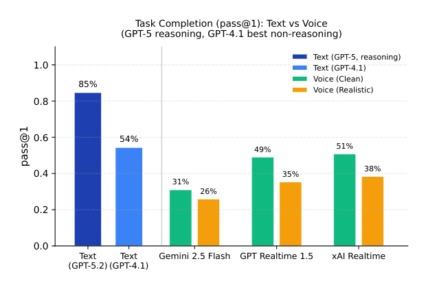
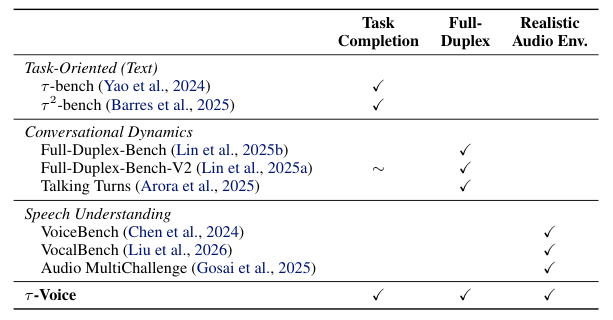
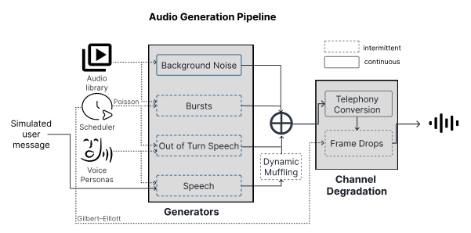
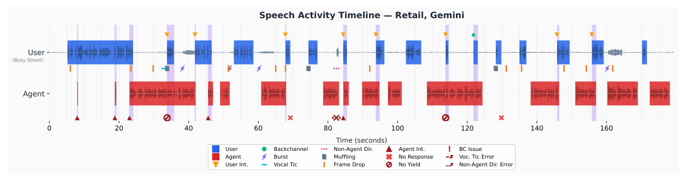

### 말은 자연스럽게 하는데, 반품 처리도 제대로 할 수 있을까? τ²-bench를 음성으로 확장한 τ-Voice에 대해 알아봅니다.

> 원제
> **τ-Voice: Benchmarking Full-Duplex Voice Agents on Real-World Domains**  
> Soham Ray, Keshav Dhandhania, Victor Barres, Karthik Narasimhan (Sierra, Princeton University), arXiv 2603.13686, 2026

 출처: Ray et al., τ-Voice (https://arxiv.org/abs/2603.13686), Figure 1 
  

 

>  **1. 기존 음성 벤치마크는 대화 역학(턴테이킹, 끼어들기)만, 상담 벤치마크는 텍스트 과업 수행만 따로 평가해 왔음. τ-Voice는 τ²-bench의 검증 가능한 과업 + full-duplex 대화 + 현실적인 오디오 환경을 한 번에 평가함**
>
>  **2. 억양·소음·끼어들기를 제어 가능한 voice user simulator를 만들고, 시뮬레이션 시간을 wall-clock 시간과 분리(tick 기반)해 가장 강한 LLM을 사용자 시뮬레이터로 쓸 수 있게 함**
>
>  **3. 278개 과업에서 텍스트 GPT-5(reasoning)는 85%인데, 음성 에이전트는 Clean 조건 31–51%, Realistic 조건 26–38%에 그침(텍스트 성능의 30–45%만 유지). 실패의 79–90%는 에이전트 자체의 행동 때문임**

 

----

**본 포스트는 τ-Voice 논문을 읽고 정리한 노트입니다. [AICC] 에이전트 평가 연구 시리즈의 다섯 번째 글입니다.**
원문은 여기에서 보실 수 있습니다. [paper](https://arxiv.org/abs/2603.13686), [code](https://github.com/sierra-research/tau2-bench)

----
#### Contents

1. [Intro - 말은 잘하는데, 일도 잘할까?](#intro)
2. [따로 놀던 두 갈래의 평가](#related)
3. [τ²-bench를 음성으로: Full-Duplex Orchestrator](#orchestrator)
4. [진짜 같은 고객 만들기: Voice User Simulator](#simulator)
5. [무엇을 재는가: 과업 성공률과 음성 상호작용 품질](#metrics)
6. [결과: 음성은 아직 텍스트의 절반에도 못 미친다](#results)
7. [AICC 관점: 콜봇/보이스봇 도입에 주는 시사점](#aicc)
8. [마치며](#conclusion)
 

## 1. Intro - 말은 잘하는데, 일도 잘할까?

OpenAI Realtime, Gemini Live 같은 audio-native 모델이 나오면서, 사람처럼 듣는 동시에 말하는 **full-duplex** 음성 에이전트가 연구실을 벗어나 실제 서비스로 빠르게 들어오고 있습니다.
STT로 받아 적고, LLM이 답을 만들고, TTS로 읽어주던 "한 번씩 주고받는" 턴 기반 구조와 달리, full-duplex 시스템은 명시적인 턴 경계 없이 연속된 시간 위에서 동작하는데요.
고객이 말을 끊으면 멈추고, "네네" 같은 맞장구는 흘려들으면서 하던 말을 이어가야 합니다.

컨택센터는 이 기술의 가장 대표적인 적용처입니다. 복잡하거나 급한 문제일수록 고객은 여전히 전화를 선호하니까요.
그런데 여기서 저자들이 던지는 질문이 날카롭습니다.

> 이 모델들이 대화를 "자연스럽게" 할 수 있다는 건 알겠는데, 그러면서 동시에 반품을 처리하고, 주문을 수정하고, 요금 분쟁을 해결하는 일을 텍스트 에이전트만큼 믿을 만하게 해낼 수 있을까?

음성은 텍스트에 없는 난이도를 얹습니다. 구두점이 없고, "음…", "어…" 같은 filler와 말더듬(disfluency)이 섞이며, 이메일 주소의 "@"를 "at"으로 말로 풀어야 합니다.
배경 소음, 억양, 전화망 압축 때문에 생긴 인식 오류는 다음 턴으로 전파되고요.

논문이 예로 드는 시나리오가 콜센터 실무자라면 무척 익숙할 텐데요.
소음과 낯선 억양 때문에 에이전트가 고객 이름을 잘못 알아듣고 본인 인증이 실패합니다. 그러면 에이전트는 철자를 불러달라고 요청할까요? 고객이 철자를 불러주면 소음 속에서도 제대로 받아 적을까요? 그렇다면 여러 턴에 흩어진 정보를 합쳐서 인증 tool call을 올바르게 다시 호출할까요?
이런 실패는 ASR, 대화 상태 추적(DST), tool use를 각각 따로 평가해서는 절대 잡히지 않습니다. τ-Voice는 바로 이 지점을 end-to-end로 재보자는 벤치마크입니다.

## 2. 따로 놀던 두 갈래의 평가

저자들은 음성 에이전트 평가에 필요한 축을 세 가지로 정리합니다.

- **Task Completion**: 올바른 API 호출로 DB 상태가 검증 가능하게 바뀌어야 하는 과업
- **Full-Duplex**: 턴테이킹과 끼어들기가 있는 동시 양방향 발화
- **Realistic Audio Env.**: 다양한 화자 특성, 억양, 배경 소음, 채널 열화, disfluency

 출처: Ray et al., τ-Voice (https://arxiv.org/abs/2603.13686), Table 1 
  

 

표를 보면 기존 연구가 정확히 세 갈래로 나뉘어 있는 것이 보입니다.

- **Task-Oriented (Text)**: [τ-bench](https://myeonghak.github.io/ai%20contact%20center/AICC-tau-bench/)와 [τ²-bench](https://myeonghak.github.io/ai%20contact%20center/AICC-tau2-bench/)는 실제 상담 과업과 DB 검증을 갖췄지만 텍스트, 턴 기반임
- **Conversational Dynamics**: Full-Duplex-Bench(v1/v2), Talking Turns는 끼어들기·맞장구·턴테이킹을 재지만 실제 tool call이 없는 스크립트형 과업임 (V2는 다단계 목표가 있어 Task Completion에 "∼" 표시)
- **Speech Understanding**: VoiceBench, VocalBench, Audio MultiChallenge는 억양·소음 등 음향 강건성을 보지만 과업 수행과 분리되어 있음

두 번째, 세 번째 갈래의 벤치마크들은 [이전 글](https://myeonghak.github.io/ai%20contact%20center/AICC-%EC%9D%8C%EC%84%B1-%EB%8C%80%ED%99%94-%ED%8F%89%EA%B0%80/)에서 다룬 바 있는데요.
그때도 "턴테이킹을 잘하는 것"과 "상담을 잘 끝내는 것"이 따로 측정된다는 점이 아쉬웠는데, τ-Voice는 세 칸에 모두 체크 표시를 한 첫 벤치마크라고 주장합니다.
또 하나 눈여겨볼 점은, Full-Duplex-Bench-V2처럼 실시간 스트리밍으로 돌리면 끼어들기·맞장구·양보 타이밍을 정밀하게 제어하기 어렵다는 지적입니다. 이 문제를 τ-Voice는 tick 기반 orchestrator로 풉니다.

## 3. τ²-bench를 음성으로: Full-Duplex Orchestrator

τ-Voice는 τ²-bench의 과업 인프라(과업 지시문, tool, DB, 도메인 정책)를 그대로 물려받고, 그 위에 음성 전용 컴포넌트를 얹은 구조입니다.
τ²-bench가 무엇인지는 [지난 글](https://myeonghak.github.io/ai%20contact%20center/AICC-tau2-bench/)에서 다뤘으니 여기서는 새로 추가된 부분만 보겠습니다.

- 페르소나, 오디오 환경, 턴테이킹 정책을 설정할 수 있는 **voice user simulator**
- simulation tick 단위로 쪼개진 **full-duplex audio streaming channel**
- 새 음성 API를 붙이기 위한 **provider adapter** (WebSocket)

### 시뮬레이션 시간과 현실 시간을 분리하자

이 논문의 가장 영리한 아이디어는 **시뮬레이션 시간을 wall-clock 시간에서 떼어낸 것**이라고 생각합니다.
OpenAI Realtime, Gemini Live, xAI Grok 같은 음성 에이전트 API는 이벤트를 실제 시계가 아니라 **오디오 타임스탬프** 기준으로 처리합니다. 즉 오디오를 실시간보다 빠르게 보내든 느리게 보내든 API는 오디오 시간에 맞춰 처리해 준다는 것인데요.

이 성질을 이용해 τ-Voice는 연속된 오디오 스트림을 고정 길이 tick(기본 $\tau = 200$ms)으로 이산화합니다.
매 tick마다 양쪽이 정확히 200ms 분량의 오디오를 주고받으니, 둘이 동시에 말하는 진짜 full-duplex 상황이 재현됩니다. 사용자가 끼어들면 버퍼를 비워서 에이전트의 진행 중이던 응답을 잘라내고요.

이게 왜 중요할까요? 사용자 시뮬레이터가 실시간 제약에서 자유로워지기 때문입니다.
실시간으로 돌리면 시뮬레이터 LLM이 "지금 끼어들까?"를 고민하는 동안에도 시간이 흘러가 버리니, 빠르지만 덜 똑똑한 모델을 쓸 수밖에 없겠죠. tick 기반이면 시뮬레이터가 생각하는 동안 시계를 멈춰둘 수 있으니, 가장 성능 좋은 LLM을 써서 지시 이행과 턴테이킹 판단의 신뢰성을 확보할 수 있습니다.

덤으로 얻는 것이 **재현성과 제어 가능성**입니다.

- 응답 전 침묵 임계값, 끼어들기 판단 주기, 겹침 후 양보 타이밍을 설정 가능함
- 배경 소음 SNR과 drift, burst 소음 빈도·강도, 전화망 압축, frame drop 확률을 모두 파라미터화함
- seed를 고정하면 LLM을 제외한 모든 확률적 요소가 결정적으로 재현됨

참고로 에이전트 쪽 발화는 ASR을 거치지 않고 transcript를 시뮬레이터에 직접 넘겨줍니다. 사용자 시뮬레이터의 받아쓰기 오류가 에이전트 점수를 깎는 일을 막기 위함인데요. 겹쳐 말한 구간은 "상대 발화 중에 완전히 포함되어 말했으면 끝난 지점에 끼워 넣고, 아니면 먼저 시작한 쪽이 먼저"라는 규칙으로 선형화해서 시뮬레이터 LLM에 전달합니다.

## 4. 진짜 같은 고객 만들기: Voice User Simulator

 출처: Ray et al., τ-Voice (https://arxiv.org/abs/2603.13686), Figure 3 
  

 

시뮬레이터는 매 tick마다 텍스트 생성 → 페르소나 음성 합성 → 환경음 믹싱 → 전화망 열화를 거쳐 "진짜 전화 건 고객" 같은 오디오를 만듭니다. 구성 요소별로 살펴보겠습니다.

### 4-1. 말투와 페르소나

시뮬레이터 프롬프트는 "음", "어" 같은 filler와 disfluency를 넣고, "@" 대신 "at"처럼 특수문자를 말로 풀며, 짧고 퉁명스러운 답변을 하도록 설계되어 있습니다.
생성된 텍스트는 ElevenLabs v3 TTS(24kHz)로 합성되는데, 총 7개의 voice persona가 있습니다.

- **Clean용 2명**: 표준 미국 억양 (차분한 중서부 중년 남성, 이미 짜증이 난 40대 후반 여성)
- **Realistic용 5명**: 80대 초반 노년 여성, 벵골 억양의 방글라데시 남성, 쓰촨 억양의 중국 여성, 프랑스어가 모국어인 세네갈 남성, 마하라슈트라 억양의 인도 여성

"이미 40분째 대기 중이에요", "상급자 바꿔주세요" 같은 대사를 하는 페르소나까지 있는 걸 보면, 콜센터의 현실을 꽤 잘 아는 사람들이 만든 것 같습니다.

### 4-2. 오디오 환경

- **배경 소음(continuous)**: 실내(사람들 대화, TV 뉴스), 실외(번화가, 거리·지하철) 중 하나를 15dB SNR(±3dB drift)로 섞음
- **Burst 소음(intermittent)**: 전화벨, 개 짖는 소리, 경적, 사이렌 등을 Poisson process로 분당 1회, -5~+10dB SNR로 삽입
- **Out-of-turn speech**: "잠깐만요", "통화 중이야" 같은 에이전트에게 하는 말이 아닌 발화와 기침·재채기 같은 vocal tic을 분당 0.7회 삽입
- **채널 열화**: 마이크에서 멀어지는 효과(dynamic muffling, 발화의 20%), G.711 μ-law 8kHz 전화망 압축, Gilbert-Elliott 모델 기반 frame drop(평균 2% 손실)

### 4-3. 턴테이킹 정책

규칙 기반 타이밍과 LLM 판단을 섞습니다. 사용자는 기본 1초의 침묵을 기다린 뒤 말하고, 에이전트가 말하는 동안에는 LLM이 2초마다 "지금 끼어들 만한가?"를 판단합니다.
맞장구("mm-hmm") 여부도 별도 LLM이 결정하며, 에이전트가 끼어들면 설정된 겹침 시간 후 사용자가 양보합니다.

### 4-4. Clean vs Realistic

이 요소들을 조합해 두 가지 조건을 정의합니다. 두 조건 모두 G.711 8kHz 전화망 압축은 공통으로 걸려 있습니다.

| 구분 | Clean | Realistic |
| --- | --- | --- |
| 억양 | 미국 억양 | 다양한 억양 |
| 배경/burst 소음 | 없음 | 실내·실외 / 분당 약 1회 |
| Frame drop, muffling | 없음 | 약 2.0% / dynamic |
| 기침·재채기, 비지시 발화 | 없음 | 있음 |
| 끼어들기, 맞장구 | 없음 | LLM 기반 |

추가로 Retail 도메인에서는 Clean에 소음(+N), 억양(+A), 턴테이킹(+T)만 하나씩 더한 ablation 조건도 돌려서 어떤 요인이 가장 치명적인지 분리합니다.

## 5. 무엇을 재는가: 과업 성공률과 음성 상호작용 품질

### 5-1. 도메인과 과업

τ²-bench의 세 도메인에서 총 **278개 과업**을 사용합니다.

- **Retail (114개)**: 반품, 교환, 취소, 주문 수정. 한 통화에 여러 요청이 섞이거나 고객이 중간에 마음을 바꾸는 경우가 많음
- **Airline (50개)**: 항공편 변경, 취소, 좌석 업그레이드, 예약 수정
- **Telecom (114개)**: 요금제 변경, 청구 문의, 서비스 개통, 계정 수정

Retail을 주 평가 도메인으로 삼은 이유가 흥미로운데요. 이름, 이메일, 주문번호, 주소를 받아 적는 **slot filling** 의존도가 높고, end-to-end 음성 모델이 바로 이 부분에서 약하다고 알려져 있기 때문입니다. 한국 콜센터로 치면 생년월일, 휴대폰 번호, 주소 받아 적기에 해당하겠죠.

평가 대상은 세 audio-native 모델입니다: OpenAI `gpt-realtime-1.5`, Google `gemini-live-2.5-flash-native-audio`, xAI `grok-voice-agent`.
모든 모델에 동일한 시스템 프롬프트를 주되, "이름·이메일·ID를 받을 땐 한 글자씩 불러달라고 하고, 인증이 실패하면 다시 철자를 요청하라"는 음성용 지침을 넣었습니다. 사용자 시뮬레이터 LLM은 GPT-4.1, 최대 통화 길이는 1200초입니다.

### 5-2. 지표

**Task Completion**은 τ²-bench와 동일하게 대화 종료 시점의 DB 상태를 정답과 비교하는 pass@1입니다. 다만 에이전트가 고객에게 전달해야 하는 정보를 확인하는 부분은, 말로 하는 출력의 변동성을 고려해 문자열 매칭 대신 LLM 평가로 바꿨습니다.

**Voice Interaction Quality**는 네 가지 축으로 집계합니다.

- **Responsiveness** $= \text{avg}(R_R, R_Y)$: 사용자 턴에 응답한 비율($R_R$), 사용자가 끼어들었을 때 2초 안에 양보한 비율($R_Y$)
- **Latency** $= \text{avg}(L_R, L_Y)$: 사용자 발화 종료 후 응답까지 시간, 끼어들기 후 말을 멈추기까지 시간
- **Interrupt** $= I_A$: 사용자가 말을 끝내기 전에 에이전트가 말을 시작한 턴의 비율 (한 턴에 여러 번 끊으면 100%를 넘을 수 있음)
- **Selectivity** $= \text{avg}(S_{BC}, S_{VT}, S_{ND})$: 맞장구, 기침 같은 vocal tic, 에이전트에게 한 말이 아닌 발화를 올바르게 무시한 비율

Responsiveness와 Selectivity는 서로 반대 방향으로 당기는 지표입니다. 무조건 반응하면 Responsiveness는 오르지만 Selectivity가 떨어지고, 조심스러우면 그 반대가 되죠. 이 긴장 관계가 결과에서 아주 선명하게 드러납니다.

### 5-3. 타임라인으로 보는 한 통의 전화

 출처: Ray et al., τ-Voice (https://arxiv.org/abs/2603.13686), Figure 4 
  

 

번화가 소음 속에서 직소 퍼즐 교환과 주소 수정을 요청하는 약 3분짜리 Retail 통화(Gemini Live)입니다.
이 한 통에 사용자 끼어들기 8회, frame drop 12회, burst 소음 3회, muffling 3회, vocal tic 1회, 비지시 발화 1회, 맞장구 1회가 들어 있고, 평가기는 여기서 에이전트 끼어들기 5회, 무응답 2회, vocal tic 처리 오류 1회를 잡아냅니다.

몇 장면만 보면 이렇습니다.

- 8초: 고객이 "두 가지 문제가 있는데…"라고 말하는 중에 에이전트가 "Hello!"로 끼어듦
- 68초: 고객이 끼어들자 에이전트가 양보는 했는데, 이후 5초간 아무 말도 안 함
- 82초: 고객이 옆 사람에게 "잠깐만"이라고 한 말에 에이전트가 "천천히 하세요"라고 반응함 (오류)
- 113초: 고객이 끼어들었는데 에이전트가 양보하지 않고 계속 말함
- 121초: 고객의 "mm-hmm"을 맞장구로 인식하고 계속 말함 (정답)

실제 콜봇 녹취를 들어보신 분이라면 한 번쯤 본 장면들일 겁니다.

## 6. 결과: 음성은 아직 텍스트의 절반에도 못 미친다

### 6-1. 과업 성공률: 큰 voice-text gap

맨 위 Figure 1이 핵심 결과입니다. 전체 도메인 평균 pass@1 기준으로,

- 텍스트 GPT-5(reasoning): **85%**, 텍스트 GPT-4.1(최고 non-reasoning): **54%**
- 음성 Clean: Gemini 31%, OpenAI 49%, xAI 51% → GPT-5 대비 **34–54pp 하락**
- 음성 Realistic: Gemini 26%, OpenAI 35%, xAI 38% → 텍스트 SOTA 성능의 **30–45%만 유지**

(Figure 1의 막대 라벨에는 텍스트 모델이 GPT-5.2로 표기되어 있는데, 본문과 표에서는 GPT-5 (reasoning)으로 지칭합니다.)

이상적인 조건에서는 최고 음성 에이전트(51%)가 non-reasoning 텍스트 모델 GPT-4.1(54%)과 3pp 차이까지 따라왔지만, 현실 조건에서는 그 기준선에도 16pp 못 미칩니다.
또 하나 중요한 관찰은 **voice-text gap의 대부분이 "텍스트 → Clean 음성" 구간에서 생긴다**는 점입니다. Clean에서 Realistic으로 갈 때의 추가 하락은 Google 5pp, xAI·OpenAI 12–14pp 수준이었습니다. 즉 소음·억양 이전에, 음성이라는 모달리티 자체에서 이미 상당한 성능을 잃고 있다는 거죠.

도메인별로 보면 편차가 꽤 큽니다. Retail에서는 OpenAI가 Clean 71%로 벤치마크 전체에서 가장 높은 단일 점수를 냈고, Telecom에서는 xAI가 Clean 58%로 다른 두 모델(20–28%)을 크게 앞섰습니다.
Robustness 측면에서는 Google이 Clean 대비 17%만 잃어 24–28%를 잃은 다른 모델보다 약 1.5배 강건했습니다. 결국 "어느 모델이 최고"라고 단정하기 어렵고, 내 도메인에서 직접 재봐야 한다는 결론으로 이어지는데요.

Retail에서는 조건별로 2회씩 돌려 paired permutation test(Holm-Bonferroni 보정)를 했고, 텍스트→Clean, Clean→Realistic 하락 모두 세 provider에서 통계적으로 유의했다고 합니다(모두 p < 0.05).

### 6-2. 무엇이 가장 아픈가: 억양, 그리고 provider별 취약성

Retail 도메인 ablation 결과(pass@1)입니다.

| 조건 | Google | OpenAI | xAI | 평균 |
| --- | --- | --- | --- | --- |
| Clean | 45% | 71% | 48% | 55% |
| + Noise | 40% | 67% | 46% | 51% |
| + Accents | 44% | 60% | 30% | 44% |
| + Turn-taking | 33% | 57% | 52% | 47% |
| Realistic | 30% | 45% | 39% | 38% |

평균적으로는 **억양이 가장 치명적**(평균 -10pp)이고, 턴테이킹(-7pp), 소음(-4pp) 순입니다.
그런데 억양 효과는 provider별로 극단적으로 다릅니다. xAI는 억양만 추가해도 -18pp(상대적으로 -38%)가 떨어진 반면, Google은 -1pp로 거의 영향이 없었습니다.
Google의 가장 큰 약점은 오히려 턴테이킹(-11pp)이었고요.

요인 간 상호작용도 단순하지 않습니다. Google은 개별 요인 하락의 합(-16pp)이 Realistic 하락(-15pp)과 거의 같아 대략 additive했지만, xAI는 개별 합이 -16pp인데 Realistic에서는 -10pp만 떨어졌습니다.
또 OpenAI는 Clean 점수가 가장 높으면서(71%) Realistic에서의 상대 하락도 가장 컸는데(-37%), **기본 성능이 높다고 음성 복잡도에 강한 건 아니라는** 점을 시사합니다.

저자들은 억양을 TTS 페르소나로 구현했기 때문에 이 결과를 "확정적이라기보다 시사적(indicative)"으로 해석해야 한다고 선을 긋습니다. 그럼에도 비표준 억양 사용자가 체계적으로 불리한 서비스를 받을 수 있다는 **접근성(accessibility)** 문제를 제기하는데요, 고령 고객이나 외국인 고객 응대를 생각하면 국내에서도 그대로 적용되는 이야기입니다.

### 6-3. 대화 품질: 모두를 만족시키는 모델은 없다

Realistic 조건, 전체 도메인 집계 기준 음성 상호작용 품질입니다.

| Provider | Latency↓ | Responsiveness↑ | Interrupt↓ | Selectivity↑ |
| --- | --- | --- | --- | --- |
| Google | 1.14s | 69% | 21% | 54% |
| OpenAI | 0.90s | 100% | 14% | 6% |
| xAI | 1.15s | 83% | 84% | 57% |

- **OpenAI**: 가장 빠르고(0.90s) 반응률 100%, 끼어들기도 가장 적지만, Selectivity가 6%로 맞장구·기침·옆 사람에게 한 말에 거의 다 반응함
- **xAI**: Selectivity가 가장 높지만(57%), Interrupt가 84%로 거의 매 턴 고객 말을 끊음
- **Google**: Interrupt는 낮은 편(21%)이지만 Responsiveness가 69%로 사용자 턴의 거의 1/3에 응답하지 못함

각자 잘하는 축이 다르고, 모두 최소 하나의 축에서 크게 무너집니다. 저자들의 표현대로 "믿을 만한 반응성과 적절한 절제를 동시에 달성한 시스템은 아직 없다"는 것이죠.
과업 성공률 1위(xAI)가 끼어들기 1위이기도 하다는 점도 기억해 둘 만합니다. 일은 잘 끝내는데 고객 말을 계속 끊는 상담원이라면, CSAT은 썩 좋지 않겠죠.

### 6-4. 누구 탓인가: 실패의 79–90%는 에이전트

시뮬레이터 기반 벤치마크에서 늘 나오는 질문이 "그거 시뮬레이터가 이상하게 굴어서 실패한 거 아냐?"인데요. 저자들은 이를 정면으로 검증합니다.

- **Voice-Fragile**: 텍스트에서는 GPT-4.1과 GPT-5.2(medium reasoning)가 모두 성공했는데, Clean 음성에서는 다수 provider가 실패한 과업
- **Noise-Fragile**: Clean 음성에서는 다수가 성공했는데, Realistic에서는 다수가 실패한 과업

두 집단의 실패 시뮬레이션 91건을 평가자 2명이 독립적으로 라벨링했고(일치율 84%, 이후 논의로 100% 합의), 결과는 다음과 같습니다.

| 오류 주체 | 유형 | Voice-Fragile | Noise-Fragile |
| --- | --- | --- | --- |
| Agent | Logical | 13 | 16 |
| Agent | Transcription | 10 | 16 |
| Agent | Hallucination | 6 | 6 |
| Agent | VAD/Unresponsive | 1 | 4 |
| Agent | Timeout | 4 | 1 |
| Agent | 합계 | 34 (79%) | 43 (90%) |
| User | 합계 | 9 (21%) | 5 (10%) |

정성 분석에서 나온 패턴들이 특히 실무적입니다.

- **본인 인증이 최대 병목임**: 철자를 한 글자씩 불러줘도 이름·이메일을 잘못 받아 적어, 이후 모든 처리가 막힘
- **Hallucinated completion**: tool call 없이 "배송지 주소를 변경해 드렸습니다"라고 말해버린 사례가 있음
- **다단계 요청 누락**: 요청의 일부만 처리하고 나머지를 잊어버림
- **현실 조건에서의 악화**: 인증 실패가 반복되면 에이전트가 무응답 상태에 빠지고, 장황한 말투 때문에 복잡한 과업에서 시간 초과가 남

Voice-Fragile 집단에서 가장 흔한 오류가 transcription이 아니라 **logical error**(13/43)였다는 점이 중요합니다. 음성 인식이 정확해도 추론이 무너진다는 뜻이니까요. 즉 voice-text gap은 순수한 음성 인식 문제가 아니라 **추론과 grounding 문제**가 함께 얽혀 있다는 것이 저자들의 결론입니다.
텍스트 에이전트는 조용히 원하는 만큼 생각할 수 있지만, 음성 에이전트는 대화의 흐름을 유지하면서 실시간으로 다단계 추론을 해내야 하니 구조적으로 불리한 셈이죠.

## 7. AICC 관점: 콜봇/보이스봇 도입에 주는 시사점

논문은 영어, TTS 기반, 세 개의 audio-native 모델로 한정된 실험이지만, 콜봇을 도입하거나 운영하는 입장에서 곱씹을 만한 메시지가 많습니다.

### 7-1. 텍스트 챗봇 성능을 음성에 그대로 기대하지 말 것

"챗봇으로 85% 처리되니 콜봇도 비슷하겠지"는 위험한 가정입니다. 같은 과업이라도 음성 에이전트는 이상적 조건에서조차 텍스트 SOTA보다 34pp 이상 낮았고, 현실 조건에서는 텍스트 성능의 절반에도 못 미쳤습니다.
그래서 **text-first** 전략이 여전히 합리적일 수 있습니다. 복잡한 다단계 업무(여러 건의 주문 변경, 정책 판단이 많은 환불 등)는 텍스트 채널이나 상담사로 넘기고, 음성 에이전트는 인증 이후의 단순 조회나 단일 업무부터 맡기는 식이죠.
또한 논문이 평가한 것은 end-to-end audio-native 모델뿐입니다. 저자들도 future work로 cascaded(ASR→LLM→TTS) 베이스라인을 언급하는데, reasoning 모델을 가운데 둘 수 있는 cascaded 구조가 과업 정확도에서는 여전히 유리할 수 있다는 점을 염두에 두고 아키텍처를 비교해 볼 만합니다.

### 7-2. 본인 인증과 slot filling을 따로 설계할 것

실패의 가장 큰 병목이 인증 단계의 받아쓰기였습니다. 한국어 콜봇이라면 이름의 동음이의, 숫자 읽기("공일공", "영일영"), 주소의 고유명사가 같은 문제를 일으키겠죠.
DTMF(키패드 입력)나 문자 링크 같은 보조 채널, 받아 적은 값의 복창(read-back) 확인, 인증 실패 N회 시 상담사 전환 같은 장치를 프롬프트 지침만 믿지 말고 플로우 차원에서 설계하는 편이 안전합니다. 논문에서도 "철자를 불러달라고 해라"라는 지침을 모두에게 줬지만 인증 실패는 여전히 최대 병목이었으니까요.

### 7-3. 억양·소음 강건성은 벤더마다 완전히 다르다

억양만 추가했을 때 한 provider는 -1pp, 다른 provider는 -18pp였습니다. 평균 점수 하나로 벤더를 고르면 특정 고객군(고령층, 사투리 사용자, 외국인 고객, 차량·야외 통화 고객)에서 크게 무너지는 모델을 고를 수도 있다는 뜻입니다.
**우리 고객 분포를 반영한 조건별 분해 점수**를 요구해야 합니다.

### 7-4. Barge-in은 "잘 멈추는가"와 "잘 안 멈추는가"를 함께 볼 것

Barge-in(고객 끼어들기) 처리는 흔히 "고객이 말하면 바로 멈추는가"만 테스트하는데, τ-Voice의 Selectivity 지표가 보여주듯 "맞장구, 기침, 옆 사람에게 한 말에는 멈추지 않는가"도 같은 무게로 봐야 합니다.
OpenAI처럼 반응률 100%에 Selectivity 6%라면, 고객이 "네네" 할 때마다 안내가 끊기는 콜봇이 됩니다. 반대로 Responsiveness가 낮으면 고객이 말을 끝냈는데 정적이 흐르겠죠. 둘은 trade-off이므로 **우리 서비스가 어느 쪽 실수를 더 용납하기 어려운지** 먼저 정해야 합니다.

### 7-5. 벤더 평가는 "데모 시연"이 아니라 시뮬레이션으로

조용한 회의실에서 표준어로 하는 데모는 τ-Voice의 Clean 조건보다도 쉬운 환경입니다. τ-Voice의 접근법을 빌리면, 벤더 비교도 다음처럼 할 수 있습니다.

- 실제 업무 시나리오를 DB 상태로 검증 가능한 과업으로 만들고
- 동일 seed로 소음·억양·턴테이킹을 통제한 시뮬레이션을 돌리고
- 과업 성공률과 대화 품질 지표를 **분리해서** 받아보기

코드가 tau2-bench 저장소에 공개되어 있고 TTS, STT, VAD, 사용자 시뮬레이터 LLM까지 교체 가능하게 열려 있다고 하니, 도메인과 언어를 바꿔 내부 평가 파이프라인의 출발점으로 삼기에도 좋아 보입니다.

### 7-6. 음성 에이전트 QA 체크리스트

위 내용을 바탕으로 콜봇/보이스봇 QA에서 확인할 항목을 정리해 보면 다음과 같습니다.

- **과업 성공**
  - 대화 종료 후 DB/시스템 상태로 성공 여부를 검증하는가 (발화 내용만 보는 평가가 아님)
  - 텍스트 채널 대비 같은 과업에서의 성공률 차이(voice-text gap)를 측정했는가
  - tool call 없이 "처리했다"고 말하는 hallucinated completion을 탐지하는가
  - 한 통화 내 다중 요청을 모두 처리했는지 확인하는가
- **인증과 slot filling**
  - 이름·생년월일·전화번호·주소 받아쓰기 정확도를 조건별로 측정했는가
  - 인증 실패 시 재요청·복창·대체 채널·상담사 전환 플로우가 있는가
- **음향 강건성**
  - 억양/사투리, 고령 화자, 배경 소음(실내·실외), burst 소음, 전화망 압축, 패킷 손실 조건을 분리해 평가했는가
  - 고객군별로 성능 격차가 없는지(접근성) 확인했는가
- **턴테이킹**
  - 응답 지연(latency), 무응답 비율, 고객 끼어들기 시 양보 비율과 양보 지연을 측정하는가
  - 에이전트가 고객 말을 끊는 비율(interrupt rate)을 측정하는가
  - 맞장구, 기침, 비지시 발화를 올바르게 무시하는지(selectivity) 측정하는가
- **운영 재현성**
  - seed 고정 등으로 동일 조건을 재현해 모델/프롬프트 변경 전후를 비교할 수 있는가
  - 실패 건을 사람이 검토해 에이전트 오류와 평가 환경(시뮬레이터) 오류를 구분하는가

## 8. 마치며

τ-Voice는 그동안 "말을 자연스럽게 하는가"와 "상담을 제대로 끝내는가"로 나뉘어 있던 음성 에이전트 평가를 하나의 프레임 안에 묶었습니다.
기술적으로는 오디오 타임스탬프 기반 API의 성질을 이용해 시뮬레이션 시간을 현실 시간에서 떼어낸 tick 기반 orchestrator가 인상적이었는데요. 실시간성과 시뮬레이터 품질 사이의 trade-off를 깔끔하게 비켜 간 설계라고 생각합니다.

물론 한계도 분명합니다. 영어만, 녹음 음성이 아닌 TTS로 평가했고, 시뮬레이터는 실제 고객보다 인내심이 많고 기억력이 완벽합니다. 말투의 자연스러움이나 고객 만족도, 부분 성공도 측정하지 않았고요.

개인적으로 가장 와닿은 메시지는 "voice-text gap은 음성 인식 문제만이 아니다"라는 점이었습니다. 콜봇 품질 이슈가 생기면 반사적으로 STT 엔진부터 의심하게 되는데, 이 논문의 오류 분석은 인식이 정확한 상황에서도 추론과 grounding이 무너진다는 걸 보여줍니다.
데모에서 매끄럽게 대화하는 음성 에이전트를 보면 "이제 다 됐구나" 싶지만, 소음 섞인 전화 너머로 사투리 섞인 고객의 이름을 받아 적고 주문 세 건을 정확히 바꿔주는 일은 아직 한참 남은 숙제인 것 같습니다.

다음 글에서는 이 시리즈에서 다룬 LLM-as-a-Judge, τ-bench, 음성 대화 평가, τ²-bench, τ-Voice를 한데 모아 AICC 에이전트 평가 연구를 총정리해 보겠습니다.

----------------

**개선을 위한 여러분의 피드백과 제안을 코멘트로 공유해 주세요.**
**내용에 대한 지적, 혹은 질문을 환영합니다.**  

**출처**  
[Ray, S., Dhandhania, K., Barres, V., Narasimhan, K. τ-Voice: Benchmarking Full-Duplex Voice Agents on Real-World Domains. arXiv:2603.13686, 2026](https://arxiv.org/abs/2603.13686)  
[sierra-research/tau2-bench (GitHub)](https://github.com/sierra-research/tau2-bench)  
[Barres, V. et al. τ²-Bench: Evaluating Conversational Agents in a Dual-Control Environment. arXiv:2506.07982, 2025](https://arxiv.org/abs/2506.07982)  
[Lin, G.-T. et al. Full-Duplex-Bench (arXiv:2503.04721)](https://arxiv.org/abs/2503.04721)  
