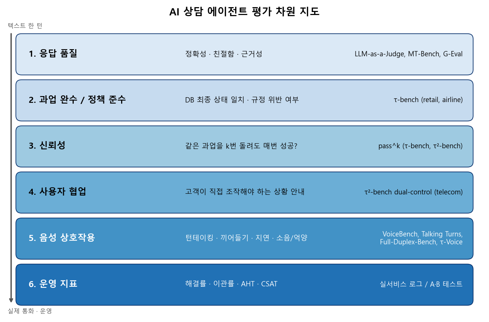
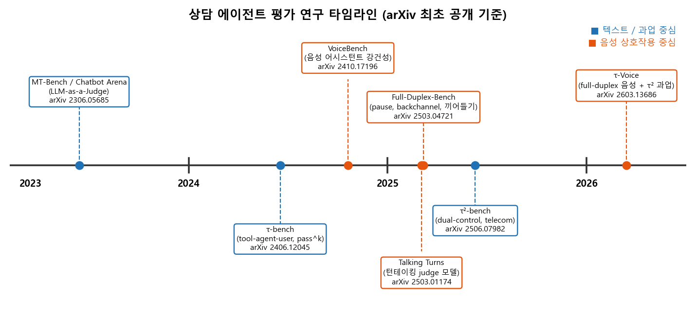
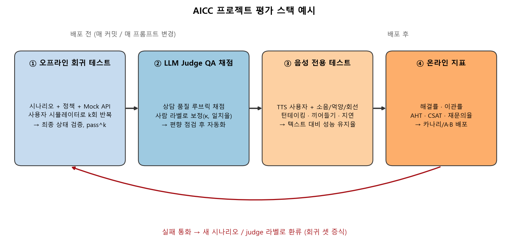

### 상담 에이전트를 "무엇으로, 어떻게" 평가할지, 지난 3년간의 연구 흐름을 한 장의 지도로 정리해 봅니다.  

> 다루는 논문  
> **MT-Bench / Chatbot Arena**: Judging LLM-as-a-Judge with MT-Bench and Chatbot Arena (Zheng et al., NeurIPS 2023 D&B)  
> **τ-bench**: A Benchmark for Tool-Agent-User Interaction in Real-World Domains (Yao et al., 2024)  
> **Full-Duplex-Bench**: A Benchmark to Evaluate Full-duplex Spoken Dialogue Models on Turn-taking Capabilities (Lin et al., ASRU 2025)  
> **τ²-bench**: Evaluating Conversational Agents in a Dual-Control Environment (Barres et al., 2025)  
> **τ-Voice**: Benchmarking Full-Duplex Voice Agents on Real-World Domains (Ray et al., 2026)  

   

 

>  **1. 상담 에이전트 평가는 "답변이 좋은가"에서 출발해 "과업을 규정대로 끝냈는가 → 매번 그러는가 → 고객을 잘 이끄는가 → 전화로도 되는가"로 점점 실제 통화에 가까워지는 방향으로 발전해 옴**
>
>  **2. 연구 흐름은 2023 MT-Bench(LLM Judge) → 2024 τ-bench(pass^k) → 2025 Full-Duplex-Bench / τ²-bench(턴테이킹, dual-control) → 2026 τ-Voice(음성 + 과업)로 요약됨**
>
>  **3. 실무 평가 스택은 시뮬레이터 기반 오프라인 회귀 테스트 + 사람 라벨로 보정한 LLM Judge + 음성 전용 테스트 + 온라인 운영 지표(해결률, 이관률, AHT, CSAT)의 4층 구조로 구성하는 것이 현실적임**

 

----

**본 포스트는 AICC 에이전트 평가 시리즈의 마지막 편으로, 앞선 다섯 편에서 다룬 논문들을 하나의 지도로 엮고 실무 평가 스택을 구성하는 방법을 정리한 글입니다.**
각 논문의 원문은 글 하단의 출처에서 보실 수 있습니다.  

----
#### Contents  

1. [Intro - 상담 에이전트는 무엇으로 평가해야 할까?](#intro)  
2. [평가 차원 지도: 한 턴의 답변에서 운영 지표까지](#map)  
3. [타임라인으로 보는 연구 흐름](#timeline)  
4. [벤치마크 한눈에 비교하기](#compare)  
5. [실전편: AICC 프로젝트의 평가 스택 조립하기](#stack)  
6. [마치며](#conclusion)  
 

## 1. Intro - 상담 에이전트는 무엇으로 평가해야 할까?  

LLM 기반 상담 에이전트를 만들다 보면 데모까지는 생각보다 금방 갑니다. 프롬프트에 상담 매뉴얼을 넣고, 주문 조회나 요금제 변경 같은 API를 tool로 붙이면 그럴싸하게 대답하는 봇이 하루 만에 나오는데요.  
문제는 그다음입니다. "그래서 이거 실서비스에 내보내도 돼?"라는 질문에 답하려면 숫자가 필요한데, 막상 무엇을 재야 하는지가 모호합니다.  

- 답변이 친절하고 정확하면 충분할까요? 규정상 환불이 안 되는 건을 친절하게 환불해 주면 곤란하겠죠.  
- 과업을 한 번 성공하면 될까요? 같은 고객이 같은 요청을 열 번 했을 때 두 번 실수하면 콜센터에서는 큰 사고입니다.  
- 텍스트 채팅에서 잘 되면 전화에서도 될까요? 고객이 말을 끊고, 주변이 시끄럽고, 주문번호를 불러주다 멈칫하는 순간 이야기가 완전히 달라집니다.  

지난 시리즈에서 이 질문들에 하나씩 답해 온 논문들을 살펴봤는데요. 이번 글에서는 이들을 **평가 차원**이라는 축으로 다시 엮어 보고, 실제 AICC 프로젝트에서 평가 체계를 어떻게 쌓으면 좋을지 정리해 보겠습니다.  

## 2. 평가 차원 지도: 한 턴의 답변에서 운영 지표까지  

맨 위 그림처럼 상담 에이전트의 평가 차원은 여섯 층으로 나눠 볼 수 있습니다. 위로 갈수록 "텍스트 한 턴"에 가깝고, 아래로 갈수록 "실제 통화와 운영"에 가깝습니다. 아래층은 위층을 대체하는 것이 아니라 **포함하면서 조건을 더 까다롭게** 만드는 관계라고 보시면 됩니다.  

**① 응답 품질** - "이 답변, 괜찮은가?"  
- 정확성, 공감/친절함, 근거성(지식 문서에 기반했는지) 등을 보는 층임  
- 정답이 하나로 정해지지 않으므로 사람 평가가 기준이지만 비쌈 → 강한 LLM을 채점자로 쓰는 **LLM-as-a-Judge**가 등장함  
- MT-Bench 논문은 GPT-4 judge가 사람 선호와 80% 이상 일치해 사람끼리의 일치 수준과 비슷하다고 보고했고, 동시에 position bias, verbosity bias, self-enhancement bias 같은 한계도 정리함 ([LLM-as-a-Judge 편](https://myeonghak.github.io/ai%20contact%20center/AICC-LLM-as-a-Judge/))  

**② 과업 완수 / 정책 준수** - "규정대로 일을 끝냈는가?"  
- 상담은 결국 주문 취소, 교환, 예약 변경 같은 **행동**으로 끝남  
- τ-bench는 대화 종료 시점의 DB 상태를 정답 상태와 비교하는 방식으로 이를 채점함. 말을 얼마나 잘했든 DB가 틀리면 실패임  
- 정책 문서(예: basic economy는 변경 불가)를 지키지 않고 고객 요구를 들어주는 것도 실패로 잡힘  

**③ 신뢰성** - "매번 그러는가?"  
- τ-bench가 제안한 **pass^k**는 같은 과업을 k번 독립 시행했을 때 **k번 모두** 성공할 확률임  
- 코드 생성에서 쓰는 pass@k(k번 중 한 번이라도 성공)와 정반대 철학인데, 상담처럼 매 고객이 한 번의 기회인 서비스에는 pass^k가 훨씬 현실적임 ([τ-bench 편](https://myeonghak.github.io/ai%20contact%20center/AICC-tau-bench/))  

**④ 사용자 협업** - "고객을 잘 이끄는가?"  
- 기술지원 상담에서는 고객이 직접 휴대폰 설정을 바꾸거나 기기를 재부팅해야 함. 에이전트 혼자 tool을 부르는 것으로 끝나지 않음  
- τ²-bench는 에이전트와 사용자가 **모두 tool을 가진 dual-control** 환경(telecom 도메인)을 만들어, "정확한 지시를 적절한 순서로 전달하는 능력"을 따로 측정함 ([τ²-bench 편](https://myeonghak.github.io/ai%20contact%20center/AICC-tau2-bench/))  

**⑤ 음성 상호작용** - "전화로도 되는가?"  
- 턴테이킹(언제 말을 시작할지), 맞장구(backchannel), 고객의 끼어들기 처리, 응답 지연, 소음/억양/전화 회선 품질에 대한 강건성이 추가됨  
- VoiceBench, Talking Turns, Full-Duplex-Bench가 이 축을 개별적으로 다뤘고 ([음성 대화 평가 편](https://myeonghak.github.io/ai%20contact%20center/AICC-%EC%9D%8C%EC%84%B1-%EB%8C%80%ED%99%94-%ED%8F%89%EA%B0%80/)), τ-Voice가 이를 ②~④의 과업 평가와 결합함 ([τ-Voice 편](https://myeonghak.github.io/ai%20contact%20center/AICC-tau-Voice/))  

**⑥ 운영 지표** - "현장에서 숫자가 좋아졌는가?"  
- 해결률(봇 단독 해결 비율), 이관률(상담사 연결 비율), AHT(평균 처리 시간), CSAT(고객 만족도), 재문의율 등  
- 논문 벤치마크에는 없는 층이지만, 최종적으로 사업의 판단은 여기서 이루어짐  

이렇게 놓고 보면, 벤치마크 연구의 역사는 결국 **"⑥을 미리 예측할 수 있는 오프라인 대리 지표를 점점 정교하게 만들어 온 과정"**이라고 볼 수도 있겠습니다.  

## 3. 타임라인으로 보는 연구 흐름  

   

 

연도별로 보면 텍스트/과업 축(파란색)과 음성 상호작용 축(주황색)이 따로 발전하다가 2026년에 합쳐지는 모양새인데요.  

- **2023 - "채점자를 LLM으로"**: MT-Bench(80개의 고품질 multi-turn 질문, 8개 카테고리)와 Chatbot Arena를 통해 LLM judge의 타당성과 편향을 체계적으로 검증함. 이후 G-Eval 같은 루브릭 기반 채점 방식과 함께 상담 QA 자동화의 기본 도구가 됨  
- **2024 - "말 말고 결과로"**: τ-bench가 tool-agent-user 구조, LLM 사용자 시뮬레이터, DB 상태 비교 채점, pass^k를 한꺼번에 제시함. retail(115개 과업)과 airline(50개 과업) 두 도메인에서 gpt-4o function calling 에이전트도 retail 약 61%, airline 약 35% 수준에 그쳤고, retail의 pass^8은 25% 미만이었음  
- **2024~2025 - "귀로 듣는 평가"**: VoiceBench가 화자/환경/내용 변이에 대한 음성 어시스턴트의 강건성을, Talking Turns가 사람 대화로 학습한 judge 모델로 턴테이킹을, Full-Duplex-Bench가 pause handling, backchanneling, smooth turn-taking, user interruption 네 가지 행동을 자동 지표(예: Takeover Rate)로 측정함  
- **2025 - "고객도 손을 움직인다"**: τ²-bench가 telecom dual-control 도메인을 추가함. 원자적 subtask를 조합해 2,285개 과업을 생성하고 그중 114개를 균형 있게 샘플링했으며, gpt-4.1의 pass^1이 retail 74%, airline 56%에서 telecom 34%로 떨어지는 것을 보임. 사용자 없이 혼자 푸는 No-User 모드 대비 Default 모드에서 gpt-4.1은 18%, o4-mini는 25% 하락함  
- **2026 - "전화로 같은 과업을"**: τ-Voice가 τ²-bench의 retail(114), airline(50), telecom(114) 총 278개 과업을 full-duplex 음성으로 옮김. 텍스트 GPT-5(reasoning)가 85%를 기록한 반면, 음성 에이전트는 clean 조건에서 31~51%, 소음/억양/턴테이킹이 들어간 realistic 조건에서 26~38%로 텍스트 대비 30~45%의 능력만 유지함  

마지막 숫자가 꽤 충격적인데요. 텍스트에서 85%를 내는 수준의 과업도 전화로 옮기면 절반 이하로 떨어진다는 것이니, "텍스트 봇 잘 만들었으니 TTS/STT만 붙이면 되겠지"라는 기대는 접어두는 것이 좋겠습니다.  

## 4. 벤치마크 한눈에 비교하기  

다섯 편의 논문을 한 표로 정리하면 아래와 같습니다. (arXiv 초록과 본문 기준)  

| 벤치마크 | arXiv | 평가 대상 | 도메인 / 구성 | 핵심 지표 | AICC 관점의 질문 |
|---|---|---|---|---|---|
| MT-Bench / Chatbot Arena | 2306.05685 | 채팅 어시스턴트 응답 품질, LLM judge 자체 | 80개 multi-turn 질문(8 카테고리), crowdsourced 대결 플랫폼 | judge-사람 일치율, 승률/점수 | 상담 품질 QA를 LLM에게 맡겨도 되는가? |
| τ-bench | 2406.12045 | tool을 쓰는 대화형 에이전트 | retail(115), airline(50), LLM 사용자 시뮬레이터 | DB 최종 상태 일치, pass^k | 규정을 지키며 과업을 끝내는가? 매번? |
| Full-Duplex-Bench | 2503.04721 | full-duplex 음성 대화 모델 | pause handling, backchannel, smooth turn-taking, user interruption | Takeover Rate, 지연 등 자동 지표 | 고객이 말을 멈추거나 끊을 때 자연스러운가? |
| τ²-bench | 2506.07982 | 사용자와 환경을 공유하는 에이전트 | retail, airline + telecom dual-control(114, 생성 풀 2,285) | pass^k, No-User/Default 비교 | 고객이 직접 조작해야 할 때 잘 안내하는가? |
| τ-Voice | 2603.13686 | full-duplex 음성 에이전트 | τ² 3개 도메인 278개 과업, 소음/억양/회선 조건 | pass@1, 음성 상호작용 품질(지연, 끼어들기 등) | 전화에서도 텍스트만큼 일을 해내는가? |

표에서 눈여겨볼 점은 두 가지입니다.  

첫째, **채점 방식이 점점 "검증 가능한" 쪽으로 이동**합니다. MT-Bench는 judge의 주관적 판단에 의존하지만, τ 계열은 DB 상태라는 객관적 정답과 비교하죠. LLM judge는 정답이 없는 "품질" 영역에, 상태 비교는 정답이 있는 "과업" 영역에 쓰는 식으로 역할 분담이 생긴 셈입니다.  

둘째, **사용자 시뮬레이터가 점점 무거워집니다.** τ-bench의 텍스트 LLM 사용자 → τ²-bench의 tool을 가진 사용자 → τ-Voice의 억양과 소음까지 가진 음성 사용자로 진화하는데요. 특히 τ-Voice는 시뮬레이션을 실제 시계 시간과 분리해서, 실시간 제약 없이 가장 강한 LLM을 사용자 역할에 쓸 수 있게 한 점이 실무적으로도 참고할 만한 설계입니다.  

## 5. 실전편: AICC 프로젝트의 평가 스택 조립하기  

자, 이제 논문 이야기는 이쯤 하고 실제 프로젝트에서 어떻게 쓸지 생각해 볼까요? 공개 벤치마크 점수는 모델 선택의 참고 자료일 뿐이고, 결국 **우리 도메인, 우리 정책, 우리 고객**으로 같은 구조를 다시 만들어야 합니다. 아래는 벤더나 모델에 상관없이 적용 가능한 4층 구조의 예시입니다.  

   

 

### 5.1 오프라인 회귀 테스트: τ-bench를 우리 도메인으로  

가장 먼저, 그리고 가장 공을 들여야 하는 층입니다.  

- **과업 정의**: 실제 상담 유형(예: 배송지 변경, 요금제 변경, 환불 문의) 별로 "고객 정보 + 숨은 의도 + 정답 최종 상태"를 묶어 시나리오를 만듦  
- **Mock 환경**: 운영 API와 같은 인터페이스를 가진 mock DB/API를 띄워, 대화 종료 후 상태를 비교할 수 있게 함. 규정상 거절해야 하는 시나리오도 반드시 포함함  
- **사용자 시뮬레이터**: LLM에게 고객 페르소나와 목표를 주고 대화하게 함. 정보를 한 번에 다 주지 않기, 중간에 마음 바꾸기, 화내기 같은 행동 패턴을 섞어야 변별력이 생김  
- **반복과 pass^k**: 같은 시나리오를 k번(예: 4~8회) 돌려 pass^k를 봄. 프롬프트 한 줄 바꿨는데 pass^1은 그대로고 pass^4만 떨어지는 경우가 의외로 많음  
- **dual-control 시나리오**: 고객이 앱에서 직접 무언가를 해야 하는 상담이 있다면, τ²-bench처럼 시뮬레이터에도 tool을 주고 "No-User 모드 대비 얼마나 떨어지는지"를 따로 기록하면 추론 문제와 안내(커뮤니케이션) 문제를 분리할 수 있음  

주의할 점은 **시뮬레이터 자체의 오류**입니다. τ²-bench가 시뮬레이터의 행동을 tool과 관찰 가능한 상태로 묶어 신뢰도를 높이려 한 것도 이 때문인데요, 실패 대화를 샘플링해서 "에이전트 탓인지 시뮬레이터 탓인지"를 사람이 주기적으로 확인하는 절차가 필요합니다.  

### 5.2 LLM Judge QA 채점: 사람 라벨로 먼저 보정하기  

과업 성공/실패만으로는 "규정은 지켰는데 말투가 고압적이었다" 같은 문제를 못 잡습니다. 그래서 상담 품질 QA 체크리스트(인사, 본인 확인, 공감 표현, 정확한 안내, 마무리 등)를 루브릭으로 만들어 LLM judge에게 채점을 맡깁니다.  

- **보정 먼저**: 기존 QA 담당자가 채점한 대화 수백 건을 골든셋으로 두고, judge 점수와의 일치율이나 Cohen's κ를 먼저 측정함. 사람끼리의 일치도보다 크게 낮으면 루브릭부터 다시 씀  
- **편향 점검**: MT-Bench에서 정리한 편향이 그대로 나타남. 두 응답 비교 시 순서를 바꿔 두 번 채점(position bias), 긴 답변 선호 확인(verbosity bias), 평가 대상과 같은 모델 계열 judge 회피(self-enhancement bias)  
- **항목별 채점**: "전체 점수 1~10"보다 항목별 Yes/No + 근거 문장 인용 방식이 재현성과 디버깅 모두에 유리함  
- **드리프트 관리**: judge 모델이나 프롬프트를 바꾸면 골든셋으로 다시 보정함. judge도 결국 버전 관리 대상임  

### 5.3 음성 전용 테스트: 텍스트 점수를 믿지 말 것  

τ-Voice의 결과가 말해주듯, 음성 채널은 별도 평가가 필수입니다.  

- **같은 시나리오, 다른 채널**: 5.1의 시나리오를 TTS 기반 음성 사용자로 다시 돌려 "텍스트 대비 성능 유지율"을 핵심 지표로 봄  
- **음향 조건 매트릭스**: 배경 소음(SNR), 다양한 억양/연령대 화자, 전화 회선 압축 조건을 조합함. τ-Voice에서도 억양이 가장 큰 타격 요인이었고 그 정도가 시스템마다 크게 달랐음  
- **슬롯 수집 집중 점검**: 이름, 이메일, 주문번호, 주소 같은 슬롯 수집은 음성에서 특히 취약함. 받아쓰기 정확도와 되묻기(확인 발화) 전략을 같이 봄  
- **턴테이킹 지표**: 응답 지연, 고객 발화 중 끼어들기 비율, 고객이 끊었을 때 멈추는 반응성, 맞장구 적절성 등. Full-Duplex-Bench의 pause / backchannel / interruption 구분이 시나리오 설계에 좋은 체크리스트가 됨  
- **트레이드오프 인지**: τ-Voice에서 지연이 가장 빠른 시스템이 선택성(끼어들 때와 아닐 때 구분)은 가장 낮았던 것처럼, 지연과 끼어들기는 서로 당기는 관계임. 단일 지표 최적화를 경계해야 함  

### 5.4 온라인 지표: 결국 현장에서 확인  

오프라인 점수가 좋아도 배포는 단계적으로 해야 합니다.  

| 지표 | 정의(예시) | 해석 시 주의점 |
|---|---|---|
| 해결률 | 봇 단독으로 종료되고 일정 기간 재문의가 없는 비율 | "종료"만 보면 고객이 포기한 통화까지 성공으로 집계됨 |
| 이관률 | 상담사 연결로 넘어간 비율 | 무조건 낮을수록 좋은 것이 아님. 이관해야 할 건을 붙잡는 것이 더 나쁨 |
| AHT | 평균 처리 시간 | 짧아졌는데 재문의가 늘었다면 품질 저하 신호일 수 있음 |
| CSAT | 통화 후 만족도 조사 | 응답 편향이 크므로 judge 점수, 해결률과 교차 확인 |

- 카나리 배포나 A/B로 트래픽 일부에만 새 버전을 적용하고, 위 지표를 기존 버전과 비교함  
- **환류 루프가 핵심**: 실패한 실제 통화(이관, 재문의, 낮은 CSAT)를 익명화해 5.1의 시나리오와 5.2의 골든셋으로 편입함. 그림의 빨간 화살표처럼 회귀 셋이 계속 자라야 오프라인 점수가 온라인 지표를 점점 더 잘 예측하게 됨  

한 가지 덧붙이면, 오프라인 지표와 온라인 지표의 **상관관계 자체를 주기적으로 확인**하는 것이 좋습니다. 오프라인 pass^k는 오르는데 해결률이 그대로라면, 시나리오 분포가 실제 문의 분포와 어긋나 있다는 신호일 테니까요.  

## 6. 마치며  

다섯 편의 논문을 지도 위에 올려 놓고 보니 흐름이 꽤 선명해졌습니다.  

- 2023년의 질문은 "누가 채점하나?"였고, 답은 사람과 80% 넘게 일치하는 LLM judge였음  
- 2024~2025년의 질문은 "말이 아니라 결과를, 그리고 매번?"이었고, 답은 상태 비교 채점, pass^k, dual-control이었음  
- 2026년의 질문은 "전화에서도?"였고, 아직 답은 "많이 부족하다"임  

개인적으로 가장 와닿았던 교훈은 **평가 체계도 제품의 일부**라는 점입니다. 에이전트 프롬프트는 매주 바뀌는데 평가 셋은 첫 달에 만든 그대로라면, 우리는 점점 엉뚱한 것을 재고 있는 셈이겠죠. 시뮬레이터와 judge를 에이전트만큼 꾸준히 관리하는 팀이 결국 현장 지표에서도 이기지 않을까 싶습니다.  

시리즈를 따라와 주셔서 감사합니다. 각 논문의 세부 내용은 2장에 걸어 둔 개별 포스트 링크에서 확인해 주세요.  

----------------

**개선을 위한 여러분의 피드백과 제안을 코멘트로 공유해 주세요.**
**내용에 대한 지적, 혹은 질문을 환영합니다.**  

**출처**  
[Judging LLM-as-a-Judge with MT-Bench and Chatbot Arena (arXiv:2306.05685)](https://arxiv.org/abs/2306.05685)  
[G-Eval: NLG Evaluation using GPT-4 with Better Human Alignment (arXiv:2303.16634)](https://arxiv.org/abs/2303.16634)  
[τ-bench: A Benchmark for Tool-Agent-User Interaction in Real-World Domains (arXiv:2406.12045)](https://arxiv.org/abs/2406.12045)  
[VoiceBench: Benchmarking LLM-Based Voice Assistants (arXiv:2410.17196)](https://arxiv.org/abs/2410.17196)  
[Talking Turns: Benchmarking Audio Foundation Models on Turn-Taking Dynamics (arXiv:2503.01174)](https://arxiv.org/abs/2503.01174)  
[Full-Duplex-Bench: A Benchmark to Evaluate Full-duplex Spoken Dialogue Models on Turn-taking Capabilities (arXiv:2503.04721)](https://arxiv.org/abs/2503.04721)  
[τ²-Bench: Evaluating Conversational Agents in a Dual-Control Environment (arXiv:2506.07982)](https://arxiv.org/abs/2506.07982)  
[τ-Voice: Benchmarking Full-Duplex Voice Agents on Real-World Domains (arXiv:2603.13686)](https://arxiv.org/abs/2603.13686)  
[sierra-research/tau2-bench (GitHub)](https://github.com/sierra-research/tau2-bench)  
