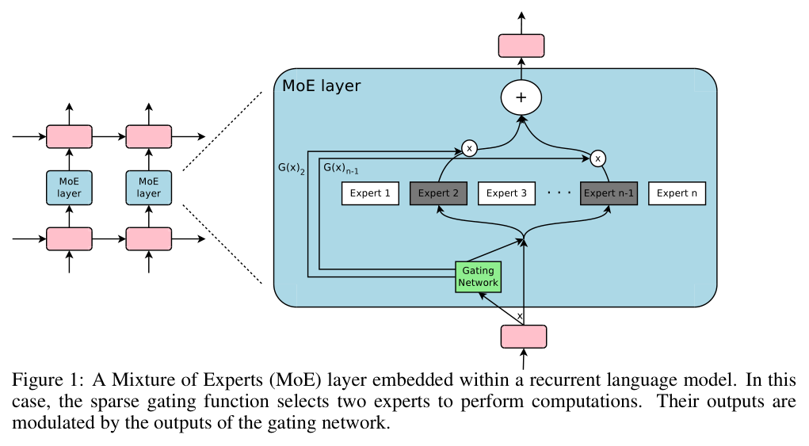
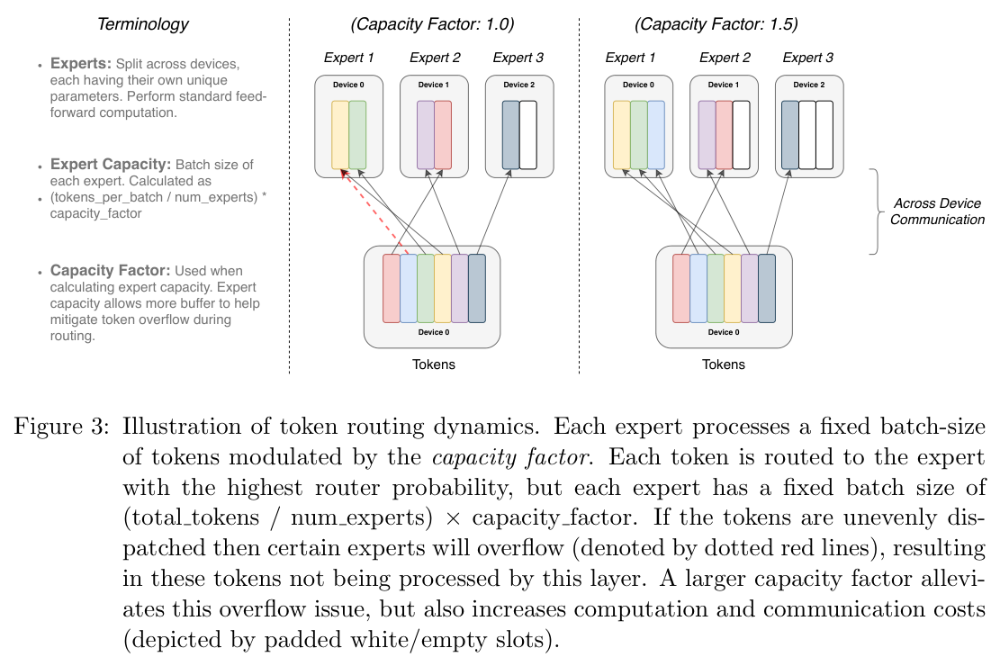
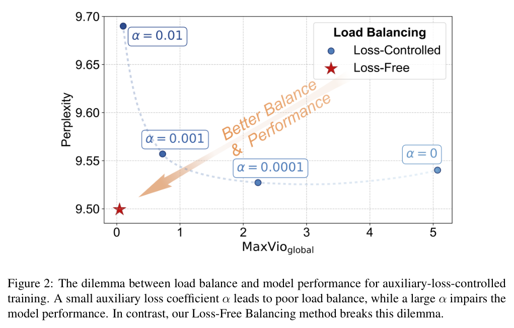
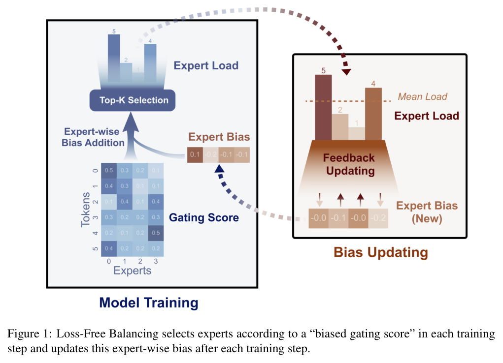
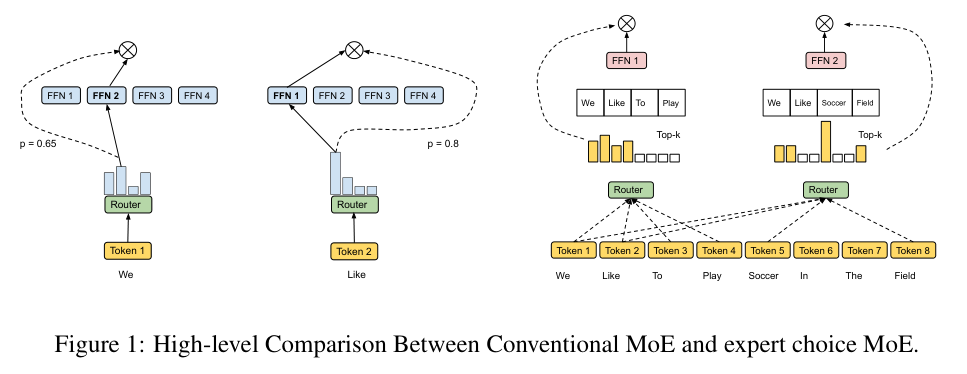
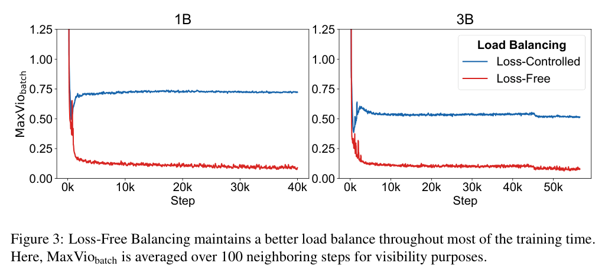

### 일부 Expert에게만 토큰이 몰리는 MoE의 고질병, Load Imbalance를 해결하는 기법들에 대해 알아봅니다.  


> 다루는 논문  
> **Sparsely-Gated MoE**: Outrageously Large Neural Networks (Shazeer et al., 2017)  
> **Switch Transformer**: Scaling to Trillion Parameter Models with Simple and Efficient Sparsity (Fedus et al., 2021)  
> **ST-MoE**: Designing Stable and Transferable Sparse Expert Models (Zoph et al., 2022)  
> **Expert Choice**: Mixture-of-Experts with Expert Choice Routing (Zhou et al., 2022)  
> **Loss-Free Balancing**: Auxiliary-Loss-Free Load Balancing Strategy for Mixture-of-Experts (Wang et al., 2024)  

<center></center>   

<font size="2"><center> 출처: Shazeer et al., Outrageously Large Neural Networks (https://arxiv.org/abs/1701.06538) </center>  </font>   

<br/>


>  **1. MoE의 라우터는 잘 나가는 Expert에게 토큰을 더 몰아주는 자기 강화(self-reinforcing) 경향이 있어, 방치하면 소수의 Expert만 일하는 routing collapse가 발생함**
>
>  **2. 고전적인 해법은 auxiliary loss + expert capacity 조합이고, 최근에는 loss 대신 bias로 라우팅만 조정하는 Auxiliary-Loss-Free 방식(DeepSeek-V3에서 채택)이 주목받고 있음**
>
>  **3. 어떤 방법을 쓰든, 레이어별 Expert 부하 분포(MaxVio), token drop rate, router logit 크기를 꾸준히 모니터링하는 것이 핵심**

<br/>

----

**본 포스트는 MoE의 Load Balancing과 관련된 주요 논문들을 리뷰하고, 간단한 PyTorch 예제로 그 동작을 확인한 내용을 담고 있습니다.**
원문은 글 하단의 출처에서 보실 수 있습니다.  

----
#### Contents  

1. [Intro - 인스타에서 만난 퀴즈 한 문제](#intro)  
2. [왜 Expert 쏠림이 일어날까?](#why)  
3. [고전적인 해법: Auxiliary Loss와 Expert Capacity](#classic)  
4. [Auxiliary Loss의 딜레마, 그리고 Loss-Free Balancing](#lossfree)  
5. [아예 Expert가 토큰을 고르게 하면? Expert Choice Routing](#expertchoice)  
6. [그래서 정답은? 그리고 무엇을 모니터링해야 할까](#answer)  
7. [마치며](#conclusion)  
<br />

<a id="intro"></a>
## 1. Intro - 인스타에서 만난 퀴즈 한 문제  

얼마 전 인스타그램을 넘기다가 ML 엔지니어 인터뷰 대비 계정(contextwindowprep)에서 재밌는 퀴즈를 하나 봤는데요. 대략 이런 내용이었습니다.  

> **Q. MoE 모델을 학습하고 있는데, 일부 Expert에게만 토큰이 몰리고 나머지 Expert는 놀고 있습니다. 모든 Expert를 골고루 쓰게 하려면 어떻게 하시겠습니까? 그리고 무엇을 모니터링하시겠습니까?**  
>
> A. 라우팅이 고르게 분포될수록 작아지는 auxiliary loss를 추가한다  
> B. 라우터 softmax의 temperature를 높여 선택을 더 부드럽게 만든다  
> C. Expert마다 hard capacity를 두고, 넘치는 토큰은 drop한다  
> D. 사용되지 않는 Expert를 몇 천 step마다 재초기화한다  

보기만 보면 다 그럴싸해 보이는데요, 막상 "왜?"라고 물어보면 설명하기가 은근히 까다로운 문제입니다.  
답부터 말씀드리면 **A가 정석이고, C는 함께 쓰는 안전장치, B와 D는 함정에 가깝습니다.**  
이번 포스트에서는 이 퀴즈를 출발점 삼아, MoE에서 Expert 쏠림이 왜 생기는지, 그리고 이를 해결하기 위해 어떤 기법들이 제안되어 왔는지 차근차근 살펴보겠습니다.  


<a id="why"></a>
## 2. 왜 Expert 쏠림이 일어날까?  

### MoE 간단 복습  

MoE(Mixture of Experts)는 Transformer의 FFN 레이어를 여러 개의 FFN(Expert)으로 쪼개고, **라우터(gating network)** 가 토큰마다 어떤 Expert에게 보낼지 결정하는 구조입니다.  
맨 위의 그림처럼 라우터가 토큰별로 각 Expert에 대한 점수를 계산하고, 그 중 top-k개의 Expert만 골라 연산을 수행합니다.  
덕분에 전체 파라미터 수는 엄청나게 키우면서도, 토큰 하나가 실제로 거치는 연산량은 일정하게 유지할 수 있는데요. Mixtral, DeepSeek-V3, 그리고 요즘 공개되는 대형 오픈소스 LLM 상당수가 이 구조를 채택하고 있습니다.  

### 부익부 빈익빈: Routing Collapse  

문제는 이 라우터가 생각보다 쉽게 **편식**을 한다는 점입니다. Shazeer et al.(2017)은 이 현상을 이렇게 설명합니다.  

> *"The gating network tends to converge to a state where it always produces large weights for the same few experts. This imbalance is self-reinforcing, as the favored experts are trained more rapidly and thus are selected even more by the gating network."*  

풀어서 보면 아래와 같은 악순환입니다.  

- 학습 초기에 우연히 조금 더 높은 점수를 받은 Expert가 더 많은 토큰을 받음  
- 토큰을 많이 받은 Expert는 그만큼 더 많이 학습되어 성능이 좋아짐  
- 라우터는 loss를 줄이기 위해 성능이 좋은 Expert를 더 자주 선택함 -> 다시 첫 번째 단계로  

회사로 치면 일 잘하는 사람한테 일이 몰리고, 그 사람은 일을 더 잘하게 되고, 나머지는 자연스럽게 월급루팡이 되는 구조라고 할까요.  
이렇게 소수의 Expert만 일하는 상태를 흔히 **routing collapse** 라고 부릅니다.  

### 쏠리면 뭐가 문제일까?  

**1) 파라미터 낭비**  
- 놀고 있는 Expert의 파라미터는 메모리만 차지할 뿐 학습되지 않음  
- 결국 "파라미터는 크게, 연산은 적게"라는 MoE의 장점이 사라지고, 사실상 작은 dense 모델과 다를 바 없어짐  

**2) 학습 속도 저하**  
- 대형 MoE는 보통 Expert를 여러 GPU에 나누어 배치하는 Expert Parallelism을 사용함  
- 특정 Expert에 토큰이 몰리면 해당 GPU만 바빠지고, 나머지 GPU는 그 GPU를 기다리게 됨 (straggler 문제)  

**3) Token Drop 증가**  
- 뒤에서 다룰 capacity 제한이 걸려 있다면, 몰린 토큰들은 처리되지 못하고 버려짐 -> 모델 품질 저하  


<a id="classic"></a>
## 3. 고전적인 해법: Auxiliary Loss와 Expert Capacity  

### Noisy Top-k Gating과 Importance Loss  

Shazeer et al.(2017)은 이 문제를 해결하기 위해 두 가지 장치를 도입했습니다.  

- **Noisy Top-k Gating**: 라우터 점수에 학습 가능한 크기의 가우시안 노이즈를 더해, 다양한 Expert가 선택될 기회를 줌 (일종의 exploration)  
- **Importance Loss**: 배치 내에서 각 Expert가 받은 gate 값의 합(importance)을 구하고, 이 값들의 변동계수(CV)의 제곱을 loss에 더함 -> Expert 간 importance 편차가 클수록 페널티  

### Switch Transformer의 Auxiliary Loss  

이후 Switch Transformer에서 제안한 auxiliary loss가 사실상의 표준이 되었는데요. 수식은 아래와 같습니다.  

$$
\mathcal{L}_{aux} = \alpha \cdot N \cdot \sum_{i=1}^{N} f_i \cdot P_i
$$

- $N$: Expert의 수  
- $f_i$: 배치 내 토큰 중 Expert $i$로 **실제로 라우팅된** 토큰의 비율  
- $P_i$: 배치 내 토큰들이 Expert $i$에 부여한 **라우터 확률의 평균**  

재밌는 점은 $f_i$와 $P_i$를 굳이 곱한다는 것인데요. $f_i$는 argmax로 계산되기 때문에 미분이 불가능하고, $P_i$는 softmax 출력이라 미분이 가능합니다.  
즉, "실제로 많이 받은 Expert($f_i$가 큰)"의 확률($P_i$)을 낮추는 방향으로 gradient가 흐르게 만드는 트릭이라고 볼 수 있습니다.  
토큰이 완벽하게 균등하게 분배되면 $f_i = P_i = 1/N$이 되어, loss 값은 최솟값인 $\alpha$가 됩니다. 앞에 $N$을 곱해주는 이유도 Expert 수와 무관하게 이 값을 일정하게 맞추기 위함입니다.  
논문에서는 $\alpha$를 $10^{-1}$부터 $10^{-5}$까지 탐색한 끝에, 학습 loss를 방해하지 않으면서도 균형을 빠르게 맞추는 $\alpha = 10^{-2}$를 사용했다고 합니다.  

코드로 보면 아래와 같습니다.  

```python
import torch

def switch_aux_loss(router_logits, top1_idx):
    # router_logits: (num_tokens, num_experts)
    E = router_logits.size(-1)
    probs = router_logits.softmax(-1)
    f = torch.bincount(top1_idx, minlength=E).float() / top1_idx.numel()  # 실제 라우팅 비율 (미분 X)
    P = probs.mean(0)                                                      # 평균 라우터 확률 (미분 O)
    return E * (f * P).sum()  # 여기에 alpha를 곱해 main loss에 더해줌
```

8개의 Expert 중 2개에 쏠리도록 만든 toy 데이터로 계산해 보면, 쏠린 경우는 약 **2.22**, 균등한 경우는 **1.0**이 나옵니다. 쏠림이 심할수록 loss가 커지는 것을 확인할 수 있네요.  

### Expert Capacity: 넘치면 버린다  

Auxiliary loss가 "고르게 나눠 가져라"라고 권장하는 장치라면, **Expert Capacity**는 "이 이상은 못 받는다"라고 선을 긋는 장치입니다.  

<center></center>   

<font size="2"><center> 출처: Fedus et al., Switch Transformers (https://arxiv.org/abs/2101.03961) </center>  </font>   

<br>

$$
\text{expert capacity} = \frac{\text{tokens per batch}}{\text{number of experts}} \times \text{capacity factor}
$$

- 각 Expert가 한 배치에서 처리할 수 있는 토큰 수에 상한을 둠  
- 상한을 넘은 토큰(그림의 빨간 점선)은 해당 레이어의 연산을 건너뛰고, residual connection을 통해 그대로 다음 레이어로 전달됨 (**token drop**)  
- capacity factor를 키우면 drop은 줄어들지만, 빈 슬롯(그림의 흰색 칸)만큼 연산과 메모리가 낭비됨  

여기서 오해하기 쉬운 점이 하나 있는데요, **capacity는 쏠림을 해결하는 장치가 아닙니다.** 쏠림은 그대로 둔 채로, 쏠렸을 때 특정 GPU가 터지지 않도록 막아주는 안전장치에 가깝습니다. 오히려 쏠림이 심한 상태에서 capacity만 걸어두면 drop되는 토큰이 늘어나 모델 품질이 떨어지게 됩니다. 그래서 보통은 auxiliary loss와 **세트로** 사용합니다.  

### Router z-loss: 라우터 안정화  

ST-MoE에서는 여기에 **router z-loss**를 하나 더 추가합니다.  

$$
\mathcal{L}_{z}(x) = \frac{1}{B} \sum_{i=1}^{B} \left( \log \sum_{j=1}^{N} e^{x_j^{(i)}} \right)^2
$$

라우터로 들어가는 logit $x$의 크기가 커지는 것에 페널티를 주는 loss인데요. logit이 커지면 bfloat16 같은 낮은 정밀도에서 반올림 오차가 커지고, 학습이 불안정해지기 쉽습니다.  
엄밀히 말하면 load balancing 기법은 아니지만, 라우터 logit이 폭주하면 특정 Expert로의 쏠림이 함께 나타나는 경우가 많아 실전에서는 거의 함께 쓰입니다. 논문에서는 계수 $c_z = 0.001$을 사용했습니다.  

최종 loss는 아래와 같이 구성됩니다.  

$$
\mathcal{L}_{tot} = \mathcal{L}_{CE} + c_B \mathcal{L}_{B} + c_z \mathcal{L}_{z}
$$


<a id="lossfree"></a>
## 4. Auxiliary Loss의 딜레마, 그리고 Loss-Free Balancing  

### 균형이냐, 성능이냐  

여기까지 보면 auxiliary loss만 잘 걸어주면 될 것 같은데요, 사실 여기에는 꽤 골치 아픈 딜레마가 숨어 있습니다.  

<center></center>   

<font size="2"><center> 출처: Wang et al., Auxiliary-Loss-Free Load Balancing Strategy for Mixture-of-Experts (https://arxiv.org/abs/2408.15664) </center>  </font>   

<br>

- $\alpha$가 작으면 (그림 오른쪽): 균형을 잡는 힘이 약해 쏠림이 남아있음 (MaxVio가 큼)  
- $\alpha$가 크면 (그림 왼쪽 위): 균형은 잘 잡히지만, auxiliary loss의 gradient가 원래 학습 목표(언어 모델링)를 방해해 perplexity가 나빠짐  

결국 auxiliary loss는 "균형을 위해 성능을 조금 양보하는" 구조일 수밖에 없는 셈인데요, 그렇다면 **gradient를 건드리지 않고** 균형을 맞출 수는 없을까요?  

### Loss-Free Balancing: bias로 라우팅만 살짝 조정하기  

DeepSeek 연구진이 제안한 Loss-Free Balancing은 이 질문에 대한 답입니다. 아이디어는 놀라울 정도로 단순합니다.  

<center></center>   

<font size="2"><center> 출처: Wang et al., Auxiliary-Loss-Free Load Balancing Strategy for Mixture-of-Experts (https://arxiv.org/abs/2408.15664) </center>  </font>   

<br>

**1) Expert마다 bias $b_i$를 두고, top-k를 고를 때만 더해줌**  

$$
g_{i,t} =
\begin{cases}
s_{i,t}, & s_{i,t} + b_i \in \text{Topk}\left(\{ s_{j,t} + b_j \}_{j=1}^{N}, K\right) \\
0, & \text{otherwise}
\end{cases}
$$

- 여기서 핵심은 bias가 **"어떤 Expert를 고를지"에만 영향을 주고**, 실제 출력에 곱해지는 gate 값은 원래 점수 $s_{i,t}$를 그대로 사용한다는 것  
- 즉, 라우팅 결정만 살짝 비틀 뿐 모델의 출력 계산 자체는 건드리지 않음  

**2) 매 step이 끝나면, 부하에 따라 bias를 업데이트함**  

$$
b_i \leftarrow b_i + u \cdot \text{sign}(\bar{c} - c_i)
$$

- 평균보다 토큰을 많이 받은 Expert -> bias를 낮춤 -> 다음 step에서 덜 선택됨  
- 평균보다 토큰을 적게 받은 Expert -> bias를 높임 -> 다음 step에서 더 선택됨  
- bias는 gradient로 학습되는 게 아니라 규칙에 따라 갱신되므로, **언어 모델링 loss에 간섭하는 gradient가 전혀 없음**  

교통 정리로 비유하자면, auxiliary loss가 운전자들에게 "막히는 길로 가지 마세요"라고 교육시키는(=모델 자체를 바꾸는) 방식이라면, Loss-Free Balancing은 막히는 길에 통행료를 붙여 자연스럽게 분산시키는 방식이라고 볼 수 있겠습니다.  

논문에서는 업데이트 폭 $u = 0.001$에 sign 함수를 쓴 버전이 가장 좋았다고 하는데요 (perplexity 9.50, MaxVio<sub>global</sub> 0.044). 위의 딜레마 그림에서 빨간 별이 바로 이 방법으로, 균형과 성능을 동시에 잡은 것을 볼 수 있습니다.  
그리고 이 방법은 **DeepSeek-V3**에 그대로 채택되었습니다. DeepSeek-V3는 여기에 아주 작은 계수의 sequence-wise balance loss만 보조적으로 더하고, 학습과 추론 모두에서 token drop을 하지 않는다고 밝히고 있습니다.  

간단하게 구현해 보면 아래와 같습니다.  

```python
import torch

torch.manual_seed(0)
T, E, K = 4096, 8, 2                                      # 토큰 수, Expert 수, top-k
skew = torch.tensor([2.0, 1.5, 0, 0, 0, 0, 0, 0])         # 0, 1번 Expert로 쏠리도록 설정
bias = torch.zeros(E)
u = 1e-3

for step in range(1001):
    scores = (torch.randn(T, E) + skew).sigmoid()          # 라우터 점수 (DeepSeek-V3처럼 sigmoid 사용)
    topk_idx = (scores + bias).topk(K, dim=-1).indices     # bias는 선택에만 사용
    gate = scores.gather(-1, topk_idx)                     # 출력 가중치는 원래 점수 사용
    load = torch.bincount(topk_idx.flatten(), minlength=E).float()
    bias += u * torch.sign(load.mean() - load)             # gradient 없이 규칙 기반 업데이트

    if step % 250 == 0:
        max_vio = (load.max() - load.mean()) / load.mean()
        print(step, round(max_vio.item(), 3), load.int().tolist())
```

```
0     2.192  [3269, 2618, 398, 388, 382, 367, 394, 376]
250   0.047  [995, 1021, 1021, 1031, 1000, 1072, 1046, 1006]
500   0.05   [1033, 1064, 983, 1042, 1075, 963, 1003, 1029]
750   0.037  [1017, 1062, 1055, 1015, 993, 1000, 1012, 1038]
1000  0.039  [1024, 1033, 1039, 1018, 1021, 1064, 963, 1030]
```

처음에는 0, 1번 Expert가 토큰의 70% 가까이를 가져가고 있었는데, bias 업데이트만으로 250 step 만에 거의 균등하게 분배되는 것을 확인할 수 있습니다.  
(실제 학습에서는 라우터도 함께 학습되기 때문에 이렇게 깔끔하지는 않겠지만, 동작 원리를 이해하기에는 충분할 것 같습니다.)  


<a id="expertchoice"></a>
## 5. 아예 Expert가 토큰을 고르게 하면? Expert Choice Routing  

지금까지의 방법들은 모두 **토큰이 Expert를 고르는(token choice)** 방식이었는데요. Google의 Expert Choice Routing은 발상을 뒤집어, **Expert가 토큰을 고르도록** 만들었습니다.  

<center></center>   

<font size="2"><center> 출처: Zhou et al., Mixture-of-Experts with Expert Choice Routing (https://arxiv.org/abs/2202.09368) </center>  </font>   

<br>

- 각 Expert는 배치 내 전체 토큰 중 자신과의 점수가 가장 높은 top-k개의 토큰을 고름  
- $k = \frac{n \times c}{e}$ ($n$: 배치 내 토큰 수, $c$: capacity factor, $e$: Expert 수)  
- 모든 Expert가 정확히 $k$개씩 가져가므로 **구조적으로 완벽한 균형**이 보장됨 -> auxiliary loss가 필요 없음  
- 토큰마다 처리하는 Expert의 수가 달라질 수 있음 (중요한 토큰은 여러 Expert가, 쉬운 토큰은 적은 Expert가 처리)  

다만 치명적인 약점이 하나 있는데요, autoregressive 언어 모델에서는 **미래 토큰 정보가 새어나갈 수 있다**는 점입니다.  
Expert가 "배치 전체"를 보고 토큰을 고르다 보니, 지금 토큰이 선택될지 여부가 뒤에 오는 토큰들의 점수에 영향을 받게 되기 때문입니다. 추론 시에는 토큰을 하나씩 생성하기 때문에 학습 때와 같은 방식으로 라우팅하기도 어렵습니다.  
Loss-Free Balancing 논문에서도 이 future token leakage 문제를 지적하며, 이전 배치의 통계만 사용하는 자신들의 방식은 이런 문제가 없다는 점을 강조하고 있습니다.  


<a id="answer"></a>
## 6. 그래서 정답은? 그리고 무엇을 모니터링해야 할까  

다시 처음의 퀴즈로 돌아가 보겠습니다.  

**A. Auxiliary loss 추가 -> 정석**  
- Switch Transformer 이후 대부분의 MoE 학습에서 기본으로 사용되는 방법  
- 다만 $\alpha$에 따라 균형과 성능 사이의 trade-off가 있으므로, 최근에는 Loss-Free Balancing처럼 gradient 간섭을 줄이는 방향으로 발전하는 중  

**B. Softmax temperature 올리기 -> 함정**  
- temperature scaling은 모든 logit을 같은 상수로 나누는 것이므로, **logit 간의 순위는 전혀 바뀌지 않음**  
- top-k 선택은 순위로만 결정되므로, 라우팅 결과는 그대로이고 gate 값만 부드러워질 뿐  

말로만 하면 와닿지 않으니 직접 확인해 보겠습니다.  

```python
torch.manual_seed(0)
logits = torch.randn(4096, 8) + torch.tensor([2.0, 1.5, 0, 0, 0, 0, 0, 0])

for tau in [1.0, 2.0, 5.0]:
    idx = (logits / tau).softmax(-1).topk(2, dim=-1).indices
    print(tau, torch.bincount(idx.flatten(), minlength=8).tolist())
```

```
1.0 [3269, 2618, 398, 388, 382, 367, 394, 376]
2.0 [3269, 2618, 398, 388, 382, 367, 394, 376]
5.0 [3269, 2618, 398, 388, 382, 367, 394, 376]
```

보시다시피 temperature를 5배로 올려도 Expert별 토큰 수는 한 개도 달라지지 않습니다. (Shazeer et al.이 temperature가 아니라 **노이즈**를 더한 것도 이런 이유에서입니다. 노이즈는 순위 자체를 흔들 수 있으니까요.)  

**C. Hard capacity + token drop -> 보조 장치**  
- 앞서 말씀드렸듯 쏠림을 해결하는 게 아니라, 쏠렸을 때의 피해(OOM, straggler)를 막는 안전장치  
- 단독으로 쓰면 drop되는 토큰만 늘어나므로 A와 함께 써야 의미가 있음  

**D. 안 쓰이는 Expert 재초기화 -> 근본적인 해결책이 아님**  
- 쏠림의 원인은 Expert가 아니라 **라우터**에 있으므로, Expert만 새로 초기화해도 라우터는 여전히 그 Expert를 고르지 않음  
- 오히려 학습 도중 갑작스럽게 파라미터가 바뀌면서 학습이 불안정해질 수 있음  
- VQ-VAE의 dead codebook reset처럼 비슷한 휴리스틱이 쓰이는 분야도 있지만, MoE에서는 표준적인 방법이 아님  

### 무엇을 모니터링해야 할까?  

퀴즈의 두 번째 질문이 사실 더 실무적인 질문인데요, 아래 지표들을 **레이어별로** 보는 것을 추천드립니다. MoE 레이어마다 쏠림 양상이 다르게 나타나는 경우가 많기 때문입니다.  

<center></center>   

<font size="2"><center> 출처: Wang et al., Auxiliary-Loss-Free Load Balancing Strategy for Mixture-of-Experts (https://arxiv.org/abs/2408.15664) </center>  </font>   

<br>

**1) Expert별 토큰 비율 ($f_i$)**  
- 가장 기본이 되는 지표. 레이어 x Expert 히트맵으로 그려두면 쏠림을 한눈에 파악할 수 있음  

**2) MaxVio (Maximal Violation)**  
- $\text{MaxVio} = \frac{\max_i \text{Load}_i - \overline{\text{Load}}}{\overline{\text{Load}}}$  
- 가장 많이 받은 Expert가 평균 대비 얼마나 초과했는지를 나타내는 값으로, 0에 가까울수록 균형 잡힌 상태  
- 위 그림처럼 학습 step에 따라 추적하면 균형이 유지되고 있는지 확인 가능  

**3) Token drop rate**  
- capacity를 사용한다면 반드시 봐야 하는 지표. 이 값이 높다면 쏠림이 심하거나 capacity factor가 너무 작다는 신호  

**4) Auxiliary loss 값**  
- 완벽한 균형일 때 $\alpha$ (계수를 뺀 값 기준으로는 1.0)에 수렴하므로, 이 값에서 멀어진다면 쏠림이 진행 중이라는 의미  

**5) Router entropy와 logit 크기 (z-loss)**  
- router entropy가 급격히 떨어지면 라우터가 특정 Expert에 확신을 갖기 시작했다는 신호  
- logit 크기가 계속 커진다면 수치 불안정과 collapse의 전조일 수 있음  

**6) Expert Parallelism을 쓴다면, GPU별 처리 시간**  
- 특정 GPU만 계속 느리다면 해당 GPU에 올라간 Expert에 부하가 몰리고 있는 것  


<a id="conclusion"></a>
## 7. 마치며  

MoE를 처음 접했을 때는 "여러 전문가를 두고 필요한 사람만 골라 쓴다"는 아이디어가 참 우아하다고 생각했는데요, 막상 학습시키는 쪽의 이야기를 들여다보니 결국 **팀 운영**의 문제와 꽤 닮아 있다는 생각이 듭니다.  
일 잘하는 사람에게만 일이 몰리지 않도록 규칙(auxiliary loss)을 만들고, 한 사람이 감당할 수 있는 업무량에 상한(capacity)을 두고, 요즘은 아예 업무 배분 방식 자체(bias, expert choice)를 바꿔보는 식으로 발전해 온 셈이니까요.  

개인적으로는 Loss-Free Balancing이 가장 인상 깊었는데요, "loss로 모델을 바꾸지 말고, 라우팅 규칙만 바꾸자"는 단순한 발상의 전환이 DeepSeek-V3 같은 대형 모델의 학습까지 이어졌다는 점이 흥미롭습니다.  
요즘 공개되는 오픈소스 LLM 상당수가 MoE 구조를 채택하고 있는 만큼, 직접 MoE 모델을 파인튜닝하거나 학습해 보실 일이 있다면 오늘 정리한 모니터링 지표들을 꼭 한 번 찍어보시길 추천드립니다.  

----------------


**개선을 위한 여러분의 피드백과 제안을 코멘트로 공유해 주세요.**
**내용에 대한 지적, 혹은 질문을 환영합니다.**  


**출처**  
[Outrageously Large Neural Networks: The Sparsely-Gated Mixture-of-Experts Layer](https://arxiv.org/abs/1701.06538)  
[Switch Transformers: Scaling to Trillion Parameter Models with Simple and Efficient Sparsity](https://arxiv.org/abs/2101.03961)  
[ST-MoE: Designing Stable and Transferable Sparse Expert Models](https://arxiv.org/abs/2202.08906)  
[Mixture-of-Experts with Expert Choice Routing](https://arxiv.org/abs/2202.09368)  
[Auxiliary-Loss-Free Load Balancing Strategy for Mixture-of-Experts](https://arxiv.org/abs/2408.15664)  
[DeepSeek-V3 Technical Report](https://arxiv.org/abs/2412.19437)  
