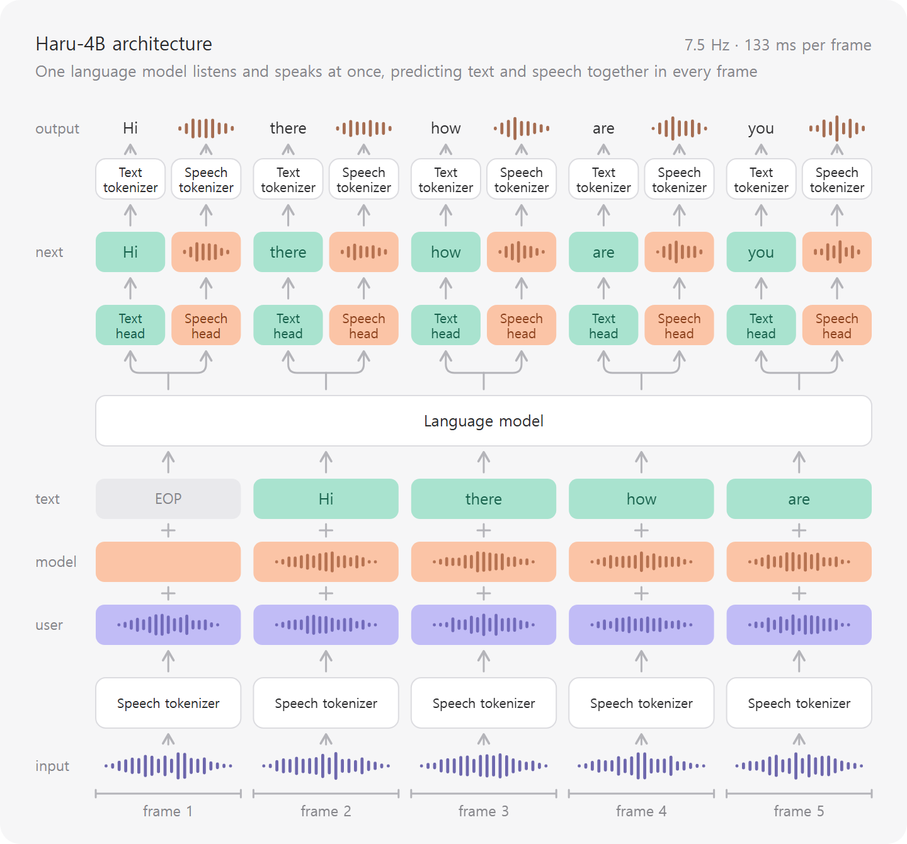
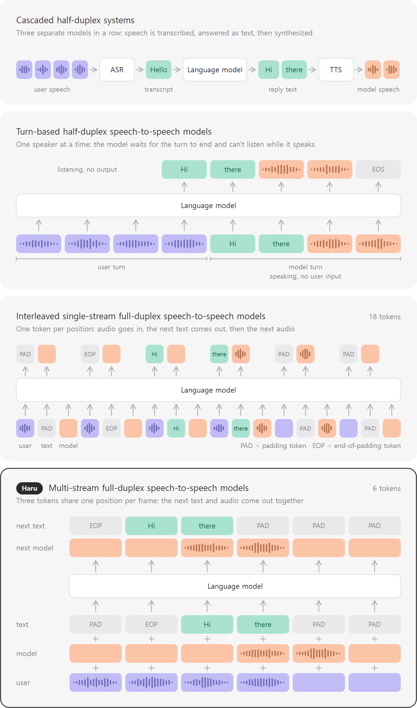
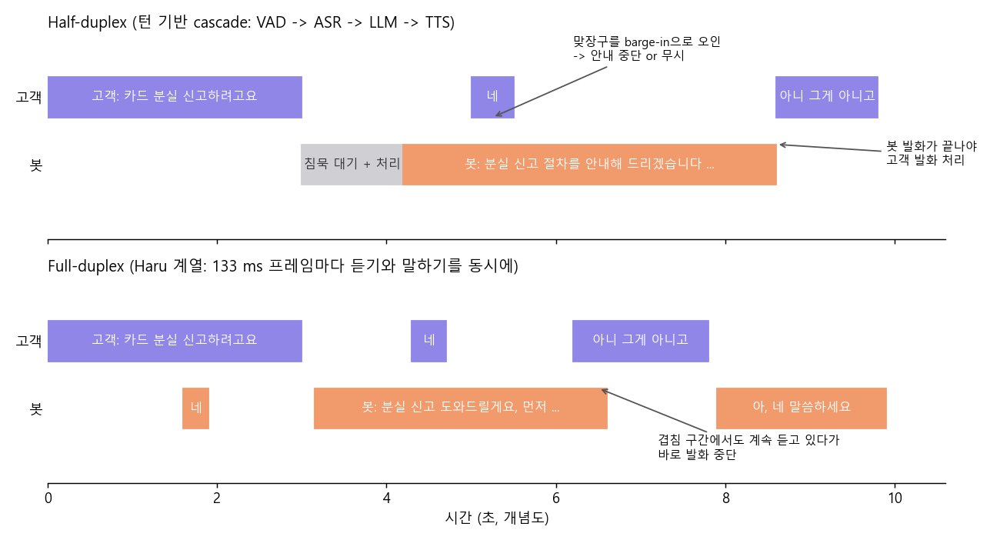
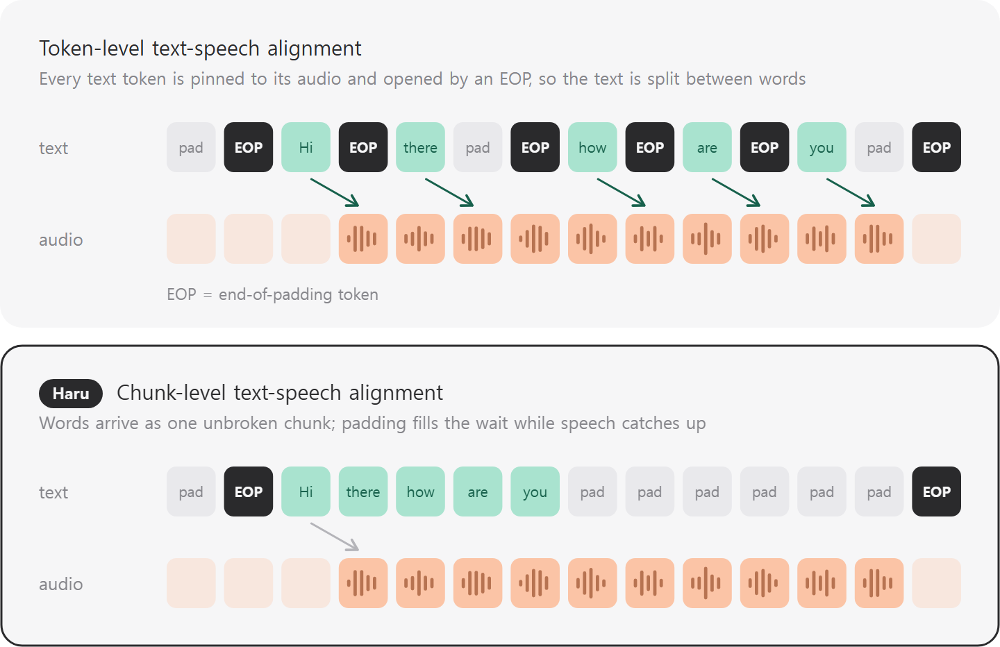
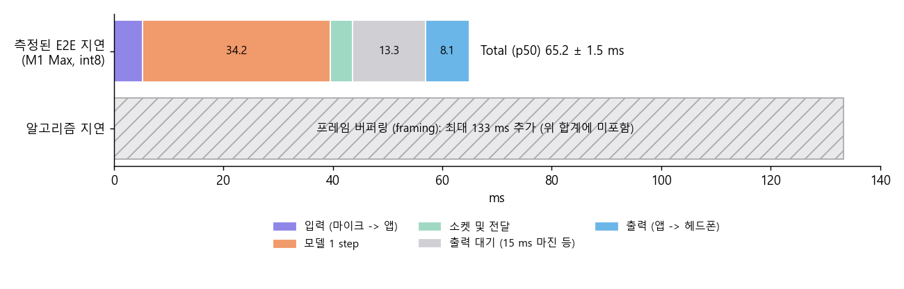

### 133 ms마다 한 번씩 듣고, 동시에 말하는 오픈 full-duplex 음성 대화 모델 Haru-4B에 대해 알아봅니다.

> 다루는 자료  
> **Haru-4B**: A Low-Latency and Multilingual Full-Duplex Continuous Spoken Dialogue Foundation Model  
> higurashi (Rikuto Kotoge), Hugging Face 모델 카드 + 기술 블로그, 2026.11  

<center></center>
<font size="2"><center> 출처: higurashi-ai/Haru-4B 모델 카드 (https://huggingface.co/higurashi-ai/Haru-4B), assets/architecture.svg </center>  </font>

<br/>

>  **1. Haru-4B는 Qwen3.5-4B 위에 만든 full-duplex speech-to-speech 베이스 모델로, 7.5 Hz(133 ms) 프레임마다 사용자 음성 1프레임을 받고 자기 음성과 텍스트 1프레임을 내보냄. 세 스트림을 한 position에 더해 넣어서 듣기와 말하기가 서로를 기다리지 않음**
>
>  **2. 오디오는 이산 토큰이 아닌 64차원 연속 latent이고, 4-layer MLP head가 MeanFlow로 1 step 만에 생성함. 4,000만 시간 이상의 실음성(합성 대화 제외)으로 학습했고, 그중 1,300만 시간 이상은 단일 채널 녹음을 분리해 만든 full-duplex 데이터임**
>
>  **3. 공개 자료에는 지연 시간 측정값만 있고 대화 품질, 턴테이킹, 과업 수행 벤치마크는 없음. 지시 따르기를 하지 않는 연구용 베이스 모델이라 상담 콜봇에 바로 쓰기는 어렵고, Full-Duplex-Bench / τ-Voice 방식으로 직접 검증해야 함**

<br/>

----

**본 포스트는 Haru-4B의 Hugging Face 모델 카드, GitHub README, 그리고 higurashi 기술 블로그(일본어/영어)를 읽고 정리한 노트입니다.**
원문은 여기에서 보실 수 있습니다. [model card](https://huggingface.co/higurashi-ai/Haru-4B), [blog (ja)](https://blog.higurashi.ai/melte/haru4b-ja/), [code](https://github.com/higurashi-ai/Haru)

----
#### Contents

1. [Intro - 전화 통화처럼 말하는 오픈 모델](#intro)
2. [Full-duplex란 무엇일까?](#duplex)
3. [133 ms 프레임 하나에서 일어나는 일: Haru-4B 아키텍처](#arch)
4. [4,000만 시간의 실음성: 학습 데이터와 레시피](#training)
5. [지연 시간, 그리고 보고되지 않은 것들](#results)
6. [직접 돌려보기](#usage)
7. [AICC 관점: 콜봇/보이스봇에 주는 시사점](#aicc)
8. [한계와 라이선스](#limits)
9. [마치며](#conclusion)
<br />

<a id="intro"></a>
## 1. Intro - 전화 통화처럼 말하는 오픈 모델

지난 11월 12일, 일본 스타트업 higurashi가 Hugging Face에 **Haru-4B** 라는 음성 대화 모델을 공개했습니다. 공개 일주일 남짓 만에 좋아요가 5.7천 개를 넘기면서 트렌딩 상단에 올라와 있는데요.
모델 카드의 첫 문장이 이 모델의 성격을 잘 요약합니다. "사람이 전화 통화할 때처럼, 듣는 동시에 말하는(full-duplex) 모델"이라는 것이죠.

이 블로그에서는 그동안 음성 에이전트를 주로 **평가하는 쪽** 에서 다뤄 왔습니다. [음성 대화 평가](https://myeonghak.github.io/ai%20contact%20center/AICC-%EC%9D%8C%EC%84%B1-%EB%8C%80%ED%99%94-%ED%8F%89%EA%B0%80/) 글에서는 Full-Duplex-Bench와 Talking Turns로 턴테이킹을 재는 법을, [τ-Voice](https://myeonghak.github.io/ai%20contact%20center/AICC-tau-Voice/) 글에서는 full-duplex 음성 에이전트가 실제 상담 과업을 얼마나 해내는지를 살펴봤습니다.
그때 평가 대상으로 등장한 오픈 모델은 사실상 Moshi 계열이 전부였는데, 이번에 4B 크기에 한국어까지 주요 언어로 포함한 모델이 Apache-2.0으로 나온 셈입니다.

이번 글에서는 Haru-4B가 어떤 구조로 "듣는 동시에 말하기"를 구현했는지, 무엇으로 학습했는지, 그리고 공개 자료가 **무엇을 보여주고 무엇을 보여주지 않는지** 를 정리한 뒤, 콜봇/보이스봇을 만드는 입장에서 어떻게 받아들이면 좋을지 이야기해 보겠습니다.
참고로 아직 논문이나 테크니컬 리포트는 없고(블로그에 "추후 공개 예정"이라고 되어 있습니다), 아래 숫자는 모두 모델 카드, GitHub README, config.json, 기술 블로그에서 확인한 값입니다.


<a id="duplex"></a>
## 2. Full-duplex란 무엇일까?

통신 용어로 half-duplex는 무전기처럼 한 번에 한쪽만 말할 수 있는 방식이고, full-duplex는 전화처럼 양쪽이 동시에 말하고 들을 수 있는 방식입니다.
음성 대화 시스템에 이 개념을 가져오면, Haru 블로그는 시스템을 크게 네 가지로 나눕니다.

<center></center>
<font size="2"><center> 출처: higurashi Tech Blog, Haru-4B (https://blog.higurashi.ai/melte/haru4b-ja/) </center>  </font>

- **Cascade half-duplex**: ASR이 받아 적고, LLM이 텍스트로 답하고, TTS가 읽어주는 세 모델 직렬 구조. 현재 콜봇의 대부분이 이 구조임
- **턴 기반 half-duplex speech-to-speech**: 하나의 모델이 음성을 받아 음성으로 답하지만, 사용자 턴이 끝나야 말을 시작하고 말하는 동안은 듣지 못함
- **Interleaved 단일 스트림 full-duplex**: 사용자 음성, 모델 텍스트, 모델 음성 토큰을 한 줄로 번갈아 끼워 넣어 동시성을 흉내 냄. 대신 시퀀스가 길어짐
- **Multi-stream full-duplex (Haru)**: 세 스트림의 토큰을 한 position에 겹쳐 넣고, 다음 텍스트와 다음 음성을 한 번에 내보냄

현업에서 cascade 구조에 VAD와 barge-in 감지를 붙여 쓰는 경우가 많은데요, 이건 결국 "누가 지금 말할 차례인가"를 **규칙과 별도 모듈로** 결정하는 방식입니다.
문제는 이 결정이 꽤 어렵다는 거죠. 아래는 상담 장면을 가정해서 직접 그린 개념도입니다.

<center></center>

위쪽 half-duplex에서는 고객 발화가 끝난 뒤 침묵을 기다렸다가(end-of-turn 판단) 처리를 시작하고, 봇이 말하는 중에 들어온 "네"를 끼어들기로 볼지 맞장구로 볼지 별도 로직이 판단해야 합니다.
아래쪽 full-duplex 모델은 봇이 말하는 중에도 매 프레임 고객 음성을 입력으로 받고 있기 때문에, "네"는 흘려듣고 "아니 그게 아니고"에는 말을 멈추는 판단을 **모델이 직접** 하게 됩니다. 적어도 원리상으로는요.
"원리상"이라고 굳이 붙인 이유는, 지난 글에서 본 것처럼 Moshi도 구조상 full-duplex였지만 Full-Duplex-Bench에서는 잠깐의 pause에도 거의 항상 끼어드는 모습을 보였기 때문입니다. 구조가 full-duplex라고 해서 턴테이킹을 잘한다는 보장은 없는 셈이죠.


<a id="arch"></a>
## 3. 133 ms 프레임 하나에서 일어나는 일: Haru-4B 아키텍처

### 구성 요소

모델 카드와 config.json 기준으로 Haru-4B는 네 부분으로 이루어져 있습니다.

| 부분 | 내용 |
| --- | --- |
| 언어 모델 | Qwen3.5-4B 텍스트 백본, 32 layers, hidden size 2560 (config상 linear attention 3개마다 full attention 1개가 오는 하이브리드 구조) |
| 오디오 코덱 | VibeVoice acoustic tokenizer (causal), 24 kHz, latent 1개당 3200 samples, latent 차원 64 |
| 오디오 head | 4-layer MLP, MeanFlow, 1 sampling step, guidance scale 1~2 (기본 1.5) |
| 프레임 레이트 | 7.5 Hz |

이름은 4B지만, Hugging Face 메타데이터의 safetensors 파라미터 수는 약 5.27B(BF16)로 표시됩니다. 백본 외에 코덱, 오디오 projection, MeanFlow head가 하나의 `model.safetensors` 에 함께 들어 있어서 생기는 차이로 보입니다(파일 구성은 모델 카드의 Files 표에 나와 있지만, 부분별 파라미터 수는 공개되어 있지 않습니다).

프레임 레이트는 코덱에서 바로 나옵니다.

$$
\frac{24000 \text{ samples/s}}{3200 \text{ samples/frame}} = 7.5 \text{ Hz}, \qquad \frac{1}{7.5} \approx 133 \text{ ms}
$$

config.json의 코덱 downsampling ratio가 8, 5, 5, 4, 2, 2인데, 곱하면 정확히 3200이 됩니다. 1초짜리 음성이 LLM 입장에서는 토큰 7.5개짜리 시퀀스가 되는 셈이죠.

### 세 스트림을 "더해서" 한 칸에

맨 위 그림을 다시 보면, 매 프레임 $t$ 마다 언어 모델의 입력은 세 가지 임베딩의 합입니다.

$$
x_t = E_{\text{user}}(a^{u}_t) + E_{\text{model}}(a^{m}_t) + E_{\text{text}}(w_t)
$$

- $a^{u}_t$: 코덱으로 인코딩한 사용자 음성 latent (64차원)
- $a^{m}_t$: 모델이 직전에 생성한 자기 음성 latent
- $w_t$: 모델이 직전에 생성한 텍스트 토큰 (말하지 않는 구간에는 padding token)

언어 모델의 hidden state $h_t$ 는 두 갈래로 나갑니다. 하나는 일반 LM head처럼 **다음 텍스트 토큰** 을, 다른 하나는 MLP head가 **다음 음성 latent** 를 예측합니다. 그리고 이 둘이 다음 프레임의 입력으로 다시 들어가는 autoregressive 루프가 133 ms마다 돌아갑니다.

Interleaved 방식이라면 한 프레임에 user, text, model 토큰 3개가 순서대로 들어가야 하는데, 더하기로 한 칸에 겹쳐 넣으니 **컨텍스트 길이가 1/3로 줄어든다** 는 것이 블로그의 설명입니다. 같은 이유로 텍스트 스트림이 오디오 토큰에 의해 중간중간 끊기지 않는다는 장점도 있다고 하네요.
이 "multi-stream을 합쳐서 한 position에" 라는 아이디어 자체는 Moshi와 FLM-Audio를 인용하고 있어서, Haru가 처음 제안한 것이라기보다는 이 계열 설계를 더 낮은 프레임 레이트와 연속 latent로 밀어붙인 쪽에 가깝습니다.

GitHub README에는 구현 관점의 디테일이 하나 더 있습니다. **모델이 사용자보다 한 프레임 앞서 있다** 는 것인데요. `start()` 가 모델의 프레임 0을 돌려주고, 사용자 프레임 $k$ 를 넣어 `step()` 을 호출하면 모델 프레임 $k+1$ 이 나옵니다. 듣는 쪽과 말하는 쪽이 항상 한 박자씩 엇갈려 돌아가는 구조죠.

### 이산 토큰 대신 연속 latent, 그리고 1 step 생성

많은 음성 LM은 RVQ(Residual Vector Quantization)로 만든 이산 토큰을 씁니다. 블로그 그림에 따르면 RVQ 계열은 12.5 Hz 프레임마다 8개의 코드를 내기 위해 별도의 autoregressive Transformer를 8번 돌리는 식입니다.
Haru는 대신 7.5 Hz의 64차원 **연속** latent를 쓰고, 이를 작은 MLP head로 생성합니다. 이 head는 Flow Matching으로 먼저 학습한 뒤 MeanFlow로 distillation했다고 하는데요.

간단히 짚어 보면, Flow Matching은 노이즈에서 데이터로 가는 경로의 **순간 속도** 를 학습하기 때문에 샘플링할 때 ODE를 여러 step에 걸쳐 풀어야 합니다. MeanFlow는 구간 $[r, t]$ 에 대한 **평균 속도** $u(z_t, r, t)$ 를 학습해서

$$
z_r = z_t - (t - r)\, u(z_t, r, t)
$$

한 번의 계산으로 $t=1$ (노이즈)에서 $r=0$ (데이터)까지 건너뛸 수 있게 합니다. 그 결과 프레임당 음성 생성 비용이 "MLP 한 번 forward"로 줄어듭니다. 실시간 full-duplex에서는 133 ms 안에 모든 걸 끝내야 하니, 이 부분이 꽤 중요한 설계 포인트로 보입니다.

### 텍스트는 덩어리(chunk)로

텍스트와 음성은 시간 해상도가 다릅니다. 한 프레임(133 ms) 동안 단어가 하나도 안 나올 수도, 여러 개 나올 수도 있죠.

<center></center>
<font size="2"><center> 출처: higurashi Tech Blog, Haru-4B (https://blog.higurashi.ai/melte/haru4b-ja/) </center>  </font>

Haru는 단어마다 해당 음성 위치에 맞춰 정렬하지 않고, **말을 시작하기 직전 프레임에 EOP(end-of-padding) 토큰** 을 두고, 그 뒤에 텍스트를 한 덩어리로 쭉 내보낸 다음 음성이 따라올 동안 padding으로 채웁니다.
EOP가 사실상 "이제 말 시작한다"는 신호 역할을 하는 셈이고, 텍스트가 중간에 쪼개지지 않으니 사전학습된 LLM의 텍스트 능력도 덜 잊어버린다(catastrophic forgetting 완화)는 것이 블로그의 설명입니다.
콜봇 관점에서 보면 이 텍스트 스트림이 꽤 쓸모 있을 것 같은데요. 모델이 지금 무슨 말을 하려는지 텍스트로 바로 볼 수 있으니 로깅이나 실시간 모니터링에 활용할 여지가 있습니다.


<a id="training"></a>
## 4. 4,000만 시간의 실음성: 학습 데이터와 레시피

### 데이터 철학: 합성 대화는 넣지 않는다

블로그에서 가장 강조하는 부분은 데이터입니다. 실제 녹음에는 끼어들기, 머뭇거림, 맞장구, 겹쳐 말하기, 불규칙한 화자 교대가 자연스럽게 들어 있는데, LLM으로 대본을 만들고 TTS로 읽힌 합성 대화에는 이런 게 없다는 거죠. 그래서 **LLM 생성 대화와 TTS 합성 음성을 학습 데이터에서 의도적으로 제외** 했다고 합니다.

- 전체 규모: 4,000만 시간 이상, 160개 이상 언어
- 주요 9개 언어: 영어, 스페인어, 포르투갈어, 독일어, 프랑스어, 중국어, 일본어, 러시아어, 한국어
- 대부분의 음성은 Sidon(오픈소스 다국어 음성 복원 모델)으로 깨끗하게 복원해서 사용

다만 언어별 시간 비중은 공개되어 있지 않아서, 한국어가 얼마나 들어갔는지는 알 수 없습니다.

### 2단계 사전학습

**Stage 1: 단일 채널 음성 사전학습.** Qwen3.5-4B를 음성에 적응시키는 단계로, 다음 세 가지를 섞어서 학습했다고 합니다.

- ASR: 음성과 언어 표현을 연결
- 음성/텍스트 continuation: 연속 음성을 모델링하고 생성하는 법을 학습
- 텍스트만으로 하는 rehearsal: 원래 LLM의 지식을 잊지 않도록

**Stage 2: Full-duplex 사전학습.** 여기서 재미있는 문제가 하나 생깁니다. full-duplex 학습에는 화자별로 분리된 두 채널 음성이 필요한데, 세상의 대화 녹음은 대부분 한 채널에 섞여 있죠.
그래서 higurashi는 **FastDialogueSidon** 이라는, 음성 분리와 복원을 동시에 하는 모델을 따로 만들어 단일 채널 녹음을 시간 정렬된 두 스트림으로 바꿨습니다(이 모델도 공개했습니다).

- 분리된 full-duplex 대화 데이터 1,300만 시간 이상
- 최대 60분 길이의 대화 샘플로 학습해 긴 호흡의 턴테이킹과 겹침 발화를 학습
- 샘플마다 캐릭터 프롬프트를 생성하고, 같은 화자의 참조 음성을 조건으로 줘서 캐릭터와 목소리 제어를 학습

블로그 데모 섹션에는 "네이티브로 녹음된 2채널 대화를 전혀 쓰지 않고, 분리된 음성만으로 사전학습했는데도 맞장구와 겹침 발화가 있는 자연스러운 대화가 된다"는 설명이 붙어 있습니다.
컨택센터 입장에서는 이 대목이 흥미로운데요. 상담 녹취는 대개 고객과 상담사 채널이 이미 나뉘어 있는 경우가 많으니, 오히려 Haru가 향후 작업으로 언급한 "네이티브 2채널 데이터로 fine-tuning"에 딱 맞는 재료가 될 수 있겠죠. (물론 개인정보 처리는 별개의 큰 문제입니다.)

### 학습 인프라

NVIDIA B200 GPU 256장으로 약 8일 동안 사전학습했고, 학습 인프라는 Megatron-LM 기반입니다. 코덱, Sidon, FastDialogueSidon 같은 전처리 모델도 Triton 커널로 최적화해서 대규모 전처리를 가속했다고 합니다. 가난한 영세 개발자 입장에서는 숫자만 봐도 아득해지는 규모네요.


<a id="results"></a>
## 5. 지연 시간, 그리고 보고되지 않은 것들

### 보고된 숫자: 지연 시간

공개 자료에서 정량적으로 보고된 성능은 사실상 **지연 시간** 이 전부입니다.

<center></center>

- **Apple M1 Max MacBook (int8, Metal 커널 최적화한 Swift 앱)**: end-to-end 약 65 ms (p50 65.2 ± 1.5 ms). 이 중 모델 1 step이 34.2 ± 0.5 ms
- 이 값은 음향 인코딩, LM 추론, 음성 디코딩, 유선 마이크/헤드폰 I/O를 포함하지만 **프레임 버퍼링은 제외** 한 값임. 7.5 Hz이므로 프레이밍 때문에 **최대 133 ms의 알고리즘 지연이 추가** 됨
- **NVIDIA B300 + vLLM-Omni**: 오디오 인코딩/디코딩과 LM 1 step을 합쳐 약 15 ms
- 블루투스 기기는 100 ms 이상을 추가한다고 모델 카드에 명시됨

"65 ms"라는 헤드라인 숫자만 보면 오해하기 쉬운데요. 사용자 입장에서 체감하는 지연은 여기에 프레임을 모으는 시간(최대 133 ms)이 더해지고, 실제 서비스라면 네트워크와 전화망 구간까지 붙습니다. 블로그가 이 부분을 명확히 분리해 적어 둔 건 좋은 점이라고 생각합니다.
그리고 이건 어디까지나 **시스템 처리 지연** 입니다. 고객 말이 끝난 뒤 모델이 실제로 말을 시작하기까지 걸리는 시간(Full-Duplex-Bench의 turn-taking latency 같은 것)은 모델이 "지금 말해야겠다"고 판단하는 타이밍에 달려 있고, 이 값은 보고되어 있지 않습니다.

### 보고되지 않은 것들

정리하면, 현재 공개 자료에 **없는** 것은 다음과 같습니다.

- 턴테이킹 벤치마크: Full-Duplex-Bench, Talking Turns 같은 지표(pause 처리, 맞장구, 턴 전환, 끼어들기 대응)
- 음성 이해/생성 품질: ASR 정확도, 음성 품질(MOS 등), 화자 유사도, 언어별 성능
- 지식/추론/과업 수행: 음성 QA, 지시 따르기, tool calling, τ-Voice 같은 과업 성공률
- Moshi 등 기존 full-duplex 모델과의 정량 비교
- 안전성 평가, 그리고 언어별(특히 한국어) 데이터 비중

블로그의 데모 영상은 일본어 2개, 영어 1개이고, 한국어 데모는 없습니다. 베이스 모델 공개이고 테크니컬 리포트가 예정되어 있다고 하니 이후 업데이트를 지켜봐야겠지만, **지금 시점에서 "턴테이킹을 잘한다"는 것은 데모로만 보여준 주장** 이라는 점은 짚고 넘어가야 할 것 같습니다.


<a id="usage"></a>
## 6. 직접 돌려보기

GitHub 저장소에는 PyTorch 구현(웹 데모 포함), Apple Silicon용 MLX 구현(macOS 네이티브 앱 포함), vLLM-Omni 서빙 플러그인이 들어 있고, 세 구현 모두 같은 체크포인트를 읽습니다.
NVIDIA GPU 기준으로는 **약 12 GB 메모리** 가 필요하다고 되어 있습니다. 웹 데모는 아래처럼 띄웁니다(모델 카드 그대로).

```bash
git clone https://github.com/higurashi-ai/Haru && cd Haru
pip install -e ./haru
python -m haru.server --hf-repo higurashi-ai/Haru-4B
```

`http://localhost:8998` 에 접속해서 캐릭터를 고르고, 목소리를 지정한 뒤 대화하면 됩니다. Haru는 기본 목소리를 제공하지 않기 때문에 **3초에서 3분 사이의 단일 화자, 깨끗한 음성 클립** 을 직접 올려야 합니다. 물론 사용 권한이 있는 목소리만 써야 하고요.

Python에서 프레임 단위로 돌리는 코드는 모델 카드에 아래처럼 나와 있습니다.

```python
from haru import DuplexSession, HaruModel
from haru.audio import load_audio, prepare_reference

model = HaruModel.from_pretrained("higurashi-ai/Haru-4B")
voice = prepare_reference(load_audio("voice.wav"))
session = DuplexSession(model, system_prompt=card, reference=voice)

frame = session.start()                  # the model's first 133 ms: frame.audio, frame.text
while not frame.done:
    frame = session.step(user_audio)     # 3200 samples at 24 kHz in, 3200 out
```

`card` 는 고정된 형식의 캐릭터 카드인데, README에는 `render_card` 로 persona, 이름, 상대방 이름, 관계, 상황 같은 필드를 채워 만드는 예시가 있습니다. 예시 상황이 "오랜만에 안부 전화하는 고등학교 친구"인 걸 보면, 이 모델이 겨냥하는 건 상담원보다는 **잡담 상대에 가까운 캐릭터** 라는 게 느껴지네요.
이 루프가 133 ms 안에 한 바퀴를 돌아야 실시간이 유지되므로, 사용자 음성 3200 samples(24 kHz)를 정확히 잘라 넣고 모델 음성 3200 samples를 바로 재생하는 오디오 I/O 쪽 구현이 생각보다 중요합니다. 녹음된 파일로 오프라인 테스트를 하고 싶다면 `haru-inference user.wav reply.wav --reference voice.wav ...` 형태의 CLI도 제공됩니다.

(저는 이 글을 쓰는 환경에 맞는 GPU가 없어서 직접 실행 결과는 싣지 않았습니다. 위 코드는 모델 카드의 코드를 그대로 옮긴 것입니다.)


<a id="aicc"></a>
## 7. AICC 관점: 콜봇/보이스봇에 주는 시사점

### 콜봇에서 full-duplex가 풀어줄 수 있는 문제

[음성 대화 평가](https://myeonghak.github.io/ai%20contact%20center/AICC-%EC%9D%8C%EC%84%B1-%EB%8C%80%ED%99%94-%ED%8F%89%EA%B0%80/) 글에서 한국어 상담의 특징으로 "네, 아 네, 예예" 같은 맞장구가 아주 많다는 점을 짚었는데요. cascade 콜봇은 이걸 barge-in으로 처리하면 계속 말을 멈추고, 둔감하게 만들면 진짜 끼어들기를 놓칩니다.
Haru 같은 모델이 기대를 받는 이유는 세 가지로 정리할 수 있을 것 같습니다.

- **Barge-in**: 말하는 중에도 매 프레임 고객 음성을 입력으로 받으므로, 끼어들기 판단을 별도 VAD 규칙이 아닌 모델이 문맥을 보고 할 수 있음. 반응 단위는 133 ms 프레임임
- **Backchannel**: 반대로 봇이 고객의 긴 설명 중간에 "네" 하고 호응하는 것도 같은 루프 안에서 자연스럽게 나올 수 있음. 4,000만 시간의 실음성에서 이런 패턴을 배웠다는 것이 Haru의 주장임
- **Latency**: end-of-turn을 침묵 길이로 판단할 필요가 없고, ASR, LLM, TTS를 순서대로 기다리지 않아도 됨

### 그런데 상담에 바로 쓰기 어려운 이유

반대로, 현재 Haru-4B를 상담 콜봇에 그대로 넣기 어려운 이유도 분명합니다.

- **지시를 따르지 않는 베이스 모델**: 모델 카드에 "사실 정보의 신뢰할 만한 출처가 아니며, 어시스턴트처럼 지시를 따르지 않는다"고 명시되어 있음. 상담 스크립트, 정책 준수, 본인 확인 절차 같은 건 기대하기 어려움
- **Tool calling 부재**: 공개된 인터페이스는 캐릭터 카드 + 음성 프레임 입출력뿐임. 주문 조회나 예약 변경 같은 백엔드 연동 경로가 없음
- **채널 조건 차이**: 학습 음성은 24 kHz로 복원한 깨끗한 음성 위주인데, 전화망은 보통 8 kHz 협대역에 코덱 잡음이 섞임. 이 차이가 성능에 얼마나 영향을 주는지는 공개된 정보가 없음 (제 추측으로는 fine-tuning 없이는 손실이 있을 것 같음)
- **에코 문제**: 모델 카드가 유선 헤드폰을 권장하는 것처럼, 모델이 자기 목소리를 다시 듣는 상황에 대한 처리는 별도로 언급되지 않음. 스피커폰 고객이 많은 콜센터에서는 따로 확인이 필요함
- **4B의 한계**: 블로그 스스로 "상대적으로 작은 LM 백본이 응답 품질을 제한한다"고 적고 100B+ 모델을 학습 중이라고 밝힘

결국 지금의 Haru-4B는 "상담 봇"이라기보다는 **full-duplex 상담 봇을 만들기 위한 연구용 출발점** 으로 보는 게 맞겠습니다. 상담 도메인 2채널 녹취로 fine-tuning하거나, 대화 타이밍은 full-duplex 모델이 맡고 업무 처리는 텍스트 에이전트가 맡는 하이브리드 구조 같은 방향을 생각해 볼 수 있겠지만, 이건 공개 자료에 없는 제 아이디어 수준의 이야기입니다.

### 어떻게 평가할까: Full-Duplex-Bench와 τ-Voice 방식으로

공개 벤치마크가 없으니, 도입을 검토한다면 직접 재야 합니다. 이전 글들에서 정리한 두 축을 그대로 가져오면 됩니다([에이전트 평가 연구 총정리](https://myeonghak.github.io/ai%20contact%20center/AICC-%EC%97%90%EC%9D%B4%EC%A0%84%ED%8A%B8-%ED%8F%89%EA%B0%80-%EC%97%B0%EA%B5%AC-%EC%B4%9D%EC%A0%95%EB%A6%AC/) 참고).

**1) 대화 역학 (Full-Duplex-Bench 스타일)**

| 항목 | 측정 방법 | 상담 관점에서 보는 것 |
| --- | --- | --- |
| Pause handling | 고객 발화 중간에 pause를 넣고 모델이 턴을 가져가는 비율(TOR) | 주민번호, 카드번호 불러주다 멈칫할 때 끼어들지 않는지 |
| Backchannel | 맞장구 빈도와 사람 분포 대비 타이밍(JSD) | 긴 불만 토로 중 적절히 호응하는지, 과하지 않은지 |
| Smooth turn-taking | 고객 발화 종료 후 응답 시작까지의 지연 | 체감 응답 속도. 시스템 지연 65 ms와는 별개로 측정해야 함 |
| User interruption | 끼어든 뒤 멈추기까지의 지연과 응답 품질 | "아니 그게 아니고"에 바로 멈추고 내용을 반영하는지 |

여기에 한국어 맞장구 세트("네", "네네", "아 네", "예")를 봇 발화 중에 주입해서 **맞장구에 멈춰버리는 오탐률** 과, 반대로 진짜 정정 요청을 **무시하고 계속 말하는 미탐률** 을 따로 재 보는 걸 추천합니다. Haru는 텍스트 스트림이 함께 나오기 때문에, 모델이 언제 EOP를 내고 말을 시작했는지 프레임 단위로 로그를 남길 수 있어 이런 분석이 비교적 수월할 것 같습니다.

**2) 과업 수행 (τ-Voice 스타일)**

[τ-Voice](https://myeonghak.github.io/ai%20contact%20center/AICC-tau-Voice/)는 음성 사용자 시뮬레이터와 tick 기반 orchestrator로 full-duplex 에이전트가 실제 상담 과업(반품, 요금 분쟁 등)을 끝까지 해내는지 재는 벤치마크였습니다. 당시 결과에서도 상용 음성 에이전트가 텍스트 에이전트 대비 크게 떨어졌죠.
Haru-4B는 tool calling이 없어서 τ-Voice를 그대로 돌릴 수는 없습니다. 다만 프레임 단위 `step()` 인터페이스가 tick 기반 시뮬레이션과 잘 맞는 형태라서, 하이브리드 구조를 만들거나 fine-tuning을 한 뒤라면 같은 방식으로 "자연스럽게 말하면서 일도 제대로 하는지"를 검증하는 게 다음 단계가 되겠습니다. 소음, 억양, 전화망 음질 조건을 바꿔 가며 재는 것도 τ-Voice에서 가져올 만한 부분입니다.

### Managed 실시간 음성 서비스와 비교하면

현업에서 현실적인 대안은 클라우드의 managed 실시간 음성 서비스입니다. 예를 들어 Microsoft 문서 기준으로 Azure의 **Voice Live API** 는 음성 인식, 생성형 AI, TTS를 하나의 인터페이스로 묶은 speech-to-speech API로 소개되어 있고, 노이즈 억제, 에코 캔슬링, 끼어들기 감지, end-of-turn 감지, function calling 등을 WebSocket 기반으로 제공합니다. Azure OpenAI에도 realtime 오디오 모델을 저지연으로 주고받는 API가 있고요.
특정 서비스의 우열보다는, **자체 호스팅 오픈 full-duplex 모델** 과 **managed 실시간 음성 서비스** 라는 두 선택지로 나눠 보면 이렇습니다.

| 관점 | 오픈 full-duplex 모델 (Haru-4B) | Managed 실시간 음성 서비스 (Voice Live API, Azure OpenAI realtime 등) |
| --- | --- | --- |
| 턴테이킹 | 모델이 매 프레임 학습된 방식으로 결정 | 서비스가 제공하는 VAD/end-of-turn/끼어들기 감지 설정으로 제어 |
| 지시 따르기, tool calling | 없음 (베이스 모델) | 문서상 function calling 등 에이전트 기능 제공 |
| 음향 처리 | 별도 언급 없음 (유선 헤드폰 권장) | 문서상 노이즈 억제, 에코 캔슬링 제공 |
| 커스터마이징 | 가중치 직접 fine-tuning 가능 (Apache-2.0) | 서비스가 허용하는 범위(프롬프트, 음성 선택 등) 안에서 |
| 운영 | GPU 직접 운영, 동시 통화 수만큼 용량 계획 필요 | 인프라 운영 부담이 적고 사용량 기반 과금 |
| 데이터 | 음성이 자체 인프라를 벗어나지 않게 구성 가능 | 클라우드 리전, 데이터 처리 정책을 따로 검토해야 함 |
| 검증 상태 | 공개 벤치마크 없음, 연구용 | 제품으로 제공되지만, 상담 과업 성능은 역시 직접 평가 필요 |

요금이나 세부 기능은 수시로 바뀌니 도입 시점의 공식 문서를 확인해야 합니다. 어느 쪽이든 결론은 같은데요, τ-Voice 결과가 보여줬듯 "자연스럽게 말하는 것"과 "상담을 끝까지 해내는 것"은 별개의 능력이라 **자사 시나리오로 두 축을 모두 재 보는 것** 이 유일하게 믿을 만한 비교 방법입니다.


<a id="limits"></a>
## 8. 한계와 라이선스

모델 카드와 블로그가 직접 밝힌 한계는 다음과 같습니다.

- 연구용으로 공개한 **사전학습 베이스 모델** 임. 자연스러운 대화는 하지만 사실 정보를 신뢰할 수 없고, 어시스턴트처럼 지시를 따르지 않음
- 참조 클립의 목소리를 흉내 낼 수 있으므로, 사용 권한이 있는 목소리만 써야 함
- 분리된 음성으로 학습했기 때문에, 특히 겹침 발화 구간에 분리 오류와 잡음이 남아 있을 수 있음 (그래서 네이티브 2채널 데이터로 fine-tuning 중이라고 함)
- 4B 백본의 크기 때문에 응답 품질에 한계가 있음

**라이선스** 는 가중치와 코드 모두 **Apache License 2.0** 입니다. 상업적 사용이 가능한 라이선스라는 점은 큰 장점인데요, 다만 GitHub에 별도의 THIRD_PARTY_NOTICES 파일이 있으니 README에서 기반으로 밝힌 서드파티 구성요소(Qwen, VibeVoice 코덱, Moshi에서 파생된 웹 클라이언트 등)의 고지 사항도 함께 확인해야 합니다.
그리고 음성 복제가 가능한 모델인 만큼, 상담 서비스에 쓴다면 목소리 사용 동의와 "AI와 통화 중"이라는 고지 같은 부분도 법무 검토가 필요하겠죠.


<a id="conclusion"></a>
## 9. 마치며

Haru-4B를 한 줄로 요약하면 **"7.5 Hz 연속 latent + 1 step MeanFlow로 full-duplex를 가볍게 만든 오픈 베이스 모델"** 입니다.
세 스트림을 더해서 한 칸에 넣는 구조, 1초에 7.5번만 도는 autoregressive 루프, 그리고 단일 채널 녹음을 분리해서 1,300만 시간의 full-duplex 데이터를 만든 파이프라인까지, 설계가 일관되게 "실시간으로 싸게 돌리는 것"을 향하고 있다는 점이 인상적이었습니다.

반면 상담 현장 기준으로 보면 아직 빈칸이 많습니다. 턴테이킹을 잘한다는 근거는 데모 영상뿐이고, 지시 따르기와 tool calling이 없으며, 한국어 성능과 전화망 음질에서의 동작은 알 수 없습니다.
개인적으로는 "드디어 한국어가 되는 오픈 full-duplex 모델로 Full-Duplex-Bench 스타일 실험을 직접 해 볼 수 있겠다"는 점이 가장 반갑습니다. 이전 글들에서 평가 방법만 열심히 정리했는데, 이제 그 잣대를 들이댈 만한 오픈 모델이 하나 생긴 셈이니까요. 기회가 되면 한국어 맞장구 오탐률부터 직접 재 보고 후속 글로 정리해 보겠습니다.

----------------


**개선을 위한 여러분의 피드백과 제안을 코멘트로 공유해 주세요.**
**내용에 대한 지적, 혹은 질문을 환영합니다.**  


**출처**  
[higurashi-ai/Haru-4B, Hugging Face 모델 카드](https://huggingface.co/higurashi-ai/Haru-4B)  
[Haru-4B: 低遅延・多言語の全二重連続音声対話基盤モデル, higurashi Tech Blog (일본어)](https://blog.higurashi.ai/melte/haru4b-ja/)  
[Haru-4B: A Low-Latency and Multilingual Full-Duplex Continuous Spoken Dialogue Foundation Model, higurashi Tech Blog (영어)](https://blog.higurashi.ai/melte/haru4b/)  
[higurashi-ai/Haru, GitHub](https://github.com/higurashi-ai/Haru)  
[Full-Duplex-Bench (arXiv 2503.04721)](https://arxiv.org/abs/2503.04721)  
[τ-Voice (arXiv 2603.13686)](https://arxiv.org/abs/2603.13686)  
[Moshi (arXiv 2410.00037)](https://arxiv.org/abs/2410.00037)  
[Mean Flows for One-step Generative Modeling (Geng et al., NeurIPS 2025)](https://arxiv.org/abs/2505.13447)  
[Voice Live API overview, Microsoft Learn](https://learn.microsoft.com/en-us/azure/ai-services/speech-service/voice-live)  
