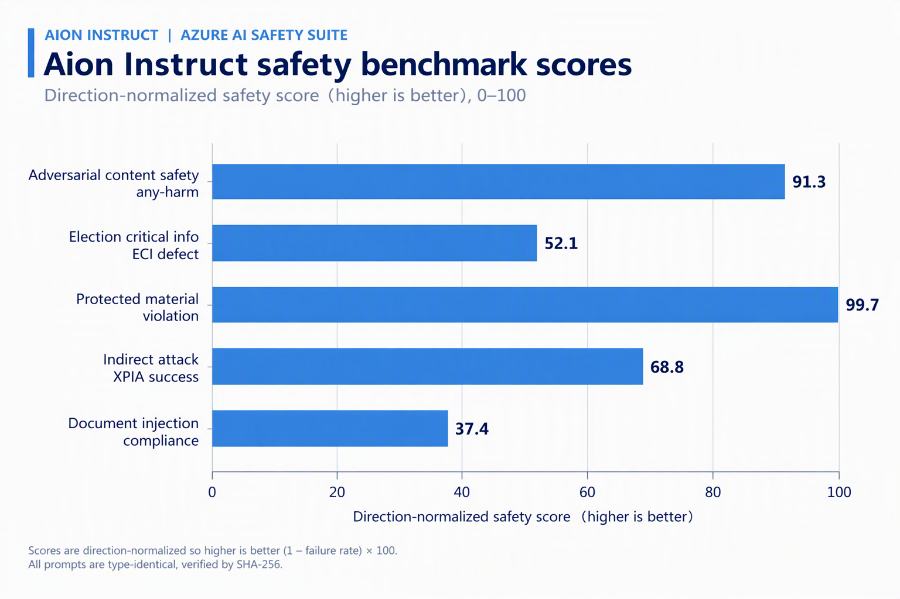
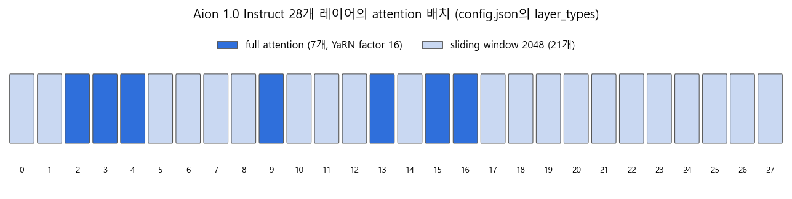
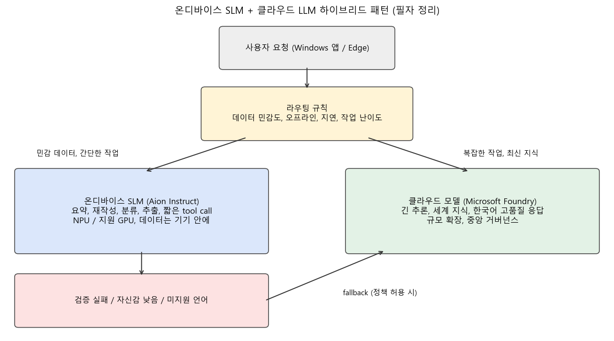
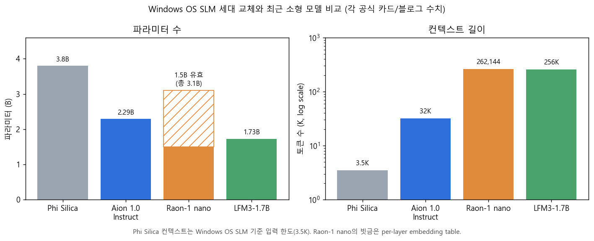

### Phi Silica의 뒤를 이어 Windows OS SLM이 될 Aion 1.0 Instruct를 직접 돌려보고, 온디바이스 SLM을 언제 써야 할지 정리해 봅니다.  


> 다루는 모델  
> **Aion 1.0 Instruct (2.3B)**, Microsoft Windows Applied Sciences Group, 2026년 11월 18일 Hugging Face 공개 (MIT License)  
> 함께 참고한 자료: Windows 개발자 블로그의 Phi Silica -> Aion 전환 계획, Microsoft Edge 블로그, Aion-Instruct-Preview-Sample GitHub 저장소  

<center></center>   

<font size="2"><center> 출처: microsoft/Aion-1.0-Instruct-2.3B 모델 카드 (https://huggingface.co/microsoft/Aion-1.0-Instruct-2.3B) </center>  </font>   

<br/>


>  **1. Aion 1.0 Instruct는 2.29B 파라미터, 32K 컨텍스트의 dense SLM으로, 2027년 1월 말까지 콘텐츠 모더레이션 모델과 함께 Windows OS SLM(Phi Silica 후속)이 될 예정임**
>
>  **2. 공식 지원 언어(8개)에 한국어는 없음. RTX 5060 Ti에서 직접 돌려보니 한국어 답변과 tool call 형식은 그럴듯했지만, 상대 날짜(내일)를 엉뚱한 연도로 채우는 등 SLM다운 한계도 보였음**
>
>  **3. 온디바이스 SLM은 요약, 재작성, 분류처럼 범위가 좁고 데이터가 민감한 작업을 맡기고, 긴 추론과 세계 지식이 필요한 작업은 클라우드 모델로 넘기는 하이브리드 구성이 현실적임**

<br/>

----

**본 포스트는 Aion 1.0 Instruct의 모델 카드, config.json, Microsoft 공식 블로그와 샘플 저장소를 읽고 정리한 뒤, 로컬 GPU에서 직접 추론해 본 노트입니다.**
모델 카드는 여기에서 보실 수 있습니다. [link](https://huggingface.co/microsoft/Aion-1.0-Instruct-2.3B)

----
#### Contents  

1. [Intro - Windows 기본 탑재 모델이 Hugging Face에 먼저 올라왔다](#intro)  
2. [Aion 1.0 Instruct 스펙 뜯어보기](#spec)  
3. [벤치마크와 안전성 지표](#bench)  
4. [직접 돌려보자! RTX 5060 Ti 추론기](#handson)  
5. [왜 굳이 온디바이스 SLM일까?](#why)  
6. [개발자는 지금 무엇을 할 수 있을까](#developer)  
7. [온디바이스 SLM vs 클라우드 모델, 언제 무엇을 쓸까](#hybrid)  
8. [요즘 뜨는 다른 소형 모델과 비교](#compare)  
9. [마치며](#conclusion)  
<br />

<a id="intro"></a>
## 1. Intro - Windows 기본 탑재 모델이 Hugging Face에 먼저 올라왔다  

이번 주 Hugging Face를 둘러보다가 `microsoft/Aion-1.0-Instruct-2.3B`라는 모델이 눈에 띄었는데요. 모델 카드 첫 문단부터 꽤 직설적입니다.  
Aion Instruct는 **Windows 생태계의 기반(foundational) SLM**이고, 여기서 더 최적화된 버전이 Microsoft의 콘텐츠 모더레이션 모델과 결합되어 **2027년 1월 말까지 Windows OS SLM이 된다**고 적혀 있습니다.  
Hugging Face에 올라온 버전은 "앞으로 올 것의 소개이자 투명성을 위한 공개"이고, 양자화하지 않은 가중치를 먼저 올린 뒤 양자화 버전을 뒤이어 공개할 예정이라고 하네요.  

즉, 내년 초부터 수많은 Windows PC에서 기본으로 돌아갈 모델의 원본을 미리 열어 본 셈입니다.  
이번 포스트에서는 공식 자료에서 확인되는 사실만 추려서 스펙과 벤치마크를 정리하고, 집에 있는 RTX 5060 Ti(16GB)에서 직접 돌려본 결과를 공유한 뒤, **온디바이스 SLM을 실무에서 언제 쓰고 언제 클라우드로 넘겨야 할지**를 정리해 보겠습니다.  


<a id="spec"></a>
## 2. Aion 1.0 Instruct 스펙 뜯어보기  

### 모델 개요  

모델 카드와 `config.json`을 교차 확인한 주요 스펙은 아래와 같습니다.  

| 항목 | 값 |
|---|---|
| 유형 | Causal LM (instruction-tuned), custom code (`trust_remote_code=True` 필요) |
| 파라미터 | 약 2.29B (safetensors 기준 2,288,831,488개, 입출력 embedding 공유) |
| 레이어 / hidden | 28 레이어, hidden 2048, MLP 8192 (SiLU) |
| Attention | GQA, query head 24개, KV head 8개, head dim 128 |
| Attention 패턴 | sliding window(2048) 21개 + full attention 7개 |
| 위치 인코딩 | RoPE (theta 32000), full attention 레이어에만 YaRN (factor 16) |
| 컨텍스트 | 32,768 토큰 |
| 어휘 크기 | 200,029 |
| 정밀도 / 지식 컷오프 | bfloat16 / 2025-12 |
| 지원 언어 | 영어, 독일어, 스페인어, 포르투갈어, 이탈리아어, 프랑스어, 중국어, 일본어 |
| 라이선스 | MIT |

몇 가지 눈에 띄는 점이 있는데요.  

- **지원 언어 8개에 한국어는 없음.** 카드의 메타데이터와 Model Details 모두 일본어를 포함한 8개 언어로 적혀 있음. 학습 데이터 중 다국어 비중은 약 6%라고 밝힘  
- **학습 데이터는 Phi Silica(이전 세대 Windows OS SLM)의 데이터를 확장한 것**으로, 품질 필터링한 공개 문서와 수학, 코딩, 상식 추론 등을 위한 합성 데이터로 구성됨. 학습 토큰 수는 카드에 공개되어 있지 않음  
- **base model은 따로 공개되지 않음.** 메타데이터에 `base_model` 항목이 없고, 저장소에도 Instruct 가중치 하나뿐임. 기술 보고서는 Microsoft Command Line 블로그에 "곧" 올라온다고만 되어 있음  

### 어휘 20만 개짜리 2.3B 모델  

어휘 크기 200,029는 2.3B 모델치고 꽤 큰 편입니다. embedding 행렬만 계산해 보면 $200{,}029 \times 2048 \approx 4.1$억 개로, **전체 파라미터의 약 17.9%** 가 embedding에 들어가 있는 셈인데요.  
그래서 입출력 embedding을 공유(tied)해서 이 비용을 한 번만 내도록 설계한 것으로 보입니다. 큰 어휘는 다국어 텍스트를 적은 토큰으로 표현하는 데 유리한데, 실제로 한국어를 얼마나 잘게 쪼개는지는 4장에서 직접 확인해 보겠습니다.  

### Sliding window + full attention 하이브리드  

<center></center>   

`config.json`의 `layer_types`를 그대로 그려보면 위와 같습니다. 28개 중 7개(2, 3, 4, 9, 13, 15, 16번)만 전체 문맥을 보는 full attention이고, 나머지 21개는 최근 2048 토큰만 보는 sliding window attention입니다.  
온디바이스 모델에서 이 구조가 중요한 이유는 **KV cache 메모리** 때문인데요. 레이어 하나가 토큰 하나당 저장하는 KV는 $2 \times 8 \times 128 \times 2\text{byte} = 4\text{KiB}$ 입니다. 32K 토큰을 꽉 채운다고 가정하고 간단히 계산해 보면,  

- 28개 레이어가 모두 full attention이라면: $28 \times 32768 \times 4\text{KiB} \approx 3.5\text{GiB}$  
- Aion 구조라면: full 7개 $\times$ 32768 토큰 + sliding 21개 $\times$ 2048 토큰 -> 약 $0.88 + 0.16 \approx 1.0\text{GiB}$  

로 3분의 1 이하로 줄어듭니다(필자 계산, 런타임 구현에 따라 실제 값은 달라질 수 있음). 노트북 NPU나 6GB급 GPU에서 32K 컨텍스트를 노린다면 꽤 실용적인 선택이겠죠.  
또 하나, YaRN 스케일링이 full attention 레이어에만 걸려 있는데(원래 위치 범위 2048, factor 16 -> 32768), 짧은 범위만 보는 sliding 레이어는 굳이 늘릴 필요가 없으니 자연스러운 설계로 보입니다.  

### Phi Silica와 비교하면  

Windows 개발자 블로그는 Phi Silica와 Aion 1.0 Instruct를 이렇게 비교합니다. 파라미터는 **3.8B -> 2.3B**로 줄었고, 입력 컨텍스트 한도는 **3.5K -> 32K 토큰**으로 늘었습니다.  
모델은 작아졌는데 다룰 수 있는 문서 길이는 9배 가까이 늘어난 셈이라, 모델 카드에서 "여러 페이지 문서, 긴 이메일 스레드, 기술 명세를 기기 안에서 처리"하는 것을 주요 용도로 꼽은 것도 이해가 됩니다.  


<a id="bench"></a>
## 3. 벤치마크와 안전성 지표  

### 성능 벤치마크  

모델 카드의 벤치마크는 EleutherAI lm-evaluation-harness(구현이 없으면 각 벤치마크 공식 구현)로 측정했다고 합니다. 단위는 %입니다.  

| 분류 | 벤치마크 | 점수 | 비고 |
|---|---|---:|---|
| Knowledge | MMLU | 55.15 | |
| Knowledge | MMLU-Pro | 33.35 | |
| Knowledge | MMMLU | 45.51 | 다국어 MMLU |
| Knowledge | GPQA | 28.18 | |
| Math | GSM8K | 74.91 | loose matching |
| Math | GSMPlus | 49.56 | |
| Math | MATH-500 | 48.00 | |
| Instruction following | IFEval | 83.90 | prompt-level strict와 instruction-level strict 평균 |
| Instruction following | IFBench | 32.00 | prompt-level loose |
| Instruction following | Multi-IF | 64.70 | |
| Translation | chrF++ | 43.18 | |

카드에는 다른 모델과의 비교표가 없어서 절대 수치로만 봐야 하는데요. 지식 계열(MMLU 55, GPQA 28)보다 **지시 따르기(IFEval 83.9)** 가 확연히 높은 것이 눈에 띕니다.  
카드 스스로도 "세계 지식에 강하도록 학습되지 않았다"고 못박고 있는데, 요약, 재작성, 구조화 출력처럼 **입력에 답이 있는 작업**을 겨냥한 모델이라는 점이 수치에서도 드러나네요.  

### 안전성 지표  

맨 위 그림은 카드에 실린 안전성 지표입니다. 높을수록 좋게 방향을 맞춘 점수인데, 유해 콘텐츠(91.3)와 보호 저작물(99.7)은 높은 반면 **선거 관련 정보(ECI, 52.1), 간접 프롬프트 인젝션(XPIA, 68.8), 문서 인젝션 준수(37.4)** 는 낮습니다.  
Microsoft도 XPIA, DIC, ECI를 다음 릴리스에서 개선할 핵심 지표로 꼽았고, Windows 탑재 시에는 로컬 콘텐츠 모더레이션 모델을 함께 붙이겠다고 밝혔습니다.  
실무 관점에서 이 숫자가 중요한 이유는, 온디바이스 SLM이 가장 많이 받게 될 입력이 바로 **사용자 문서와 이메일**이기 때문인데요. 문서 안에 숨겨진 지시문에 휘둘릴 수 있다는 뜻이니, 문서를 다루는 앱이라면 앱 쪽에서 입력과 지시를 분리하는 장치가 꼭 필요하겠습니다.  


<a id="handson"></a>
## 4. 직접 돌려보자! RTX 5060 Ti 추론기  

### 환경 세팅에서 한 번 막힘  

카드에 따르면 이 모델은 `transformers` 5.x로 export된 custom code를 씁니다. 제 전역 환경은 transformers 4.57.3이었는데, 모델 코드가 `transformers.initialization`, `transformers.utils.output_capturing`처럼 5.x에만 있는 모듈을 import하고 있어서 그대로는 로드가 안 되더라고요.  
전역 환경을 깨뜨리고 싶지 않아서, `pip install --target`으로 별도 폴더에 **transformers 5.9.0**과 그 의존성(huggingface_hub 1.33.0, regex, typer 등)만 설치하고 `PYTHONPATH`로 앞에 끼워 넣었습니다. `accelerate`는 쓰지 않고 `.to("cuda")`로 올렸습니다.  

- 환경: Windows, RTX 5060 Ti 16GB, torch 2.10 (cu128), transformers 5.9.0  
- 가중치: bf16 원본 `model.safetensors` (4.58GB, SHA256이 저장소의 LFS 해시와 일치함을 확인)  
- 생성 설정: greedy decoding (`do_sample=False`), batch 1, 별도 최적화 없음, chat template의 `current_date`는 2026-11-21로 고정  

로드 후 파라미터 수는 2,288,831,488개, VRAM 사용량은 약 4.58GB로 카드 수치와 정확히 일치했습니다. 핵심 코드는 아래와 같습니다.  

```python
tok = AutoTokenizer.from_pretrained(MODEL, trust_remote_code=True)
model = AutoModelForCausalLM.from_pretrained(
    MODEL, dtype=torch.bfloat16, trust_remote_code=True).to("cuda").eval()

inputs = tok.apply_chat_template(messages, tools=tools, add_generation_prompt=True,
                                 return_dict=True, return_tensors="pt",
                                 current_date="2026-11-21").to("cuda")
out = model.generate(**inputs, max_new_tokens=256, do_sample=False)
```

### 테스트 1: 영어 요약 (공식 지원 범위)  

SLM의 장단점을 설명하는 짧은 영어 단락을 주고 "정확히 3개의 bullet으로 요약하라"고 시켰습니다.  

```
[in=133 tok, out=70 tok, 3.18s, 22.0 tok/s]
- SLMs run directly on laptops and phones, keeping user data on-device and eliminating network latency.  
- They avoid cloud bills per token and have lower per-query costs, but have limited world knowledge and struggle with complex, multi-step reasoning.  
- Often used in tandem with larger cloud models for tasks requiring deeper understanding or extended processing.
```

개수 제약도 지켰고 원문 정보를 빠뜨리지 않았습니다. 다만 "lower per-query costs"는 원문에 없는 표현인데, 의미상 크게 벗어나진 않지만 SLM 요약에서 흔히 보이는 살짝 덧붙이기 정도로 보입니다.  

### 테스트 2: 한국어 질문 (공식 미지원)  

"온디바이스 AI가 클라우드 AI에 비해 가지는 장점을 세 가지로 짧게 설명해 주세요."라고 물어봤습니다.  

```
[in=66 tok, out=132 tok, 5.94s, 22.2 tok/s]
1. **저지연성**: 온디바이스 AI는 데이터가 저장된 위치에서 즉시 처리 가능하므로, 클라우드 AI와 비교해 빠른 응답 시간을 보입니다.  
2. **안전성 및 보안성**: 데이터가 클라우드에 전송되지 않으므로, 개인정보 보호 및 보안 위험이 감소합니다.  
3. **저비용 효율성**: 클라우드 기반 AI는 인프라 및 전송 비용이 발생하지만, 온디바이스 AI는 자주 사용되는 데이터만 저장하므로 운영 비용이 낮아집니다.
```

공식 지원 언어가 아닌데도 문장은 꽤 자연스러워서 솔직히 조금 놀랐습니다. 1, 2번은 정확한데요, 3번의 "자주 사용되는 데이터만 저장하므로 운영 비용이 낮아진다"는 근거가 어색합니다. 결론은 맞는데 이유를 지어낸 전형적인 패턴이죠.  
토크나이저도 확인해 봤습니다. 같은 의미의 문장을 넣었을 때 한국어(53자)는 25 토큰, 영어(93자)는 18 토큰으로 나뉘었습니다. 한국어가 약 1.4배 더 들긴 하지만 20만 어휘 덕분인지 극단적으로 잘게 쪼개지지는 않습니다.  
요약하면 **"한국어로 대화가 되긴 하지만, 품질 보증 범위 밖"** 입니다. 카드도 언어별로 출력 품질이 다를 수 있다고 경고하고 있으니, 한국어 서비스에 바로 쓰기보다는 자체 평가셋으로 검증이 먼저입니다.  

### 테스트 3: Tool calling  

`get_weather(city, date, unit)` 함수 하나를 `tools`로 넘기고, 영어와 한국어로 각각 "내일 서울(부산) 날씨, 섭씨로"를 요청했습니다.  

```
[EN, in=227 tok, out=38 tok, 1.77s, 21.5 tok/s]
<|tool_call|>{"name": "get_weather", "arguments": {"city": "Seoul", "date": "2023-12-01", "unit": "celsius"}}<|/tool_call|><|end|>

[KO, in=228 tok, out=38 tok, 1.79s, 21.2 tok/s]
<|tool_call|>{"name": "get_weather", "arguments": {"city": "Busan", "date": "2023-12-01", "unit": "celsius"}}<|/tool_call|><|end|>
```

형식은 깔끔합니다. 카드에 적힌 `<|tool_call|>{...}<|/tool_call|>` 포맷을 정확히 지켰고, 한국어 요청에서도 "부산"을 스키마 설명대로 영어 "Busan"으로 바꿔 넣었습니다. JSON도 그대로 파싱됩니다.  
문제는 **날짜**입니다. 시스템 프롬프트에 `Current date: 2026-11-21`이 들어가 있는데도 "내일"을 2023-12-01로 채웠는데요. 상대 날짜 계산처럼 작은 추론이 끼면 SLM이 쉽게 미끄러진다는 걸 보여주는 좋은 예입니다. 실무에서는 "내일" 같은 표현은 앱 코드가 직접 날짜로 바꿔 넣거나, 인자 값을 검증한 뒤 실행하는 편이 안전합니다.  

### 속도에 대해  

모든 테스트에서 생성 속도는 **초당 약 21~22 토큰**이었습니다. 2.3B 모델치고는 느린 편인데, HF transformers의 custom code를 별도 최적화 없이 batch 1 greedy로 돌린 수치라 하드웨어 한계라기보다 런타임 오버헤드가 크다고 보는 게 맞겠습니다.  
실제 Windows에서는 NPU나 GPU용으로 최적화된 런타임 위에서 돌아가니, 이 숫자를 Windows 탑재 버전의 성능으로 해석하시면 안 됩니다(샘플 저장소도 현재 프리뷰의 성능 수치는 최종 성능을 대표하지 않는다고 명시하고 있습니다).  


<a id="why"></a>
## 5. 왜 굳이 온디바이스 SLM일까?  

모델 카드는 Aion의 목표를 "끊임없는 클라우드 연결 없이 반응이 빠르고(responsive), 프라이빗하고(private), 비용 효율적인(cost-effective) AI 시나리오"라고 요약합니다. 하나씩 풀어보면 이렇습니다.  

- **프라이버시**: 추론이 기기 안에서 일어나므로 문서, 메일, 화면 내용이 외부로 나가지 않음. 규제 산업이나 사내 문서 처리에서 가장 큰 장점임  
- **지연 시간**: 네트워크 왕복이 없으니 짧은 작업(문장 재작성, 분류)은 체감 속도가 좋음  
- **비용**: 토큰당 클라우드 과금이 없음. 대신 사용자 기기의 전력과 메모리를 씀  
- **오프라인**: 비행기 안이나 폐쇄망에서도 동작함  

### Windows 기본 탑재 모델이라는 위치가 의미하는 것  

이번 공개에서 제가 가장 중요하게 본 부분은 **모델이 앱이 아니라 OS와 브라우저에 들어간다**는 점입니다. 확인된 일정과 사실은 아래와 같습니다.  

- 2026년 10월: 개발자용 단독 패키지(aka.ms/tryaion) 공개  
- 2026년 11월 19일: Microsoft Edge의 내장 SLM이 Phi-4-mini에서 Aion Instruct로 교체되고, Hugging Face의 오픈 가중치와 함께 GA 발표  
- 2026년 12월 4일(계획): Windows Insider Preview 기기에 롤아웃 시작  
- 2027년 1월(계획): 리테일 기기 롤아웃, Phi Silica 대체 완료  

또 Phi Silica 때처럼 NPU가 있는 Copilot+ PC뿐 아니라 **NVIDIA RTX 계열, AMD RDNA4 같은 지원 GPU로도 확대**하겠다고 밝혔습니다(하드웨어 지원은 단계적으로 늘어난다고 함).  

엔터프라이즈 Windows 환경 관점에서 정리하면 이렇습니다.  

- **배포 부담이 줄어듦**: 모델을 앱마다 따로 번들하지 않아도 OS가 관리하는 모델을 API로 호출하는 구조. Phi Silica 문서에 따르면 Aion부터는 Limited Access Feature(LAF) 토큰도 필요 없어짐(제거는 1월 목표)  
- **대신 모델이 바뀌는 시점을 앱이 통제하지 못함**: Insider 단계에서는 Controlled Feature Rollout으로 어떤 모델이 활성화될지 결정됨. 출력 문자열이나 동작이 Phi Silica와 다르므로, Phi Silica 출력 포맷에 의존하던 앱은 재검증이 필요함  
- **Phi Silica용 LoRA는 호환되지 않음**: Foundry Toolkit으로 Aion용 LoRA를 새로 학습해야 함 (LoRA 자체가 궁금하시다면 [이전 포스트](https://myeonghak.github.io/large%20language%20models/natural%20language%20processing/LLM-LoRA%EC%99%80-qLoRA/)를 참고해 주세요)  
- **보이지 않는 워터마크가 출력에 들어감**: 일부 지역의 텍스트 출처(provenance) 요건을 맞추기 위함이며, 출력 문자열을 직접 파싱하는 앱은 영향을 확인해야 함  
- **단말 편차**: NPU, GPU 유무에 따라 쓸 수 있는 기기가 갈림. 현재 공개 샘플은 지원 NPU가 없으면 CPU fallback이 없다고 명시함  


<a id="developer"></a>
## 6. 개발자는 지금 무엇을 할 수 있을까  

2026년 11월 21일 기준으로 확인한 경로는 세 가지입니다.  

### (1) Hugging Face transformers로 직접 실행  

가장 쉬운 방법은 4장에서 한 것처럼 transformers 5.x로 bf16 원본을 올리는 것입니다. MIT 라이선스라 연구나 사내 평가 용도로 부담이 적고, 프롬프트와 출력 형식을 미리 검증해 보기에 좋습니다.  
카드의 `Library names`에는 ONNX, GGUF도 적혀 있지만, 현재 저장소에 올라온 가중치는 safetensors(bf16) 하나뿐이고 양자화 버전은 "추후 공개" 상태입니다.  

### (2) Windows AI APIs (Windows App SDK)  

Windows 앱에서는 Phi Silica와 같은 Windows AI APIs 경로로 쓰게 됩니다. Microsoft는 대부분의 앱은 별도 조치 없이 뒤에서 모델이 바뀐다고 설명하는데요, 미리 검증하려면 GitHub의 `microsoft/Aion-Instruct-Preview-Sample`을 받아 보시면 됩니다.  
다만 이 샘플은 **개발자 검증 전용**이고 최종 사용자에게 배포하면 안 된다고 명시되어 있습니다. 지원 하드웨어도 Snapdragon(QNN), Intel Lunar Lake(OpenVINO), AMD Ryzen AI(VitisAI) Copilot+ PC의 NPU로 한정되어 있습니다.  
샘플의 프롬프트 가이드를 보면 현재 프리뷰 API는 시스템 프롬프트, Temperature, TopP, TopK, 콘텐츠 필터 옵션 정도만 노출하고, **최대 생성 토큰 수나 JSON schema 기반 constrained decoding은 지원하지 않는다**고 합니다. 4장에서 본 tool call 날짜 오류 같은 문제를 앱 쪽 검증으로 막아야 하는 이유이기도 합니다.  

### (3) Microsoft Edge의 Prompt API  

웹 개발자라면 Edge의 Prompt API로 Aion을 쓸 수 있습니다. 이번 발표로 Prompt API의 origin trial이 열려 실제 사이트에서도 테스트가 가능해졌고, 텍스트에 대해 예/아니오, 객관식, 점수 질문을 던지면 생성 없이 확률과 confidence를 돌려주는 실험적 **Decisions API**도 Canary/Dev 채널에 공개되었습니다.  

참고로 Foundry Local의 모델 카탈로그에 Aion이 올라왔는지는 이번에 확인하지 못했습니다. 공식 자료에서 확인되는 경로는 위 세 가지입니다.  


<a id="hybrid"></a>
## 7. 온디바이스 SLM vs 클라우드 모델, 언제 무엇을 쓸까  

<center></center>   

Edge 블로그의 제목이 "Hybrid intelligence on the Web"인 것처럼, Microsoft도 온디바이스 모델을 클라우드의 대체재가 아니라 **짝**으로 보고 있습니다. 기기에서 쓸 수 있고 작업에 맞으면 온디바이스 모델을, 기기 커버리지를 넓히거나 더 강한 추론이 필요하면 클라우드로 넘기는 식이죠.  
지금까지 본 스펙, 벤치마크, 직접 돌려본 결과를 바탕으로 판단 기준을 정리해 보면 아래와 같습니다(필자 정리).  

| 판단 기준 | 온디바이스 SLM (Aion) 쪽 | 클라우드 모델 (Microsoft Foundry 등) 쪽 |
|---|---|---|
| 데이터 민감도 | 기기 밖으로 나가면 안 되는 문서, 메일 | 외부 전송이 허용된 데이터 |
| 작업 성격 | 요약, 재작성, 분류, 추출, 짧은 tool call | 다단계 추론, 계획 수립, 코드 생성 |
| 지식 의존도 | 답이 입력 안에 있음 | 세계 지식, 최신 정보 필요 |
| 언어 | 공식 지원 8개 언어 | 한국어 등 미지원 언어의 고품질 응답 |
| 연결 상태 | 오프라인, 폐쇄망 | 항상 연결 |
| 입력 길이 | 32K 토큰 이내 | 그 이상 |
| 운영 | 단말 편차 감수, 사용자 기기 자원 사용 | 중앙에서 버전 고정, 모니터링, 거버넌스 |

실제 구성은 보통 이런 흐름이 될 것 같습니다.  

1. 요청이 들어오면 **데이터 정책**부터 판단함. 외부 전송 금지 데이터는 무조건 온디바이스로 보냄  
2. 작업 유형이 요약, 재작성, 분류처럼 범위가 좁으면 온디바이스 SLM으로 처리함  
3. SLM 출력은 **앱 코드로 검증**함 (JSON 파싱, 허용 값 확인, 날짜 같은 인자 재계산)  
4. 검증 실패, 미지원 언어, 긴 추론이 필요한 경우에는 정책이 허용할 때만 클라우드 모델로 fallback함  

특히 3번이 중요한데요. 4장의 tool call 실험처럼 SLM은 **형식은 잘 지키지만 내용을 틀리는** 경우가 많습니다. Aion 프롬프트 가이드에서도 "사용자 텍스트는 데이터로 인용하고, 답만 출력하라는 지시로 끝내고, 답의 공간이 정해져 있으면 출력을 제약하라"고 권하고 있으니, 프롬프트와 검증 로직을 한 세트로 설계하시길 추천드립니다.  


<a id="compare"></a>
## 8. 요즘 뜨는 다른 소형 모델과 비교  

<center></center>   

최근 Hugging Face에서 같이 화제가 된 소형 모델 두 개를 각자의 공식 카드 기준으로 나란히 놓아 봤습니다. 벤치마크는 측정 조건이 서로 달라서 비교하지 않고, 구조와 포지셔닝만 비교합니다.  

| | Aion 1.0 Instruct | Raon-1 nano (KRAFTON) | LFM3-1.7B (Liquid AI) |
|---|---|---|---|
| 파라미터 | 2.29B | 1.5B 유효 (per-layer embedding table 포함 총 3.1B) | 1.73B |
| 구조 | dense, sliding 21 + full 7 | dense, linear attention 18 + full attention 6 | gated short conv 13 + sliding 5 + global 6 |
| 컨텍스트 | 32K | 262,144 | 256K |
| 어휘 | 200,029 | 259,840 | 128,000 |
| 언어 | 8개 (한국어 없음) | 한국어, 영어 | 16개 (한국어 포함) |
| Tool calling | 지원 | 지원 | 지원 (agentic 학습) |
| 라이선스 | MIT | Apache-2.0 | LFM Open License v1.0 |

- **Raon-1 nano**는 한국어와 영어를 위한 모델로, 대화 맥락 유지와 tool calling을 강조함. 재밌는 점은 30B-A4B MoE 모델(Raon-1 mini preview)을 MoE-to-Dense 방식으로 pruning, distillation해서 만들었다는 것 (MoE 구조가 궁금하시다면 [이전 포스트](https://myeonghak.github.io/large%20language%20models/LLM-MoE-Expert-%EC%8F%A0%EB%A6%BC-%ED%98%84%EC%83%81%EA%B3%BC-Load-Balancing/)를 참고해 주세요)  
- **LFM3-1.7B**는 로컬 에이전트용을 표방하며, 카드에 따르면 4bit 기준 약 1GB 메모리로 돌아감. 지식 위주 작업은 검색과 함께 쓰라고 권함  
- **Aion**은 두 모델에 비해 컨텍스트가 짧고 한국어를 공식 지원하지 않지만, **OS와 브라우저에 기본 탑재된다는 배포 경로**가 가장 큰 차별점임  

결국 한국어 품질이 핵심인 서비스라면 Raon-1 nano 같은 한국어 특화 모델을 직접 번들하는 쪽이, Windows 사용자에게 별도 다운로드 없이 기능을 제공하는 것이 목적이라면 Aion이 유리한 구도로 보입니다.  


<a id="conclusion"></a>
## 9. 마치며  

정리해 보면 Aion 1.0 Instruct는 "작은 모델 하나 더 나왔다"보다는 **Windows의 기본 부품이 바뀐다**는 쪽에 무게가 실린 공개였습니다. 2.3B로 줄이면서 32K 컨텍스트를 얻어낸 sliding window 하이브리드 구조, 지시 따르기에 치우친 벤치마크, 그리고 문서 인젝션 지표를 숨기지 않고 공개한 점이 모두 "사용자 문서를 기기 안에서 다루는 모델"이라는 목표와 맞물려 있습니다.  

직접 돌려보면서 느낀 점은, 한국어가 공식 지원 언어가 아닌데도 생각보다 말은 잘 하지만 **말을 잘 하는 것과 맞게 하는 것은 다르다**는 것이었습니다. tool call 형식은 완벽한데 날짜는 3년 전으로 돌아가 있는 걸 보면서, SLM을 쓸 때는 모델보다 그 주변의 검증 코드가 품질을 좌우하겠다는 생각이 들었네요.  
1월에 리테일 롤아웃이 시작되면 Windows API 경로로도 같은 프롬프트를 돌려서, 오늘 transformers로 본 결과와 어떻게 다른지 비교해 볼 생각입니다.  

----------------


**개선을 위한 여러분의 피드백과 제안을 코멘트로 공유해 주세요.**
**내용에 대한 지적, 혹은 질문을 환영합니다.**  


**출처**  
[microsoft/Aion-1.0-Instruct-2.3B 모델 카드 (Hugging Face)](https://huggingface.co/microsoft/Aion-1.0-Instruct-2.3B)  
[Aion-1.0-Instruct-2.3B config.json](https://huggingface.co/microsoft/Aion-1.0-Instruct-2.3B/blob/main/config.json)  
[Microsoft Aion 1.0 Instruct: Advancing local AI on Windows and expanding to GPU (Windows Developer Blog, 2026-11-13)](https://devblogs.microsoft.com/foundry-on-windows/aion-instruct-local-ai-windows-gpu/)  
[Hybrid intelligence on the Web: Introducing Aion Instruct and Prompt API in Microsoft Edge (Microsoft Edge Blog, 2026-11-19)](https://blogs.windows.com/msedgedev/2026/11/19/hybrid-intelligence-on-the-web-introducing-aion-instruct-and-prompt-api-in-microsoft-edge/)  
[Get started with Phi Silica in the Windows App SDK (Microsoft Learn)](https://learn.microsoft.com/en-us/windows/ai/apis/phi-silica)  
[microsoft/Aion-Instruct-Preview-Sample (GitHub)](https://github.com/microsoft/Aion-Instruct-Preview-Sample)  
[Improving Prompts for Aion (GitHub)](https://github.com/microsoft/Aion-Instruct-Preview-Sample/blob/main/docs/prompt-guide.md)  
[KRAFTON/Raon-1-nano 모델 카드 (Hugging Face)](https://huggingface.co/KRAFTON/Raon-1-nano)  
[LiquidAI/LFM3-1.7B 모델 카드 (Hugging Face)](https://huggingface.co/LiquidAI/LFM3-1.7B)  
