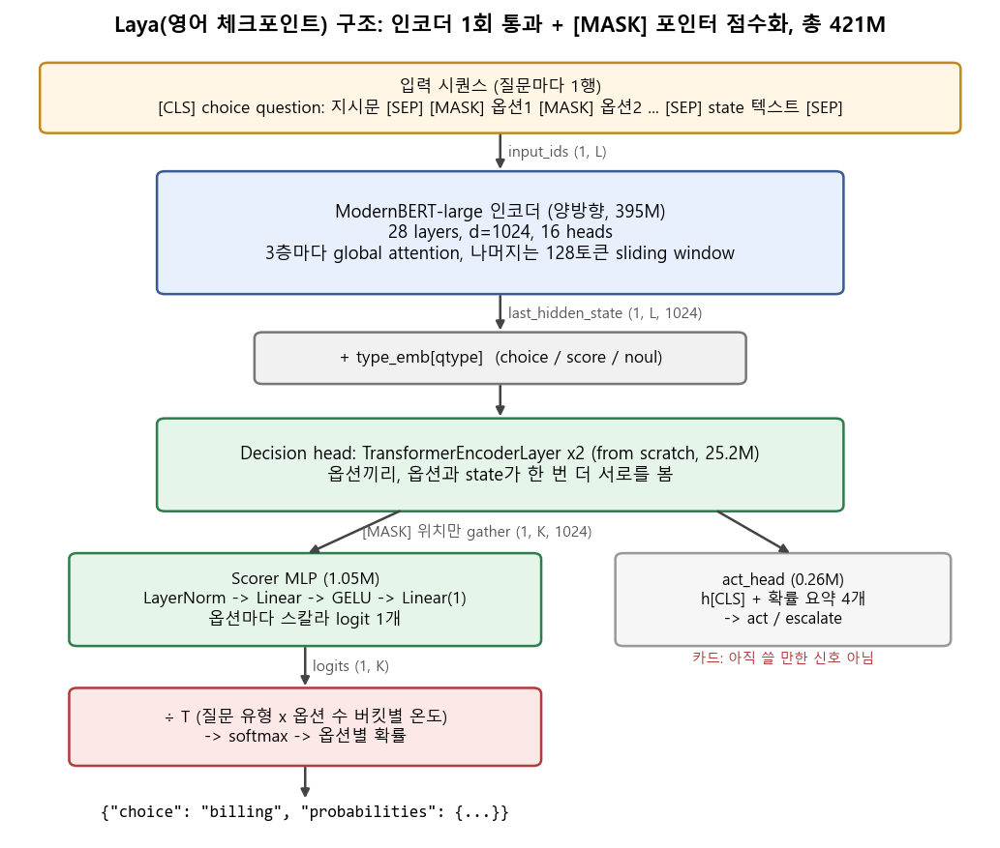
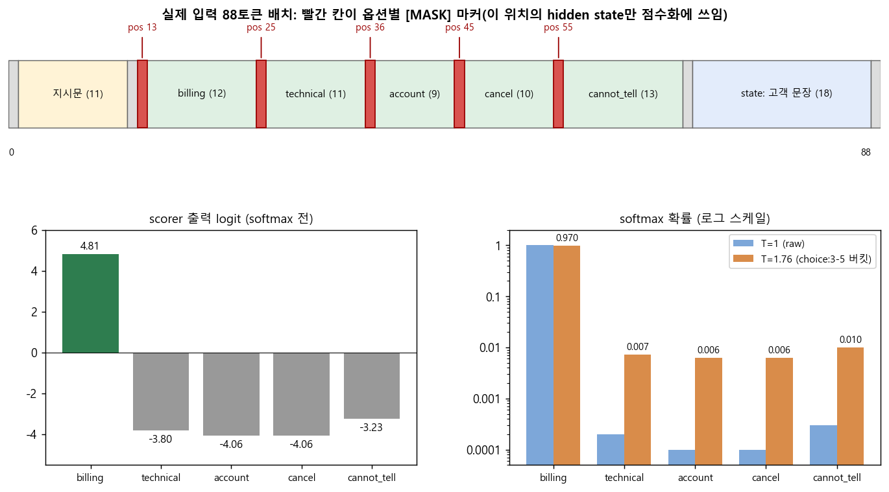
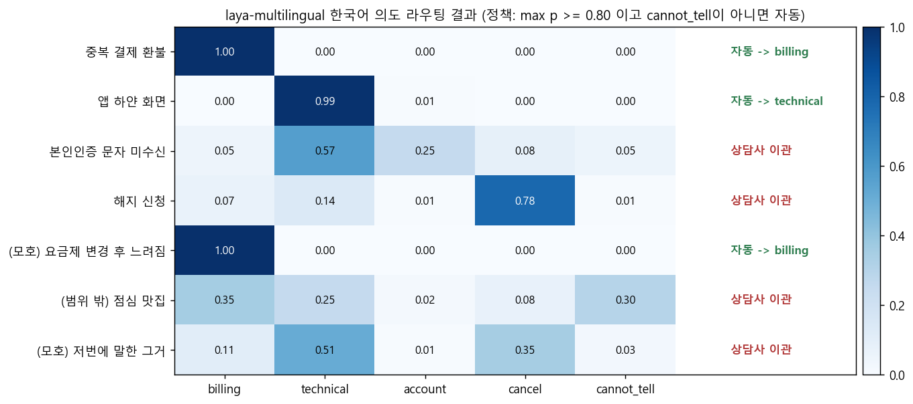
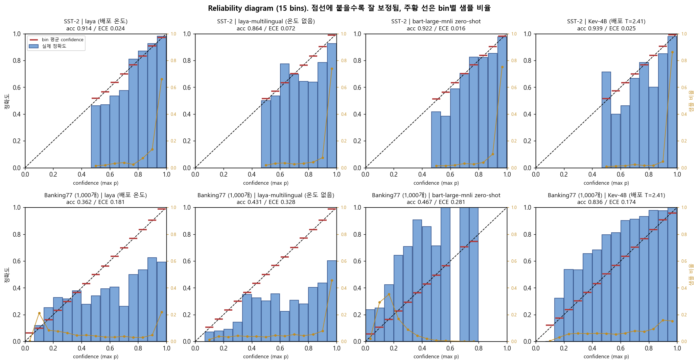
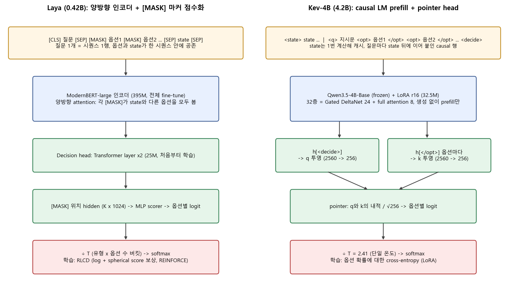

### 오픈 Decision 모델 Laya를 개인 PC의 GPU에 올려서, 결정이 어디서 나오는지 forward pass를 따라가 보고 보정(calibration)까지 직접 재 봅니다.

지난 포스트 [Decision 모델과 RLCD](https://myeonghak.github.io/large%20language%20models/LLM-Decision-%EB%AA%A8%EB%8D%B8%EA%B3%BC-RLCD/)에서 "글을 쓰지 않고 보기별 확률로 답하는" Decision 모델의 개념과 RLCD를 정리했는데요. 이번에는 직접 손으로 만져보는 편입니다.

> 다루는 자료  
> **Laya** (`convaiinnovations/laya`, Apache-2.0) 모델 카드, 체크포인트에 동봉된 추론 코드(`rl_common.py`, `rl_agent_api.py`), pip 패키지 `laya` 0.5.3  
> **From Laya to Vega: Open Non-Autoregressive Decision Models with Calibrated Probabilities** (N. M, A. M, Preprints 2026, doi:10.20944/preprints202611.0781.v1)  
> **Kev-4B** (`jaredpalmer/kev-4b`, Apache-2.0) 모델 카드와 github.com/jaredpalmer/kev 코드  

<center></center>  

<br/>


>  **1. Laya는 생성형 LLM이 아니라 ModernBERT-large 인코더(395M) 위에 2층 decision head를 얹은 421M짜리 모델임. 보기마다 [MASK] 마커를 하나씩 끼워 넣고, 그 위치의 hidden state를 MLP로 점수화해 softmax하므로 1회 forward pass로 보기별 확률이 나옴**
>
>  **2. RTX 5060 Ti에서 질문 1개 p50 43.5ms(영어)와 27.6ms(다국어), 배치로는 초당 100~238건을 처리함. 한국어 상담 라우팅에서 명확한 문의는 잘 골랐지만, 모호한 문의에 billing 1.00을 주는 등 confidence만으로는 모호함을 잡아내지 못하는 경우가 있었음**
>
>  **3. 보정은 모델의 고정된 속성이 아니라 질문 형태마다 다시 재야 하는 값임. SST-2(2지선다)는 ECE 0.024로 양호했지만 Banking77(77지선다)은 정확도 0.362, 배포 온도를 그대로 쓰면 ECE 0.550까지 나빠짐. 같은 크기의 zero-shot NLI baseline(bart-large-mnli)이 두 데이터셋 모두에서 비슷하거나 더 나았음**

<br/>

----

**본 포스트는 공개 Decision 모델 Laya와 Kev-4B를 개인 PC(RTX 5060 Ti 16GB)에서 직접 돌려보고 정리한 실습 노트입니다.**
본문의 출력과 숫자는 모두 실제로 실행한 결과이며, 모델 카드의 숫자와 다를 때는 둘 다 적었습니다. 전체 스크립트는 실습 코드 폴더에 따로 정리해 두었고, 본문에는 핵심만 짧게 옮겼습니다.

----
#### Contents

1. [실습 환경](#env)
2. [Laya는 어떻게 생겼나](#arch)
3. [한 번의 forward pass로 결정이 나오는 과정](#trace)
4. [상담 의도 라우팅 예제](#routing)
5. [속도는 얼마나 나올까?](#speed)
6. [보정 측정: ECE와 reliability diagram](#calib)
7. [Kev-4B와의 구조 비교](#kev)
8. [한계와 주의점](#limits)
9. [마치며](#conclusion)
<br />

<a id="env"></a>
## 1. 실습 환경

| 항목 | 내용 |
|---|---|
| GPU | NVIDIA GeForce RTX 5060 Ti 16GB (다른 프로세스가 약 5.7GB를 이미 쓰고 있던 공유 상태) |
| OS / Python | Windows, Python 3.10, torch 2.10 (cu128) |
| 격리 환경 | 실습 폴더 아래 venv(`--system-site-packages`)에 `transformers 5.20.2`, `laya 0.5.3`(`[serve]` 포함), `peft 0.21.3` 설치 |
| 평가 데이터 | SST-2 validation 872개, Banking77 test에서 무작위 1,000개 (seed 0) |

전역 파이썬에는 transformers 4.x가 깔려 있었는데요, Laya 체크포인트의 `encoder/config.json`이 transformers 5.0 형식(`rope_parameters`)으로 저장되어 있어서 격리된 venv에 5.x를 따로 설치했습니다. 설치는 이게 전부입니다.

```bash
pip install "transformers>=5" "laya[serve]" peft
```

한 가지 짚고 갈 점이 있습니다. 모델 카드 상단은 0.5 버전에서 추가된 **vegaml 엔진**(frozen LLM을 reader로 쓰고 그 위에 작은 decision engine을 얹는 방식)을 소개하는데, Hugging Face 저장소에 올라가 있는 421M 체크포인트는 그 이전부터 있던 **classic encoder** 계열입니다. 카드에 따르면 `laya.load("convaiinnovations/laya")`처럼 체크포인트 이름을 지정하면 classic encoder가 로드되고, 이번 실습은 전부 이 classic encoder를 대상으로 했습니다.

GPU를 다른 프로세스와 나눠 쓰는 상태였기 때문에, 아래의 속도 숫자는 "전용 GPU였다면 이보다 조금 더 빠를 수 있다" 정도로 읽어주시면 됩니다.


<a id="arch"></a>
## 2. Laya는 어떻게 생겼나

### 모델 카드에서 확인한 사실

Laya 저장소에는 체크포인트 3개가 함께 들어 있습니다. 이번에 주로 쓴 것은 앞의 두 개입니다.

| | `laya` (루트) | `laya-multilingual` | `laya-typed-decisions` |
|---|---|---|---|
| 백본 인코더 | ModernBERT-large (28층, d=1024) | mmBERT-base (22층, d=768, vocab 256k) | ModernBERT-large |
| 파라미터 | 421M | 322M | 421M |
| 문맥 (`max_len` / 보기 예산 `head_max_len`) | 512 / 192 | 1,024 / 256 (최대 8,192) | 1,024 / 256 |
| 동봉된 온도 | 질문 유형 x 보기 개수 버킷별로 fit된 값 | 없음 (전부 1.0) | 버킷별 값 |
| 학습 기록 (`rl_agent_config.json`) | 7,313 updates, 1.96시간 (기존 체크포인트에서 이어서) | 15,987 updates, 4 epochs, 4.97시간 | 카드 기준 typed-decisions 벤치마크로 fine-tune |

- 질문 유형은 세 가지임: `choice`(보기 중 선택), `score`(순서형 등급, 기댓값을 점수로 반환), `noul`(예/아니오 확률)
- 출력은 타입이 정해진 JSON임: `choice`, `probabilities`, `confidence`(정규화 엔트로피 기반), `answer_confidence`(max p)
- 한국어는 `laya-multilingual`의 지원 언어 목록에 `ko`로 들어 있고, `Router`가 문자 체계를 보고 자동으로 다국어 체크포인트로 보냄
- 학습은 카드 기준 **RLCD**: 보기 분포를 출력하고, logit에 Gaussian noise를 더해 탐색하며, strictly proper scoring rule(log score + spherical score, `score` 유형은 RPS 추가)을 보상으로 REINFORCE + group-mean baseline(GRPO 스타일)으로 업데이트함. 멀티턴은 prefix 단위 TD(λ=1.0)

보상 함수는 체크포인트에 같이 들어 있는 `rl_common.py`에서 그대로 확인할 수 있는데요, 핵심은 이 몇 줄입니다.

```python
logq = torch.log(q.clamp_min(1e-12)).clamp_min(log_floor)
log_score = (target * logq).sum(-1)                       # 정답 보기에 준 확률의 log
sph = (target * q).sum(-1) / q.norm(dim=-1).clamp_min(1e-9)  # spherical score
r = log_score + w_sph * sph                               # 둘 다 strictly proper
```

둘 다 "진짜로 믿는 확률을 그대로 말할 때" 기대 보상이 최대가 되는 scoring rule이라, 이론상 모델이 확률을 부풀리거나 깎을 이유가 없어지는 구조입니다. 물론 이론과 실측은 다를 수 있으니 6장에서 직접 재 보겠습니다.

### 모듈 트리와 파라미터 분해

체크포인트에 동봉된 `rl_agent_api.RLAgent`로 모델을 올리고 파라미터를 모듈별로 세어 봤습니다.

```text
== parameter breakdown ==
encoder.embeddings                          51.58 M  ( 12.2%)
encoder.layers (28)                        343.20 M  ( 81.5%)
encoder.final_norm                           0.00 M  (  0.0%)
type_emb                                     0.00 M  (  0.0%)
head (2x TransformerEncoderLayer)           25.19 M  (  6.0%)
scorer (MLP -> 1)                            1.05 M  (  0.2%)
act_head                                     0.26 M  (  0.1%)
TOTAL                                      421.29 M

== module tree (depth 2) ==
encoder: ModernBertModel
   embeddings: ModernBertEmbeddings
   layers: ModuleList x28
   final_norm: LayerNorm
   rotary_emb: ModernBertRotaryEmbedding
head: TransformerEncoder
   layers: ModuleList x2
type_emb: Embedding
scorer: Sequential        # LayerNorm -> Linear(1024,1024) -> GELU -> Linear(1024,1)
act_head: Sequential      # Linear(1028,256) -> GELU -> Linear(256,2)
```

카드의 "421M total"과 정확히 맞고, 무게의 94%가 인코더에 있습니다. 결정을 위해 새로 붙인 부분은 2층짜리 Transformer head(25M)와 1M짜리 scorer가 거의 전부인데요. 맨 위 그림이 이 구조를 데이터 흐름 순서로 그린 것입니다. 정리하면 다음과 같습니다.

- **인코더**: 양방향(bidirectional) ModernBERT-large. 3층마다 global attention, 나머지 층은 128토큰 sliding window attention (`encoder/config.json`의 `layer_types`)
- **type_emb**: 질문 유형(choice/score/noul) 임베딩을 모든 토큰의 hidden state에 더함
- **decision head**: `nn.TransformerEncoderLayer` 2개 (16 heads, FFN 4096). 처음부터 학습됨
- **scorer**: 보기별 [MASK] 위치 hidden state 하나를 받아 스칼라 logit 하나를 냄. 모든 보기가 **같은 scorer를 공유**하므로 보기 개수와 이름을 요청 시점에 마음대로 정할 수 있음
- **act_head**: `h[:, 0]`(CLS)과 확률 분포 요약값 4개(top1, top1-top2, 정규화 엔트로피, 보기 수)를 받아 act/escalate를 냄. 카드 스스로 "아직 쓸 만한 신호가 없음(#185)"이라고 밝히고 있음


<a id="trace"></a>
## 3. 한 번의 forward pass로 결정이 나오는 과정

이제 요청 하나를 넣고 forward pass 중간중간에 hook을 걸어 텐서를 들여다보겠습니다. 상담 문의 한 문장과 보기 5개(billing / technical / account / cancel / cannot_tell)를 썼습니다.

### 입력은 이렇게 직렬화됩니다

`rl_common.build_sequence`의 docstring에 형식이 그대로 적혀 있습니다.

```text
[CLS] <type> instructions [SEP] [MASK] opt0 [MASK] opt1 ... [SEP] state [SEP]
```

실제로 만들어진 시퀀스를 디코딩해 보면 다음과 같습니다.

```text
len(input_ids) = 88  marker positions = [13, 25, 36, 45, 55]
decoded: [CLS]choice question: Which team should handle this customer message?[SEP][MASK] billing: charges, invoices, payments, refunds[MASK] technical: app errors, outages, connection problems[MASK] account: login, password, profile changes[MASK] cancel: the customer wants to terminate the service[MASK] cannot_tell: not enough information or unrelated to our service[SEP]Hi, I was charged twice for my October bill. Can you refund the duplicate payment?[SEP]
tokens around markers: [['[MASK]', 'Ġbilling', ':'], ['[MASK]', 'Ġtechnical', ':'], ...]
```

재미있는 점은 **질문과 보기가 state보다 앞에** 온다는 것인데요. 문서가 길어서 잘려도 보기 쪽은 살아남도록 보기에 별도 예산(`head_max_len`)을 먼저 떼어 주고, 남은 길이를 state에 쓰는 방식입니다. 보기가 많아서 예산을 넘으면 모든 보기 텍스트를 똑같이 잘라냅니다. 이 부분이 6장의 Banking77 결과와 직접 연결됩니다.

<center></center>  

### 텐서 shape 따라가기

```text
input_ids (1, 88) | marker_pos (1, 5) | qtype [0]
encoder.last_hidden_state                (1, 88, 1024) torch.float32
head_out                                 (1, 88, 1024) torch.float32
scorer_in(gathered markers, after LN)    (1, 5, 1024) torch.float32
scorer_out                               (1, 5, 1) torch.bfloat16
logits (1, 5) | act_logits (1, 2)
```

흐름을 말로 풀면 이렇습니다.

1. 88개 토큰 전체가 인코더를 한 번 통과해 `(1, 88, 1024)`가 됨
2. 2층 head가 같은 shape를 한 번 더 섞음. 양방향이라 각 [MASK]는 state 전체와 다른 보기들을 모두 볼 수 있음
3. `torch.gather`로 마커 위치 5개만 뽑아 `(1, 5, 1024)`
4. scorer MLP가 보기마다 스칼라 하나를 내서 `(1, 5)` logit
5. 질문 유형과 보기 개수로 정해지는 온도 T로 나눈 뒤 softmax

즉, **결정은 각 보기 앞에 놓인 [MASK] 토큰의 최종 hidden state에서 나옵니다.** CLS 풀링이 아니고, 보기마다 "이 보기가 답일 정도"를 각자의 자리에서 읽어내는 포인터 방식인 셈이죠.

### softmax 직전의 logit

```text
== per-option logits (temperature bucket choice:3-5 -> T=1.760) ==
billing      logit=   4.812  softmax(T=1)=0.9992  softmax(T)=0.9701
technical    logit=  -3.797  softmax(T=1)=0.0002  softmax(T)=0.0073
account      logit=  -4.062  softmax(T=1)=0.0001  softmax(T)=0.0063
cancel       logit=  -4.062  softmax(T=1)=0.0001  softmax(T)=0.0063
cannot_tell  logit=  -3.234  softmax(T=1)=0.0003  softmax(T)=0.0100
```

raw logit 그대로면 billing 0.9992인데, 동봉된 `choice:3-5` 버킷 온도 1.76으로 나누면 0.9701로 내려옵니다. 체크포인트가 "보기 3~5개짜리 choice 질문에서는 원래 과신하는 편"이라는 걸 스스로 알고 깎아주는 셈인데요. 이 온도표가 어떻게 생겼는지가 6장에서 꽤 중요해집니다.

보기 순서를 거꾸로 넣어 봤더니 billing이 0.9701에서 0.9840으로 바뀌었습니다. 답은 같지만 **확률이 보기 순서에 완전히 무관하지는 않다**는 점은 기억해 둘 만합니다.


<a id="routing"></a>
## 4. 상담 의도 라우팅 예제

이제 AICC(AI 컨택센터)에서 가장 흔한 결정 하나, **문의 의도 라우팅**을 해 보겠습니다. 보기는 위와 같은 5개로 고정하고, 한국어 문의 7개를 직접 만들었습니다. 명확한 문의 4개, 모호한 문의 2개, 범위 밖 문의 1개입니다.

```python
import laya
ml = laya.load("convaiinnovations/laya", subfolder="multilingual", device="cuda")
QUESTION = {"intent": {"type": "choice",
    "instructions": "이 고객 문의를 어느 상담 큐로 보내야 하나요?",
    "criteria": {"billing": "요금, 청구서, 결제, 환불 문의",
                 "technical": "앱 오류, 접속 장애, 인터넷/기기 고장",
                 "account": "로그인, 비밀번호, 본인인증, 회원정보 변경",
                 "cancel": "서비스 해지 또는 탈퇴를 원함",
                 "cannot_tell": "정보가 부족하거나 우리 서비스와 무관한 내용"}}}
r = ml.predict("지난달 요금이 두 번 결제됐어요. 중복으로 나간 금액 환불해 주세요.", QUESTION)
```

애플리케이션 쪽 정책은 단순하게 잡았습니다. **max p가 0.80 이상이고 답이 cannot_tell이 아니면 자동 라우팅, 아니면 상담사에게 이관**입니다.

```python
AUTO_T = 0.80
def policy(ans):
    top = sorted(ans["probabilities"].items(), key=lambda kv: -kv[1])
    (k1, p1), (k2, p2) = top[0], top[1]
    if k1 == "cannot_tell":
        return "handoff (cannot_tell)"
    if p1 >= AUTO_T:
        return f"auto -> {k1}"
    return f"handoff (top2: {k1} {p1:.2f} / {k2} {p2:.2f})"
```

<center></center>  

| 문의 | 기대 | laya-multilingual 결과 (max p) | 정책 |
|---|---|---|---|
| 지난달 요금이 두 번 결제됐어요. 중복으로 나간 금액 환불해 주세요. | billing | billing 1.000 | 자동 |
| 앱을 열면 로그인 화면에서 계속 하얀 화면만 뜨고 멈춰요. 재설치해도 똑같아요. | technical | technical 0.989 | 자동 |
| 비밀번호를 바꾸려는데 본인인증 문자가 안 와요. | account | technical 0.567 / account 0.250 | 이관 |
| 이번 달까지만 쓰고 해지하려고요. 해지 신청은 어떻게 하나요? | cancel | cancel 0.782 | 이관 (0.80 바로 아래) |
| (모호) 요금제를 바꾼 뒤로 인터넷이 너무 느려졌는데, 요금은 그대로 다 나가네요. | billing 또는 technical | **billing 1.000** | **자동** |
| (범위 밖) 회사 근처에 괜찮은 점심 맛집 하나 추천해 주실 수 있나요? | cannot_tell | billing 0.353 / cannot_tell 0.300 | 이관 |
| (모호) 저번에 말씀드린 그거 어떻게 처리됐어요? | cannot_tell | technical 0.511 / cancel 0.350 | 이관 |

결과를 보면서 느낀 점을 정리해 보면 다음과 같습니다.

- **명확한 문의 2개는 깔끔하게 자동 처리됨.** 다국어 체크포인트는 동봉된 온도가 없어서(T=1) 확률이 1.000처럼 극단적으로 나오는 경향이 있음
- **"본인인증 문자가 안 와요"는 technical로 기움.** 사람이 봐도 account와 technical 경계에 있는 문의라, 확률이 갈리고 이관된 것 자체는 나쁘지 않은 동작임
- **해지 문의는 0.782로 임계값 바로 아래에서 이관됨.** 임계값을 0.75로 내리면 자동 처리되겠지만, 임계값은 이런 사례 몇 개가 아니라 자기 데이터의 정확도-커버리지 곡선을 보고 정해야 함
- **가장 아픈 건 모호한 문의에 billing 1.000을 준 사례임.** "요금"이라는 단어에 강하게 끌린 것으로 보이는데, 정책상 자동 라우팅됨. confidence 임계값은 모델이 헷갈려 할 때만 막아줄 수 있지, 모델이 **확신하며 틀릴 때**는 막지 못함
- **범위 밖 문의는 확률이 넓게 퍼져서 이관됨.** 다만 argmax는 cannot_tell이 아니라 billing이었음. "cannot_tell 보기를 넣어두면 범위 밖을 걸러준다"고 기대하기보다, 분포가 퍼지는 것 자체를 신호로 쓰는 편이 안전함

pip 패키지가 제공하는 게이트(`min_confidence=0.8`)를 모호한 문의에 걸어봐도 결과는 같습니다.

```text
min_confidence=0.8 gate on the ambiguous case -> {"type": "choice", "choice": "billing", "confidence": 1.0, "answer_confidence": 1.0, ..., "abstention": "passed", "abstention_threshold": 0.8}
```

게이트는 확률이 정직할 때만 의미가 있다는 걸 다시 확인하게 되네요.

### 영어 체크포인트에 한국어를 넣으면?

같은 한국어 7문장을 영어 체크포인트(`laya`)에 넣으면 max p가 0.24~0.40 사이로, 거의 균등 분포가 나왔습니다. 7개 모두 이관입니다. 카드는 영어 체크포인트가 비라틴 문자에서 무너진다고 경고하면서 크메르어에서 **정확도 0.000에 confidence 0.952**라는 예를 드는데요, 한국어에서는 이번 실험상 확신하며 틀리기보다는 아예 모르겠다는 쪽으로 나왔습니다. 어느 쪽이든 언어에 맞는 체크포인트를 쓰는 게 먼저이고, `Router`가 이를 자동으로 해 줍니다.

```text
Router routing: {'model': 'multilingual', 'repo': 'convaiinnovations/laya/multilingual', 'reason': 'non-Latin script (hangul, 100% of letters); the English checkpoint cannot read it', ...}
```

참고로 모호한 문의를 영어로 바꿔 영어 체크포인트에 넣으면 billing 0.542 / technical 0.267로 갈렸고, "What happened with that thing I told you about last time?"에는 cannot_tell 0.292가 1위였습니다. 같은 모델 계열이라도 언어와 체크포인트에 따라 모호함을 드러내는 정도가 꽤 다르다는 얘기입니다.

### 서버로 띄우기

카드가 권하는 방식대로 `laya-serve`를 띄우면 TypeSafe Jev와 같은 모양의 `POST /v1/systemone` 엔드포인트가 생깁니다. 한 요청에 질문을 여러 개 넣을 수 있어서, 의도 분류와 "환불 요청 여부(noul)"를 한 번에 물어봤습니다.

```bash
LAYA_DEVICE=cuda LAYA_PRELOAD=1 LAYA_HOST=127.0.0.1 laya-serve
```

```text
"intent": {"type": "choice", "choice": "billing", "probabilities": {"billing": 1.0, "technical": 0.0, ...}, ...}
"refund": {"type": "noul", "noul": 0.9884, ...}
"usage": {"input_tokens": 183, "output_tokens": 0, ...}
"routing": {"model": "multilingual", ...}
HTTP round-trip p50=38.7 ms p95=43.9 ms (2 questions, 50 calls)
```

`output_tokens: 0`이 Decision 모델의 정체성을 한 줄로 보여주는데요. 생성하는 토큰이 없으니 파싱할 것도 없습니다. 상담 봇 파이프라인이라면 이 응답을 받아 큐 배정, 환불 플래그, 이관 여부를 코드에서 바로 분기하면 됩니다.


<a id="speed"></a>
## 5. 속도는 얼마나 나올까?

질문 개수를 1, 5, 10개로 바꿔 가며 요청 100번씩 latency를 재고, 같은 질문을 256개 state에 배치로 돌려 throughput도 쟀습니다(`predict_batch`).

| | `laya` (영어) | `laya-multilingual` | 카드 (T4) |
|---|---|---|---|
| 질문 1개 p50 / p95 | 43.5 / 49.4 ms | 27.6 / 32.4 ms | 39.5 ms / 32.8 ms |
| 질문 5개 p50 / p95 | 73.6 / 77.5 ms | 40.7 / 46.5 ms | 84.5 ms / 40.1 ms |
| 질문 10개 p50 / p95 | 112.1 / 117.3 ms | 57.6 / 63.7 ms | 158.6 ms / 72.3 ms |
| 배치 throughput (bs 32 / 128) | 103.2 / 99.7 req/s | 237.9 / 201.9 req/s | 103~332 questions/s |
| 최대 VRAM | 2.93 GB | 1.95 GB | |
| 모델 로드 | 8.6 s | 4.7 s | |

카드의 T4 숫자와 비슷한 수준이고, 다국어 체크포인트가 더 작은 인코더(mmBERT-base)라 거의 2배 빠릅니다. 질문 10개를 한 번에 물어도 영어 기준 112ms 정도라, 상담 한 턴마다 의도, 감정, 이관 여부, 환불 요청 여부를 다 물어봐도 실시간 처리에는 부담이 없겠죠. 2~3GB면 충분해서 16GB 카드에서는 다른 모델과 같이 올려도 여유가 있습니다.

다만 이 latency는 대부분 짧은 입력 기준입니다. state가 길어지면 시퀀스 길이에 따라 늘어나니, 긴 상담 이력을 통째로 넣을 거라면 따로 재 봐야 합니다.


<a id="calib"></a>
## 6. 보정 측정: ECE와 reliability diagram

보정(calibration)이 무엇인지, ECE와 reliability diagram을 어떻게 읽는지는 예전 포스트 [딥러닝 모델의 Calibration이란?](https://myeonghak.github.io/deep%20learning/Deep-Learning-Calibration%EC%9D%B4%EB%9E%80/)에서 정리했으니, 여기서는 바로 측정으로 넘어가겠습니다.

### 실험 설정

- **데이터**: SST-2 validation 872개(2지선다 감성), Banking77 test 중 무작위 1,000개(77지선다 은행 상담 의도). 둘 다 laya-ai.com의 System One 벤치마크와 Laya 카드에서 언급하는 데이터셋임
- **질문**: SST-2는 `negative`/`positive` 보기에 설명을 붙인 choice, Banking77은 라벨 이름(밑줄을 공백으로)을 그대로 보기로 쓴 choice
- **지표**: 정확도, max p 기준 ECE(15 bins), NLL, Brier
- **온도 3종**: raw(T=1), 배포 온도(체크포인트 동봉 값을 pip 패키지가 적용하는 그대로), 2-fold cross-fit 온도(절반으로 T를 fit하고 나머지 절반에 적용, 엿보기 없음)
- **baseline**: `facebook/bart-large-mnli`(407M) zero-shot. 보기마다 "This customer message is about {label}." 같은 가설을 만들어 entailment logit을 얻고 보기 축으로 softmax. Laya와 크기가 거의 같은 고전적인 zero-shot 분류기라 비교 대상으로 골랐음

ECE는 `rl_common.ece_score`와 같은 정의로 계산했습니다.

```python
edges = np.linspace(0, 1, bins + 1); ece = 0.0
for lo, hi in zip(edges[:-1], edges[1:]):
    sel = (conf > lo) & (conf <= hi)
    if sel.any():
        ece += sel.mean() * abs(conf[sel].mean() - correct[sel].mean())
```

### 결과

**SST-2 (872개, 2지선다)**

| 모델 | 정확도 | ECE raw | ECE 배포 T | ECE cross-fit T | NLL (배포 또는 raw) |
|---|---|---|---|---|---|
| `laya` | 0.914 | 0.049 | **0.024** (T=1.906) | 0.016 (T=1.73) | 0.212 |
| `laya-multilingual` | 0.864 | 0.073 | 온도 없음 | 0.013 (T=1.87~1.92) | 0.407 |
| bart-large-mnli | 0.922 | **0.016** | | 0.016 | 0.206 |
| Kev-4B (7장 참고) | 0.939 | | 0.025 (T=2.41) | | 0.166 |

**Banking77 (1,000개, 77지선다)**

| 모델 | 정확도 | ECE raw | ECE 배포 T | ECE cross-fit T | 평균 confidence (배포 또는 raw) |
|---|---|---|---|---|---|
| `laya` (기본 보기 예산 192) | 0.362 | 0.189 | 0.181 (pip, T=0.5) / **0.550** (동봉값 T=0.1) | 0.161 | 0.501 |
| `laya` (보기 예산 512, `max_len` 1024) | 0.421 | 0.189 | 0.153 (T=0.5) / 0.479 (T=0.1) | 0.159 | 0.547 |
| `laya-multilingual` | 0.431 | 0.328 | 온도 없음 | 0.164 | 0.759 |
| bart-large-mnli | 0.467 | 0.281 | | **0.097** | 0.186 |
| Kev-4B (학습 데이터에 Banking77 train 포함) | 0.836 | | 0.174 (T=2.41) | | 0.664 |

<center></center>  

### 숫자를 읽어보면

**1) 2지선다에서는 카드가 말하는 수준이 거의 재현됨.** laya-ai.com의 System One 벤치마크는 Laya의 SST-2 ECE를 0.015로 보고했는데, 제 실험에서는 배포 온도로 0.024, cross-fit 온도로 0.016이 나왔습니다. 질문 문구와 bin 개수가 다를 수 있으니 이 정도면 같은 결론으로 봐도 될 것 같습니다. reliability diagram에서도 대부분의 샘플이 0.9 이상 구간에 몰려 있고, 그 구간은 대각선에 잘 붙어 있습니다.

**2) 77지선다에서는 정확도와 보정이 함께 무너짐.** 같은 벤치마크는 Banking77 ECE를 0.506으로 보고했는데, 저는 동봉된 온도를 그대로 쓰면 0.550이 나왔습니다. 원인을 따라가 보니 **보기 11개 이상 버킷의 온도가 0.1**이었습니다. logit을 10배로 키우는 값이라 평균 confidence가 0.91까지 올라가는데 정확도는 0.36이니 ECE가 클 수밖에 없죠. pip 패키지는 이 값을 경고와 함께 0.5로 잘라서 쓰는데(`ships invalid temperatures or values outside [0.5, 5]`), 그래도 ECE 0.181입니다. 체크포인트 자체 평가표(`eval/results.md`)에서는 "intent and routing" 과제군이 정확도 0.991, ECE 0.009였으니, **in-task에서 fit한 온도가 다른 분포로 그대로 옮겨가지 않는다**는 것을 보여주는 사례입니다.

**3) 보기 예산이 정확도를 깎음.** 기본 설정에서는 보기 77개가 192토큰 예산을 나눠 써야 해서 보기당 [MASK] 포함 4토큰만 남습니다. `card arrival`, `card delivery estimate`처럼 앞부분이 같은 라벨은 구분이 안 되겠죠. 카드가 권하는 대로 `head_max_len=512`로 늘리자 0.362에서 0.421로 올랐고, 카드가 보고한 0.425와 거의 같아졌습니다.

**4) 같은 크기의 고전적인 baseline이 꽤 강함.** bart-large-mnli는 SST-2에서 정확도와 ECE 모두 Laya와 대등하거나 조금 낫고, Banking77에서는 정확도 0.467에 cross-fit 후 ECE 0.097로 더 좋았습니다. 공개 벤치마크 정확도만 놓고 보면 Laya를 고를 이유가 뚜렷하지 않은 셈인데요. 대신 **속도 구조가 완전히 다릅니다.** NLI 방식은 보기마다 forward pass를 한 번씩 해야 해서 Banking77에서 초당 6.1건이었고, Laya는 보기 77개를 한 시퀀스에 넣고 한 번에 점수화해서 초당 30.1건(다국어 65.3건)이었습니다. 여러 유형의 질문을 한 요청에 묶어 타입이 정해진 JSON으로 받는 API까지 생각하면, Laya의 강점은 "더 정확함"보다는 "운영하기 좋은 구조"에 가깝다고 보는 게 공정할 것 같습니다.

**5) 온도 하나만 다시 fit해도 차이가 큼.** 다국어 체크포인트는 SST-2 ECE가 0.073에서 0.013으로, Banking77은 0.328에서 0.164로 내려갔습니다. 카드도 "배포된 그대로는 과신하니, 자기 데이터로 (질문 유형, 보기 수) 버킷마다 온도를 다시 fit하라"고 적어두고 있습니다. 실무에서는 **라벨이 붙은 수백 건만 있어도 해 볼 수 있는 가장 싼 개선**입니다.

하나 덧붙이면, Laya 카드는 학습 데이터 목록을 공개하지 않아서 SST-2나 Banking77이 학습에 쓰였는지는 확인하지 못했습니다. bart-large-mnli는 MNLI로만 학습된 모델이고, Kev-4B는 카드에 Banking77과 SST-5가 학습 데이터로 명시되어 있습니다.


<a id="kev"></a>
## 7. Kev-4B와의 구조 비교

Decision 모델이 꼭 인코더일 필요는 없습니다. `jaredpalmer/kev-4b`는 **causal LM을 생성 없이 prefill만 돌리는** 반대쪽 설계의 대표격인데요. 카드 기준 kev.serve는 GPU 메모리를 14.3GB 상주시켜서 공유 중인 16GB 카드에서는 빠듯했고, 퓨즈드 DeltaNet 커널(flash-linear-attention)도 Windows에 없어서, 공식 `kev` 저장소의 `encode()`, `rows_of()`, `PointerHead`만 가져와 bf16 eager로 직접 돌렸습니다. 로드 후 VRAM은 8.52GB, 최대 8.62GB였습니다.

<center></center>  

| | Laya (`laya`) | Kev-4B |
|---|---|---|
| 백본 | ModernBERT-large, 양방향, 전체 fine-tune | Qwen3.5-4B-Base, causal, frozen + LoRA r16 |
| 층 구성 | 28층 (global/sliding attention) | 32층 = Gated DeltaNet 24 + full attention 8 |
| 파라미터 (실측) | 421.29M | 백본 4.206B + LoRA 32.5M(병합, 카드 표기 33.8M) + pointer head 1.31M |
| 입력 형식 | 질문마다 `[CLS] 질문 [SEP] [MASK]보기... [SEP] state` | `<state>` 뒤에 질문마다 `<q> 지시문 <opt> 보기 </opt> ... <decide>` 행을 이어 붙임 |
| 점수화 위치 | 보기 앞 [MASK]의 hidden state | `<decide>` 토큰(query)과 각 보기의 `</opt>` 토큰(key)의 내적 |
| 학습 | RLCD (proper scoring rule 보상 RL) | 보기 확률 cross-entropy + 단일 온도 T=2.41 |
| 문맥 | 512 (다국어 1,024~8,192) | state 최대 65,536 서빙, 검증된 길이 8,192 |
| 언어 | 영어 + 다국어 체크포인트 | 영어 |

Kev는 Qwen의 거의 안 쓰이는 special token(`<|fim_prefix|>`, `<|box_start|>` 등)을 구분자로 재활용합니다. 실제로 디코딩해 보면 이렇습니다.

```text
row tokens: 89 | state tokens: 14 | <decide> at 88 | </opt> at [34, 48, 61, 72, 87]
decoded row: <|fim_prefix|>I was charged twice last month. Please refund the duplicate payment.<|fim_middle|>Which support queue should handle this customer message?<|box_start|>billing: charges, invoices, payments, refunds<|box_end|><|box_start|>technical: ...<|box_end|>...<|fim_suffix|>
last_hidden_state (89, 2560) | h_decide (2560,) | h_opts (5, 2560) | q(h_decide) (256,) | k(h_opts) (5, 256)
raw logits: {'billing': 3.856, 'technical': -6.509, 'account': -6.86, 'cancel': -10.397, 'cannot_tell': -1.564} | T = 2.406
```

pointer head는 정말 단순합니다. 2560차원을 256차원으로 내리는 Linear 두 개가 전부입니다.

```python
z = (head.k(h_opts) @ head.q(h_decide)) * head.scale   # scale = 1/sqrt(256)
p = torch.softmax(z / T, -1)
```

**구조 차이를 한 문장으로 요약하면**, Laya는 "질문과 보기와 state를 한 시퀀스에 넣고 양방향으로 서로 보게 한 다음 보기 자리에서 읽는" 방식이고, Kev는 "state를 먼저 읽고(캐시), 그 뒤에 질문과 보기를 이어 쓰게 한 다음, 마지막 `<decide>` 토큰이 각 보기의 끝 토큰을 가리키게 하는" 방식입니다. causal 구조라서 각 보기는 자기 앞의 보기만 볼 수 있고, DeltaNet 층 때문에 질문마다 별도 행으로 돌린다는 점도 다릅니다.

같은 영어 라우팅 문의 7개를 Kev-4B에 넣은 결과는 다음과 같았습니다.

| 문의 (영어) | Kev-4B 결과 |
|---|---|
| I was charged twice last month. Please refund the duplicate payment. | billing 0.883 |
| The app shows a blank white screen on the login page and freezes ... | technical 0.673 / account 0.211 |
| I want to change my password but the verification text message never arrives. | account 0.833 |
| I'll use it until the end of this month and then cancel ... | cancel 0.888 |
| (모호) Since I changed my plan the internet got really slow, but I'm still paying the full price. | cannot_tell 0.313 / billing 0.297 / technical 0.294 |
| (범위 밖) Can you recommend a good lunch place near my office? | **cannot_tell 0.967** |
| (모호) What happened with that thing I told you about last time? | cannot_tell 0.638 |

모호한 문의에서 세 보기가 거의 삼등분되고, 범위 밖 문의에는 cannot_tell 0.967을 주는 등, 이 작은 예제에서는 모호함과 범위 밖을 Laya보다 훨씬 잘 드러냈습니다. 카드의 학습 데이터 설명을 보면 "none of the above" 보기와 방해 보기를 무작위로 끼워 넣고, 판단 근거 문장을 지운 사례에 균등 분포를 정답으로 주는 학습을 했다고 하는데, 그 효과로 보입니다. SST-2에서는 정확도 0.939, ECE 0.025로 Laya와 비슷한 보정이었고, Banking77은 정확도 0.836에 ECE 0.174였는데 reliability diagram을 보면 **과신이 아니라 과소신(underconfident)** 쪽입니다(평균 confidence 0.664 < 정확도 0.836). 다만 Banking77 train과 SST-5가 학습에 들어간 모델이라 이 두 숫자는 in-domain 결과로 봐야 합니다.

대가는 크기와 속도입니다. 이 PC의 eager 경로(DeltaNet을 PyTorch 참조 구현으로 실행)에서 질문 1개 p50이 195.8ms로 Laya보다 4~7배 느렸고, SST-2는 초당 6.8건, Banking77은 초당 2.0건이었습니다. 카드에 적힌 L40S 기준 41.5ms(질문 6개, 짧은 state)는 퓨즈드 커널과 CUDA graph를 쓴 값이라 이 숫자와 직접 비교하면 안 됩니다. 또 카드의 평가는 fp32 경로이고 저는 bf16으로 LoRA를 병합했기 때문에 확률이 소수점 둘째 자리 정도에서 다를 수 있습니다.


<a id="limits"></a>
## 8. 한계와 주의점

실습하면서, 그리고 카드를 읽으면서 체크해 둔 것들입니다.

- **base 체크포인트는 zero-shot 범용 결정 엔진이 아님.** 카드 스스로 typed-decisions 벤치마크에서 base `laya`가 0.362로 다수 클래스 baseline(0.461)보다 낮다고 밝히고, fine-tune한 체크포인트가 0.766이라고 적고 있음. 카드 표현 그대로 "특화시키기 좋은 빠른 베이스"에 가까움
- **동봉된 온도를 믿지 말 것.** 영어 체크포인트의 `choice:11+` 버킷 온도 0.1은 다른 분포에서 ECE를 0.55까지 키웠고, 다국어 체크포인트는 온도가 아예 없음. 자기 데이터로 버킷별 온도를 다시 fit하는 것이 기본값이어야 함
- **보기가 많으면 예산부터 확인.** `head_max_len`을 넘으면 보기 텍스트가 조용히 잘림. 50개 이상이면 예산을 늘리거나 2단계(대분류 후 소분류) choice로 나누는 게 카드의 권고임
- **확신하며 틀리는 경우는 임계값으로 못 막음.** 이번 실험의 "요금제 변경 후 느려짐"처럼 특정 단어에 끌려 1.000을 주는 경우가 있었음. 모호한 문의 유형을 따로 모아 회귀 테스트로 관리할 필요가 있음
- **`noul`과 `act_probability`의 알려진 이슈.** 카드에 따르면 영어 체크포인트의 `noul`은 보기 라벨(`false:` / `true:`)에 끌려 입력과 무관하게 "no"를 내는 경우가 있고(#156), `act_probability`는 아직 정답 여부와 거의 무관함(#185). 예/아니오 질문은 중립적인 키를 쓴 2지선다 choice로 바꿔 물어보라는 우회법이 카드에 있음
- **보기 순서 민감도.** 순서만 뒤집어도 확률이 조금 움직였음(0.970 vs 0.984). 운영 중에는 보기 순서를 고정해 두는 편이 재현성에 좋음
- **이번 실험 자체의 한계.** 라우팅 문의는 직접 만든 7문장이고, 질문 문구는 한 가지만 썼으며, GPU는 다른 프로세스와 공유 중이었음. 공개 벤치마크 숫자도 학습 데이터 오염 여부를 확인할 수 없음. 실제 도입 전에는 자기 상담 로그에서 다시 재야 함
- **preprint는 직접 확인하지 못함.** 카드가 인용하는 preprint 페이지는 자동 접근이 막혀(403) 본문을 읽지 못했고, 구조 설명은 카드와 동봉 코드 기준임


<a id="conclusion"></a>
## 9. 마치며

Decision 모델이라는 이름 때문에 뭔가 새로운 아키텍처를 기대했는데요, 막상 뜯어보니 Laya는 **ModernBERT 위에 [MASK] 포인터를 얹은, 아주 정직한 인코더 분류기**였습니다. 새로운 건 구조보다는 보기 집합을 요청 시점에 정의할 수 있게 만든 입력 설계, 여러 유형의 질문을 한 번에 받는 API, 그리고 proper scoring rule로 확률 자체를 보상하는 학습 방식 쪽이라고 느꼈습니다.

개인적으로 가장 인상 깊었던 건 보정 실험이었습니다. 2지선다에서 ECE 0.02 수준으로 잘 맞던 모델이, 보기가 77개가 되고 동봉된 온도 하나가 어긋나자 ECE 0.55로 무너지더라고요. 예전에 Calibration 포스트를 쓰면서 "모델이 말하는 확률을 그대로 믿지 말자"고 적었는데, 5년 가까이 지나 RLCD로 학습했다는 모델에서도 똑같은 교훈을 다시 얻은 셈입니다. 같은 크기의 bart-large-mnli가 공개 벤치마크에서 대등하게 나온 것도, "새 모델을 쓰기 전에 오래된 baseline부터 돌려보자"는 오래된 습관이 여전히 유효하다는 걸 보여줬습니다.

상담 에이전트 관점에서 정리하면, Laya류의 Decision 모델은 **수십 ms 안에 여러 개의 타입 있는 결정을 한 번에 내려주는 빠른 판정기**로는 충분히 매력적입니다. 대신 임계값을 걸기 전에 자기 상담 로그 수백 건으로 온도를 다시 맞추고, 모호한 문의 유형은 따로 모아 회귀 테스트를 돌리는 정도의 준비는 꼭 필요해 보입니다. 다음에는 실제 상담 로그 형태의 데이터로 temperature fit과 fine-tuning까지 이어서 해 보려 합니다.

----------------


**개선을 위한 여러분의 피드백과 제안을 코멘트로 공유해 주세요.**
**내용에 대한 지적, 혹은 질문을 환영합니다.**  


**출처**  
[convaiinnovations/laya 모델 카드 (Hugging Face)](https://huggingface.co/convaiinnovations/laya)  
[convaiinnovations/laya-multilingual 모델 카드 (Hugging Face)](https://huggingface.co/convaiinnovations/laya-multilingual)  
[laya (PyPI)](https://pypi.org/project/laya/)  
[From Laya to Vega: Open Non-Autoregressive Decision Models with Calibrated Probabilities (Preprints 2026)](https://doi.org/10.20944/preprints202611.0781.v1)  
[RLCD 설명 및 System One 벤치마크 요약 (laya-ai.com)](https://laya-ai.com/rlcd)  
[jaredpalmer/kev-4b 모델 카드 (Hugging Face)](https://huggingface.co/jaredpalmer/kev-4b)  
[jaredpalmer/kev (GitHub)](https://github.com/jaredpalmer/kev)  
[facebook/bart-large-mnli (Hugging Face)](https://huggingface.co/facebook/bart-large-mnli)  
[SST-2 (stanfordnlp/sst2)](https://huggingface.co/datasets/stanfordnlp/sst2)  
[Banking77 (PolyAI/banking77)](https://huggingface.co/datasets/PolyAI/banking77)  
