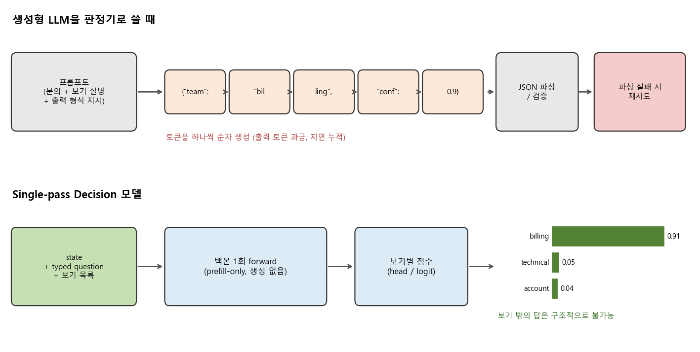
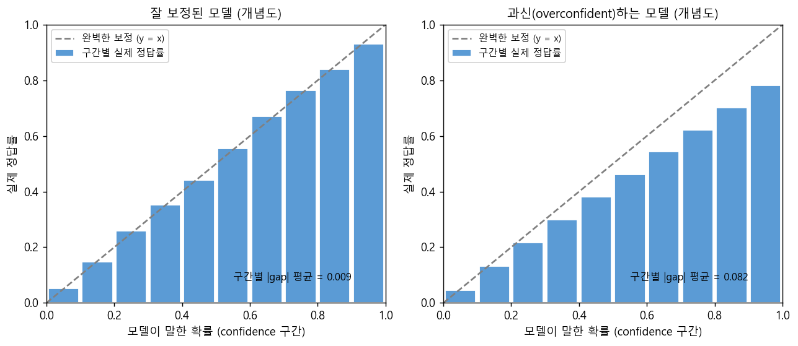
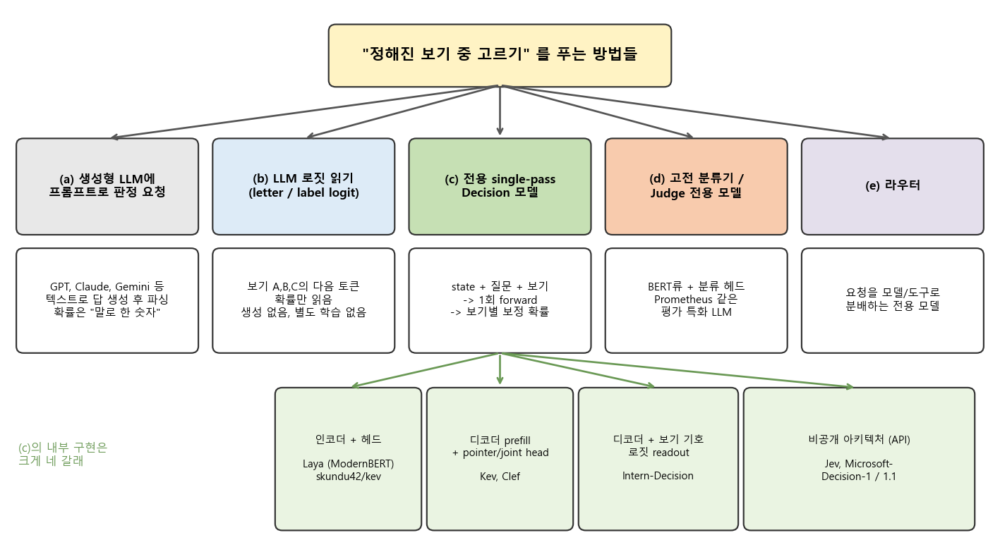
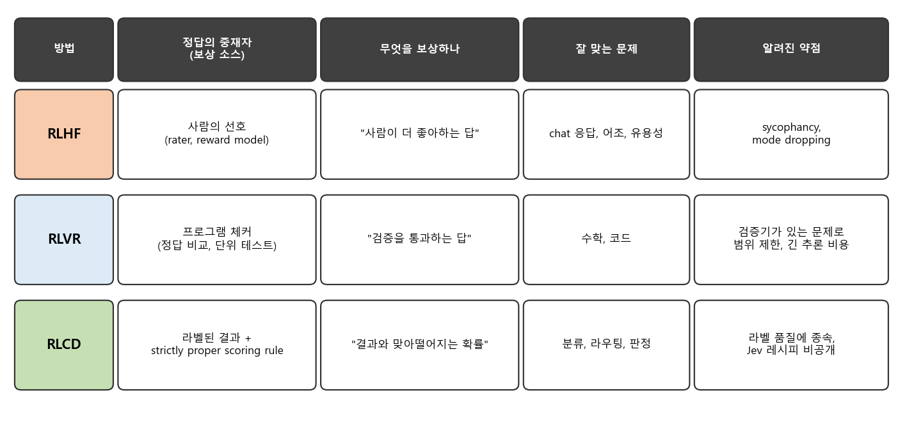
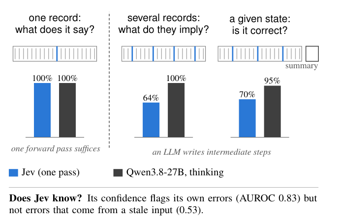
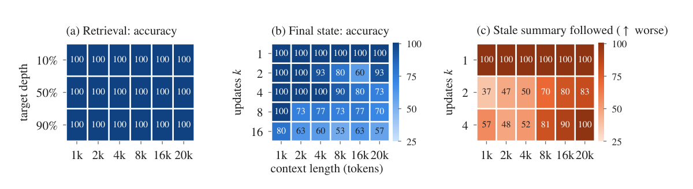

### 텍스트를 생성하는 대신 정해진 보기 중에서 보정된 확률로 고르는 Decision 모델과, 이를 학습시키는 RLCD에 대해 알아봅니다.

> 다루는 자료  
> **TypeSafe AI**: Introducing System One Models & Jev (2026.09), Manifesto "Composable AI: Build Prod, Not God"  
> **What Can't Jev Decide? Probing the Limits of One-Pass Decision Models** (Wang Yang et al., arXiv:2610.24929, 2026)  
> **Microsoft-Decision-1 / 1.1** 공식 블로그와 Microsoft Learn 문서 (2026.10 ~ 2026.11)  
> **오픈 Decision 모델 모델 카드**: Laya, Kev, Cloudflare Clef, H2O-Lightning, Intern-Decision  

  

 

>  **1. 분류, 라우팅, 판정처럼 "정해진 보기 중 하나를 고르는" 작업에 텍스트 생성은 필요 없음. Decision 모델은 1회 forward pass로 보기별 확률만 반환함**
>
>  **2. RLHF는 사람의 선호, RLVR은 프로그램 체커, RLCD는 "결과와 맞는 확률"을 보상함. 다만 Jev의 RLCD 레시피는 비공개이고, 공개된 구현은 Laya 정도임**
>
>  **3. 한 번의 forward pass로는 여러 기록을 종합하거나 입력 state 자체가 맞는지 검증하는 판단이 어려움(arXiv:2610.24929). Decision 모델은 "추론 모델이 정리한 state 위의 빠른 선택기"로 쓰는 것이 안전함**

 

----

**본 포스트는 Decision 모델 관련 공식 블로그, 문서, 모델 카드, 그리고 arXiv 논문을 읽고 정리한 리서치 노트입니다.**
벤더가 주장하는 내용과 독립적으로 확인된 내용을 최대한 구분해서 적었고, 확인하지 못한 부분은 "확인 불가"로 남겨 두었습니다. 모든 수치와 모델 ID는 2026-11-23 기준으로 원문과 Hugging Face API에서 다시 확인했습니다.
원문 링크는 글 하단의 출처에서 보실 수 있습니다.

----
#### Contents

1. [왜 Decision 모델인가](#why)
2. [Taxonomy와 대표 모델 비교](#taxonomy)
3. [RLHF vs RLVR vs RLCD: 누가 정답을 판정하는가](#rl)
4. [Jev와 그 한계 (arXiv:2610.24929)](#jev)
5. [Microsoft-Decision-1 / 1.1 리뷰](#msdecision)
6. [언제 Decision 모델을, 언제 생성형 LLM을 쓸까](#when)
7. [마치며](#conclusion)
 

## 1. 왜 Decision 모델인가

상담 에이전트나 업무 자동화 파이프라인을 실제로 뜯어보면, 모델 호출의 상당수는 "글쓰기"가 아니라 "결정"입니다. 이 문의는 결제팀으로 보낼까 기술지원팀으로 보낼까, 이 상담 응답은 환불을 약속했나, 지금 사람에게 넘겨야 하나 같은 것들이죠.

지금까지는 이런 결정도 대개 생성형 LLM에 프롬프트를 주고 `{"team": "billing", "confidence": 0.9}` 같은 JSON을 생성하게 한 뒤 파싱해서 썼는데요. 이 방식에는 몇 가지 불편함이 있습니다.

- 답 하나를 받기 위해 출력 토큰을 순차적으로 생성해야 함 (지연과 비용이 늘어남)
- 형식이 깨지면 파싱 실패, 재시도 로직이 필요함
- "confidence 0.9"는 모델이 **말로 한 숫자**일 뿐, 실제로 90% 맞는다는 보장이 없음

Decision 모델은 여기서 출발합니다. 입력으로 **state**(티켓 본문, JSON, 이미지 등)와 **타입이 정해진 질문 + 보기 목록**을 받고, 텍스트를 생성하는 대신 1회 forward pass로 **보기별 확률 분포**를 돌려줍니다. 맨 위 그림이 그 차이를 보여주는데요, 보기 밖의 답이 나올 수 없으니 파싱할 것도 없고, 출력 토큰도 없습니다.

질문 유형은 벤더가 달라도 거의 같은 형태로 수렴했습니다. TypeSafe가 Jev에서 처음 쓴 이름을 Microsoft, Cloudflare, 그리고 오픈 모델들이 그대로 쓰고 있어요.

| 질문 타입 | 의미 | 반환값 |
| --- | --- | --- |
| `noul` | 예/아니오 조건 | 참일 확률 (0~1) |
| `choice` | 보기 중 하나 선택 | 선택된 보기 + 보기별 확률 |
| `score` | 순서가 있는 등급 | 등급별 확률 + 확률 가중 평균 점수 |

Microsoft-Decision-1.1의 API 경로가 `/providers/microsoft/v1/systemone`이고 문서에서도 "system-one API와 유사한 요청 패턴"이라고 직접 언급하는 걸 보면, TypeSafe의 "System One" 인터페이스가 사실상의 표준처럼 자리잡아 가는 분위기입니다. 다만 Microsoft가 TypeSafe 규격을 공식 채택했다고 밝힌 문서는 찾지 못했습니다(확인 불가).

여기서 핵심 단어는 **calibration(보정)** 입니다. 모델이 80%라고 말한 답들을 모아 보면 실제로 80% 정도 맞아야 한다는 뜻인데요, 확률이 보정되어 있어야 "0.9 이상이면 자동 처리, 아니면 사람에게" 같은 임계값 설계가 의미를 가집니다. Calibration 개념 자체는 예전에 정리한 [딥러닝 모델의 Calibration이란?](https://myeonghak.github.io/deep%20learning/Deep-Learning-Calibration%EC%9D%B4%EB%9E%80/) 포스트를 참고해 주세요.

  

 직접 그린 개념도 (가상의 수치) 
     

 

## 2. Taxonomy와 대표 모델 비교

"정해진 보기 중 하나를 고르는 문제"를 푸는 방법을 정리해 보면 크게 다섯 갈래로 나눌 수 있습니다.

  

 

- **(a) 생성형 LLM을 프롬프트로 판정기로 사용**: 가장 흔한 방식. [LLM-as-a-Judge](https://myeonghak.github.io/ai%20contact%20center/AICC-LLM-as-a-Judge/) 포스트에서 다룬 것도 대부분 이 계열임. 범용적이지만 출력 토큰 비용과 파싱 부담이 있고, 말로 한 confidence는 보정되어 있지 않음
- **(b) LLM의 보기 로짓 읽기**: 보기에 A, B, C 같은 기호를 붙이고 다음 토큰 확률만 읽는 방식. 생성도 별도 학습도 없음. 객관식 벤치마크 평가에서 흔히 쓰는 방법이지만, 보기 순서와 표현에 민감하다는 점이 알려져 있음
- **(c) 전용 single-pass Decision 모델**: 이번 글의 주인공. 내부 구현은 다시 네 갈래로 나뉨
  - 인코더 + 분류 헤드: Laya(ModernBERT-large), `skundu42/kev`(Ettin Encoder 400M)
  - 디코더 백본을 prefill만 돌리고 pointer/joint head로 보기 점수화: Kev, Cloudflare Clef
  - 디코더의 보기 기호 로짓을 1회 forward로 읽되 그 목적에 맞게 fine-tuning: Intern-Decision
  - 아키텍처 비공개 API: Jev, Microsoft-Decision-1 / 1.1
- **(d) 고전 분류기와 judge 전용 모델**: BERT류 분류기, Prometheus 2 같은 평가 특화 생성형 모델
- **(e) 라우터**: 요청을 모델이나 도구로 분배하는 전용 모델. Decision 모델의 대표 유스케이스이기도 해서 경계가 겹침

### 대표 Decision 모델 비교표

아래 표는 2026-11-23에 Hugging Face API(`https://huggingface.co/api/models/<id>`)와 각 모델 카드, 공식 문서에서 확인한 내용입니다. 좋아요 수는 당일 기준이고, 성능 수치는 전부 **각 제작자의 자체 보고**입니다.

| 모델 | 제작 | 백본 / 구조 | 크기 | 라이선스 | HF likes |
| --- | --- | --- | --- | --- | --- |
| Jev | TypeSafe AI | 비공개 | 비공개 | 비공개 (API) | - |
| Microsoft-Decision-1 | Microsoft | Qwen3.5-9B post-train | 9B급 | 상용 (Foundry) | - |
| Microsoft-Decision-1.1 | Microsoft | Gemma 4 26B A4 post-train (블로그 표기) | 26B (MoE) | 상용 (Foundry) | - |
| `convaiinnovations/laya` | ConvAI Innovations | ModernBERT-large + decision head | 421M | Apache-2.0 | 약 6.0k |
| `convaiinnovations/laya-multilingual` | ConvAI Innovations | mmBERT-base, 100+개 언어 | 322M | Apache-2.0 | 약 430 |
| `Cloudflare/clef` | Cloudflare | Qwen3.8-27B + joint schema head, prefill-only | 27B | Apache-2.0 | 약 2.4k |
| `Cloudflare/clef-flash` | Cloudflare | Qwen3.5-9B 기반 | 9B | Apache-2.0 | 약 940 |
| `jaredpalmer/kev-4b` | Jared Palmer (개인) | Qwen3.5-4B-Base (frozen) + LoRA + pointer head | 4B | Apache-2.0 | 약 185 |
| `h2oai/h2o-lightning-4b` | H2O.ai | Qwen3.5-4B 기반 | 4B | Apache-2.0 | 약 110 |
| `internlm/Intern-Decision-4B` | InternLM | Qwen3.5-4B, 보기 기호 로짓 readout | 4B | Apache-2.0 | 약 96 |

몇 가지 짚어둘 점이 있습니다.

- **Laya는 두 얼굴임**: HF에 올라간 `convaiinnovations/laya` 체크포인트는 ModernBERT-large 기반 인코더(421M)임. 반면 0.5 버전부터 추가된 새 엔진(vegaml)은 0.8B~27B의 frozen LLM을 reader로 쓰고 그 위에 작은 decision engine을 얹는 구조라고 모델 카드에 적혀 있음. 어떤 Laya를 이야기하는지 구분할 필요가 있음
- **Kev는 하나가 아님**: 원조는 Jared Palmer의 `jaredpalmer/kev-*` 패밀리(0.5b, 0.6b, 0.8b, 4b, 8b, 9b, 27b)임. arXiv:2610.24929도 Kev를 Palmer(2026)로 인용함. 이와 별개로 `skundu42/kev`는 Ettin Encoder 400M 기반의 전혀 다른 인코더 분류기이고, 가중치 라이선스가 명시되어 있지 않음
- **멀티모달 지원**: Clef(텍스트, JSON, 이미지, 비디오), H2O-Lightning(이미지), Intern-Decision(이미지), Microsoft-Decision-1.1(텍스트와 이미지)
- **벤치마크는 다 자기가 1등**: H2O-Lightning은 JevBench 계열 리더보드 순위를, Cloudflare는 Jev Decision Index 선두를, Intern-Decision은 자체 표에서 Jev보다 높은 평균을 내세움. 같은 Laya가 Intern-Decision 표에서는 평균 57.77로 하위권이고 Laya 카드에서는 스트리밍 학습 후 Jev 1.14보다 높게 나옴. 결국 **자기 데이터로 직접 재보는 수밖에 없음**

 

## 3. RLHF vs RLVR vs RLCD: 누가 정답을 판정하는가

### 기술적 비교

TypeSafe는 사전학습된 언어 모델을 쓸모 있게 만든 post-training 방법을 세 가지로 나눕니다. RLHF는 챗봇을, RLVR은 추론 모델을 만들었고, 자신들은 세 번째인 **RLCD(Reinforcement Learning for Calibrated Decisions)** 로 Decision 모델을 만든다는 주장인데요. 참고로 TypeSafe 창업자 Diogo Almeida는 OpenAI에서 InstructGPT와 ChatGPT로 이어진 RLHF 연구에 참여한 인물로 소개됩니다(TypeSafe 문서 기준).

  

 

여기서 RLCD의 핵심은 보상 함수에 있습니다. 그런데 **TypeSafe는 Jev를 어떻게 학습했는지 공개하지 않았습니다.** 공개된 건 "텍스트 대신 결정과 보정된 확률을 반환하도록 학습한다"는 목표 수준의 설명뿐이에요. 재현 가능한 수준으로 공개된 구현은 Laya 모델 카드 정도인데, 요약하면 아래와 같습니다.

- 모델이 보기별 확률 분포를 출력함
- 학습 중 logit에 평균 0의 가우시안 노이즈를 더해 탐색(exploration)함
- 보상은 **strictly proper scoring rule**: log score + spherical score, 순서형 질문에는 ranked probability score를 추가함
- REINFORCE + 그룹 평균 baseline(GRPO 스타일)로 업데이트하고, 멀티턴 대화는 prefix slice에 대해 TD($\lambda$=1.0)를 적용함

### 왜 proper scoring rule인가

proper scoring rule은 "자기가 실제로 믿는 확률을 그대로 말할 때 기대 보상이 최대가 되는" 채점 규칙입니다. log score로 예를 들어 보면, 정답 분포가 $q$이고 모델이 $p$를 말했을 때 기대 보상은 다음과 같습니다.

$$
\mathbb{E}_{y \sim q}\left[\log p_y\right] = \sum_k q_k \log p_k
$$

Gibbs 부등식에 의해 이 값은 $p = q$일 때만 최대가 됩니다. 확률을 부풀려 말하면 틀렸을 때 크게 깎이고, 너무 소심하게 말하면 맞았을 때 얻을 보상을 놓치는 구조죠. 그래서 정확도만 보상하는 것과 달리, "얼마나 확신하는지"까지 정직하게 말하도록 압력을 줍니다.

다만 학습 목표가 보정이라고 해서 결과가 보정되어 있다는 보장은 없습니다. Laya 모델 카드 스스로 "출시 상태에서 과신(over-confident)한다"고 적고 있고, 질문 유형과 보기 개수별로 temperature를 하나씩 다시 맞추면 평균 ECE가 0.466에서 0.081로 내려간다고 보고합니다. Laya 소개 사이트(laya-ai.com)의 비교에서는 같은 Laya가 2지선다 SST-2에서는 ECE 0.015로 아주 잘 보정되어 있지만 77개 의도의 Banking77에서는 0.506으로 크게 과신했다고 하는데요. **보정은 모델의 고정 속성이 아니라 질문 유형, 보기 수, 체크포인트마다 다시 재야 하는 값**이라는 점을 기억해 두면 좋겠습니다.

### 철학적 차이: 정답의 중재자는 누구인가

세 방법을 "누가 정답을 판정하는가"로 다시 보면 차이가 더 선명해집니다.

- **RLHF**: 중재자는 사람의 선호. 어조, 유용성처럼 정량화하기 어려운 영역에서 거의 유일하게 작동하는 방법이지만, "그럴듯하게 들리는 것"과 "실제로 맞는 것"이 섞일 위험이 있음. TypeSafe 문서는 이를 sycophancy와 mode dropping으로 설명하며 "사람의 선호와 기계의 신뢰성은 서로 다른 최적화 목표"라고 정리함
- **RLVR**: 중재자는 프로그램 체커. 객관적이지만, 기계적으로 검증 가능한 정답이 있는 문제로 범위가 좁아짐
- **RLCD**: 중재자는 라벨이 붙은 실제 결과. 모델은 그 결과와 맞아떨어지는 확률을 말하도록 학습됨

TypeSafe는 이 관점을 매니페스토에서 "Build Prod, Not God"이라는 문구로 요약합니다. 핵심 문장은 이렇습니다.

> *"Current AI is trained to be a helpful, articulate, pleasant assistant. Reasonable goals if you assume a human is on the other side of the model. Yet the foreseeable consequence is AI that requires humans in the loop instead of running in the background."* ([typesafe.ai/manifesto](https://typesafe.ai/manifesto))

즉 "RLHF가 틀렸다"가 아니라, 사람과의 대화를 전제로 학습된 모델은 사람 없이 백그라운드에서 돌아가는 소프트웨어 부품으로 쓰기 불편하다는 주장입니다. 데이터베이스나 인터넷 프로토콜처럼 믿고 쌓아 올릴 수 있는 작은 부품(primitive)을 만들자는 이야기인데, 엔지니어 입장에서는 꽤 공감이 가는 대목이에요.

### 균형 잡힌 비판

그럼에도 몇 가지는 짚고 넘어가야 할 것 같습니다.

- **재현성**: RLCD라는 이름은 있지만 Jev의 보상 함수, 데이터, 학습 코드는 공개되지 않음. "보정을 목표로 한다"는 선언을 외부에서 검증할 방법이 제한적임
- **결국 정답 라벨이 필요함**: RLCD도 결과 라벨이 있어야 보정을 배울 수 있음. 신용, 채용, 의료처럼 가치판단이 섞인 결정에서는 "정답" 자체가 불분명하므로 RLHF의 문제를 RLCD가 대신 풀어주지는 않음. Microsoft도 Decision 모델을 사람에 대한 중대한 결정의 유일한 자동 판단자로 쓰지 말라고 문서에 명시함
- **벤치마크의 정답이 다른 LLM일 때**: TypeSafe의 workflow eval은 사람 라벨이 아니라 "가장 큰 외부 모델들의 예측 평균"을 참조 확률로 씀(TypeSafe 블로그에 직접 적혀 있음). 이 경우 점수는 정확도라기보다 **프론티어 모델과의 합의율**에 가까움
- **사람은 사라지지 않고 위치만 바뀜**: TypeSafe 문서도 confidence 임계값을 위험도에 따라 다르게 잡으라고 권함(예: 잔액 조회는 0.5, 송금 승인은 0.9 이상). 사람은 "매 결정"에서 빠지는 대신 "임계값과 에스컬레이션 정책 설계"라는 한 단계 위로 올라간 셈임
- **confidence와 확률은 다름**: TypeSafe 문서에 따르면 Jev의 `confidence`는 분포가 한 보기에 얼마나 몰려 있는지를 나타내는 통계량이고, 선택된 답이 맞을 확률과는 다름. 같은 confidence 0.5라도 보기 2개일 때는 top 확률 0.75, 보기 10개일 때는 0.55임. 임계값을 어떤 숫자에 걸지 먼저 정해야 함

 

## 4. Jev와 그 한계 (arXiv:2610.24929)

### Jev: 벤더 주장과 독립 측정

TypeSafe는 2026년 9월 15일 Jev를 공개하면서 아래와 같이 주장했습니다(모두 벤더 주장).

- 입력 100만 토큰당 0.042달러, 출력은 무료
- 서버 기준 응답 시간 70~500ms, 같은 수준의 지능에서 프론티어 LLM보다 40~200배 빠름
- 출력이 사전에 정의된 타입이므로 타입 오류가 수학적으로 불가능함

TypeSafe와 관계없다고 밝힌 분석 사이트 jev-ai.ai는 이 주장들을 하나씩 확인했는데요.

- **속도**: OpenRouter 경유, 중국 본토에서 20회 호출 시 end-to-end 중앙값 423ms, 90퍼센타일 1041ms. 표본이 작다고 스스로 밝힘
- **가격**: 444배 저렴하다는 비교는 프론티어 모델 기준이고, 분류에 실제로 쓰는 소형 모델과 비교하면 5~25배 수준이라고 재계산함
- **환각 불가**: 보기 밖의 답을 낼 수 없다는 건 사실이지만 정확도와는 별개. TypeSafe 자체 인보이스 워크플로 결과 61.8%가 그 예로, 틀린 답도 모두 형식은 완벽했음

"환각할 수 없다"는 말이 "믿어도 된다"로 읽히기 쉬운데, 둘은 다른 속성이라는 지적이 핵심입니다.

### 논문: 한 번의 forward pass로는 무엇을 결정할 수 없나

Case Western Reserve University, NII LLMC, Georgia Tech, Columbia 소속 연구진이 2026년 10월 18일 공개한 이 논문은 Jev 1.13.0과 23개의 오픈 Jev-style 구성(Kev, JevK5, Decider, OpenJev 등)을 같은 조건에서 시험합니다. 결론은 한 문장으로 요약됩니다. **LLM이 중간 단계를 글로 써야만 내릴 수 있는 결정은, Jev도 내리지 못한다.**

  

 출처: Yang et al., What Can't Jev Decide? (https://arxiv.org/abs/2610.24929), Figure 1 
     

 

논문의 주요 결과를 정리하면 아래와 같습니다.

- **단건 조회는 완벽함**: 20k 토큰, 64개 보기까지 기록 검색과 선택에서 오류가 없음
- **여러 기록의 종합은 무너짐**: 한 사용자에 대한 업데이트가 2개 이상 쌓이면 정확도가 떨어지고, 16회 업데이트에서는 53~80%까지 내려감. 원인은 길이나 질문 문구가 아니라 **비슷한 다른 사용자의 기록이 간섭**하기 때문
- **오래된 요약을 그대로 믿음**: 미리 계산된 state 요약을 붙여 주면, 그 요약이 낡았어도 따라감
- **실제 과제에서도 같은 패턴**: 1,131개 실제 결정 문항 중 라벨이 믿을 만한 738개를 Qwen3.8-27B가 thinking 토큰을 얼마나 써야 푸는지로 등급을 매겼더니, Jev는 1회 forward로 풀리는 문항의 97.5%를 맞혔지만 나머지는 74%만 맞힘. 추론하도록 학습된 백본으로 바꿔도 이 격차는 줄지 않았다고 함
- **자기 한계를 모름**: confidence는 모델이 스스로 만든 오류는 어느 정도 잡아내지만(AUROC 0.83), 낡은 입력에서 물려받은 오류는 거의 못 잡음(0.53). "모르겠음" 보기를 주거나 hand-off 옵션을 학습시켜도 물려받은 오류는 잡히지 않음

  

 출처: Yang et al., What Can't Jev Decide? (https://arxiv.org/abs/2610.24929), Figure 3 
     

 

(a)의 검색은 모든 깊이와 길이에서 100%인데, (b)의 최종 상태 추적은 업데이트 횟수가 늘수록 떨어지고, (c)에서는 업데이트가 많을수록 낡은 요약을 더 잘 따라가는 걸 볼 수 있습니다.

논문이 내리는 결론은 꽤 실용적입니다. One-pass Decision 모델은 **추론 모델이 계산하고 검증한 state 위에서 동작하는 빠른 선택기**로 쓰는 게 맞다는 것이죠. 저자들도 한계로 밝혔듯 이 실험은 결정을 한 번씩 독립적으로 묻는 설정이라, 에이전트 루프 안에서 오류가 누적되는 효과는 따로 측정해야 합니다. 그리고 이 논문은 Microsoft-Decision 계열이나 Laya를 평가 대상에 넣지 않았기 때문에, 같은 한계가 이 모델들에도 그대로 적용되는지는 **확인 불가**입니다. 구조가 비슷하니 비슷할 가능성이 높다고 추정할 뿐이에요.

 

## 5. Microsoft-Decision-1 / 1.1 리뷰

*참고로 필자는 Microsoft에 재직 중입니다. 이 절은 공개된 블로그, 문서, 카탈로그만을 근거로 작성했고 회사의 공식 입장이 아니며, 직접 써 본 결과(hands-on)는 포함하지 않았습니다.*

### 스펙 요약 (공개 문서에서 확인된 것)

| 항목 | Microsoft-Decision-1 | Microsoft-Decision-1.1 |
| --- | --- | --- |
| 공개 | 2026-10-09 블로그, 공개 프리뷰 | 2026-11-18 블로그, GA |
| 베이스 | Qwen3.5-9B post-train | Gemma 4 26B A4 post-train (블로그 표기) + 전용 추론 엔진 |
| 입력 | 텍스트, JSON | 텍스트, JSON, 이미지 (오디오, 비디오는 미지원) |
| 출력 | 타입이 정해진 결정 + 보기별 확률, 설명 생성 없음 | 동일 |
| 가격 (입력 100만 토큰) | 이번 조사에서 1차 자료로 재확인하지 못함 | Global Standard 0.042달러, US Data Zone 0.046달러, EU/APAC Data Zone 0.050달러, 출력 무료 |
| 기타 | Xbox Research, Copilot 팀 등 내부 사례 소개 | Foundry Evaluations의 judge로도 사용 가능 |

### 강점

- **구조적 장점**: 출력이 정해진 타입이라 파싱 실패와 형식 오류가 구조적으로 없고, 출력 토큰 과금이 없어 고빈도 워크플로의 비용 예측이 단순함. 이건 벤더 주장이라기보다 설계상의 사실임
- **문서화된 사용 범위**: Learn 문서와 카탈로그에 범위 밖 용도(생성, 대화, 번역, 요약, 입력에 없는 지식이 필요한 작업)와 알려진 한계(문구와 보기 순서에 따른 점수 변화, 익숙한 과제에서 보정이 가장 좋음, 설명 미제공)가 비교적 솔직하게 적혀 있음
- **벤더가 보고한 수치**: Decision-1은 학습에서 제외한 36개 벤치마크(약 15만 문항)에서 최고 정확도, 입력을 8가지 방식으로 변형했을 때 평균 1.3%만 결정이 바뀜, 11개 안전성 벤치마크 5,250건 테스트. Decision-1.1은 102개 벤치마크 38.5만 문항에서 평균 정확도 78.8%, 9개 역량 카테고리 중 7개 1위, Decision-1보다 2배 이상 빠름. **모두 Microsoft 자체 평가이고 제3자 재현은 찾지 못함**
- **플랫폼 통합**: 이미 Azure를 쓰는 조직이라면 배포, 과금, 권한 관리를 기존 체계 안에서 할 수 있음

### 약점과 주의할 점

- **같은 사례, 다른 숫자**: Xbox Research 사례를 techcommunity 블로그는 "GPT-5와 경쟁력 있는 품질, 80~100배 빠름"으로, Command Line 블로그는 "GPT-6 Sol과 경쟁력 있는 품질, 14배 이상 빠르고 200배 저렴"으로 소개함. 비교 대상 모델도 배수도 다름. 어느 쪽이 맞는지, 혹은 다른 측정인지는 확인 불가이므로 어느 하나를 인용하기보다 둘 다 벤더 주장으로만 보는 게 안전함
- **평가 세트가 달라 버전 간 비교 불가**: 1.0의 36개 벤치마크와 1.1의 102개 벤치마크는 서로 다른 세트라 정확도를 직접 비교할 수 없음
- **로드맵 변화**: 1.0 발표 때는 향후 MAI와 OpenAI 모델로 rebase하겠다고 했는데, 1.1은 Google의 Gemma 기반으로 나옴. 앞으로도 베이스 모델이 바뀔 수 있고, 그때마다 프롬프트 민감도나 보정이 달라질 수 있음
- **한국어 성능 미공개**: 공개 자료에서 한국어 벤치마크를 찾지 못함(확인 불가)
- **유통 채널 확인 필요**: 1.1 블로그는 OpenRouter와 Vercel에서도 제공된다고 하지만, 2026-11-23에 OpenRouter 공개 모델 목록 API(`/api/v1/models`)를 조회했을 때 Microsoft-Decision 모델은 보이지 않았음. 일시적인 상태인지는 확인 불가
- **1.0과 1.1의 관계**: 1.0이 deprecated 되었는지, 병행 운영되는지 공개 문서에서 명확히 확인되지 않음(확인 불가)
- **One-pass 구조의 한계 공유 가능성**: 4절의 논문은 Microsoft 모델을 평가하지 않았지만, 같은 인터페이스와 single-pass 구조라면 멀티턴 상태 추적 한계를 공유할 가능성이 있음(추정)

정리하면, "Decision 모델"이라는 카테고리를 대형 클라우드 카탈로그에 정식으로 들여왔다는 점과 사용 범위 문서화는 분명한 장점이지만, 공개된 성능 수치는 대부분 자체 평가이고 일부는 서로 맞지 않습니다. 어떤 Decision 모델이든 그렇듯 자기 데이터로 정확도와 보정을 직접 재는 것이 출발점입니다.

 

## 6. 언제 Decision 모델을, 언제 생성형 LLM을 쓸까

Microsoft Learn 문서의 권고가 꽤 깔끔한데요. 애플리케이션이 같은 입력에 대해 **경계가 정해진 타입의 결정**을 여러 개 내려야 하고, 생성된 글이 아니라 확률이나 선택에 따라 바로 행동해야 한다면 Decision 모델을, 콘텐츠를 생성, 요약, 재작성, 설명해야 한다면 생성형 LLM을 쓰라고 합니다. 그리고 둘을 섞어서, Decision 모델로 요청을 라우팅하거나 게이트한 뒤 통과한 요청만 생성형 모델로 보내는 구성을 제안하죠.

| 상황 | 추천 | 이유 |
| --- | --- | --- |
| 보기가 고정된 고빈도 분류, 라우팅 | Decision 모델 | 지연, 비용, 파싱 부담이 작고 확률로 임계값 설계 가능 |
| 응답 작성, 요약, 설명 | 생성형 LLM | Decision 모델은 텍스트를 생성하지 않음 |
| 판정 근거(rationale)가 필요한 평가 | 생성형 LLM judge | Decision 모델은 설명을 만들지 않음 |
| 여러 턴에 걸쳐 쌓인 상태를 종합해야 하는 판단 | 추론 모델로 state 정리 후 Decision 모델 | arXiv:2610.24929의 한계 |
| 사람에 대한 중대한 결정 | 어느 쪽이든 사람의 검토 필수 | 벤더 문서와 모델 카드 공통 권고 |

### AI 컨택센터(AICC) 관점에서 보면

상담 에이전트에는 Decision 모델이 들어갈 자리가 꽤 많습니다.

- **의도 라우팅**: 첫 발화를 결제, 기술지원, 계정 같은 큐로 분류하는 `choice` 질문. 음성 봇이라면 턴마다 지연이 누적되므로 수백 ms 단위의 차이가 체감됨
- **상담 품질 QA 자동화**: "상담사가 본인 확인 절차를 지켰나", "환불을 약속했나" 같은 체크리스트를 `noul` 질문 묶음으로 만들고, 공손함 같은 항목은 `score`로 채점. 전수 검사에 가까운 QA가 비용상 가능해짐
- **에스컬레이션 게이트**: 확률이 임계값 아래면 사람에게 넘기는 3단계(자동 처리, 확인 후 처리, 사람에게 이관) 설계. 단, 임계값은 반드시 자기 라벨 데이터로 정해야 함
- **에이전트 가드레일**: 에이전트가 제안한 툴 호출을 실행 전에 "계속/중단/사람 확인"으로 평가

다만 4절의 결과를 상담 도메인에 대입하면 주의할 점이 생깁니다. "이 고객의 현재 계약 상태는?"처럼 **여러 턴에 걸친 변경 이력을 종합**해야 하는 판단이나, 앞 단계가 써 둔 **대화 요약이 낡았을 가능성**이 있는 상황에서는 Decision 모델이 틀려도 confidence가 떨어지지 않을 수 있습니다. [tau-bench](https://myeonghak.github.io/ai%20contact%20center/AICC-tau-bench/)처럼 정책과 상태가 얽힌 멀티턴 과제에서는 state를 최신화하고 검증하는 단계를 추론 모델에 맡기고, Decision 모델은 그 위에서 빠르게 고르는 역할로 쓰는 하이브리드 구성이 현실적인 답으로 보입니다.

또 한국어 상담이라면 한 가지가 더 남습니다. 대부분의 오픈 Decision 모델 카드가 영어 위주이고(Kev-4B는 영어만 명시), 다국어를 내세우는 `laya-multilingual` 정도가 100+개 언어를 지원한다고 밝히고 있어서, 한국어 성능은 직접 재보기 전까지는 모른다고 보는 게 맞습니다.

 

## 7. 마치며

이번 글에서는 Decision 모델이라는 새 카테고리를 taxonomy, 학습 방법(RLCD), 한계(arXiv:2610.24929), 그리고 상용 모델 리뷰 순서로 정리해 봤습니다.

개인적으로 가장 인상적이었던 건 "정답의 중재자가 누구인가"라는 관점이었습니다. RLHF로 만든 모델에게 "확신도를 숫자로 말해 줘"라고 시키는 건, 말 잘하는 사람에게 자기 확신을 수치로 대라고 하는 것과 비슷한 것 같아요. 그럴듯하지만 그 숫자를 믿고 자동화를 걸기엔 찜찜하죠. proper scoring rule로 확률 자체를 보상하는 RLCD의 발상은 그 지점을 정면으로 겨냥합니다. 하지만 동시에, 보정을 목표로 학습했다는 것과 실제 내 데이터에서 보정되어 있다는 것은 전혀 다른 이야기이고, 한 번의 forward pass로는 넘을 수 없는 벽도 분명히 있었습니다.

결국 실무에서 남는 교훈은 늘 그렇듯 소박합니다. 벤치마크 1등 주장은 일단 내려놓고, **내 데이터로 정확도와 ECE를 재고, 임계값을 정하고, 상태 검증은 추론 모델에게 맡기자** 정도가 되겠네요.

### 다음 글 예고

글로만 보면 감이 덜 오니, 다음 글에서는 직접 돌려 보려고 합니다. HF에서 가장 많은 좋아요를 받은 오픈 Decision 모델인 Laya를 로컬에서 실행해 보고, 아키텍처를 뜯어본 뒤, 상담 의도 라우팅 예제와 calibration 실험(reliability diagram, temperature scaling)까지 해 볼 예정입니다.

- [[LLM] Decision 모델 로컬 실습](https://myeonghak.github.io/large%20language%20models/LLM-Decision-%EB%AA%A8%EB%8D%B8-%EB%A1%9C%EC%BB%AC-%EC%8B%A4%EC%8A%B5/)

----------------

**개선을 위한 여러분의 피드백과 제안을 코멘트로 공유해 주세요.**
**내용에 대한 지적, 혹은 질문을 환영합니다.**  

**출처**  
[TypeSafe AI, Introducing System One Models & Jev](https://typesafe.ai/blog/introducing-system-one-models-and-jev)  
[TypeSafe AI, Manifesto: Composable AI, Build Prod, Not God](https://typesafe.ai/manifesto)  
[TypeSafe Docs, AI primer](https://docs.typesafe.ai/introduction/machine-learning-primer)  
[TypeSafe Docs, Confidence](https://docs.typesafe.ai/confidence)  
[Yang et al., What Can't Jev Decide? Probing the Limits of One-Pass Decision Models (arXiv:2610.24929)](https://arxiv.org/abs/2610.24929)  
[jev-ai.ai, TypeSafe Jev: Checking the Claims One by One](https://jev-ai.ai/typesafe-jev)  
[laya-ai.com, What is RLCD](https://laya-ai.com/rlcd)  
[Microsoft Community Hub, Introducing Microsoft-Decision-1 in Microsoft Foundry](https://techcommunity.microsoft.com/blog/azure-ai-foundry-blog/introducing-microsoft-decision-1-in-microsoft-foundry-for-decision-and-classific/4562742)  
[Microsoft Command Line, Microsoft-Decision-1](https://commandline.microsoft.com/microsoft-decision-1-model-foundry/)  
[Microsoft Community Hub, Introducing Microsoft-Decision-1.1](https://techcommunity.microsoft.com/blog/azure-ai-foundry-blog/introducing-microsoft-decision-1-1-build-faster-more-efficient-ai-applications-w/4573877)  
[Microsoft Learn, Deploy and use Microsoft-Decision-1.1 in Microsoft Foundry](https://learn.microsoft.com/en-us/azure/foundry/foundry-models/how-to/use-foundry-models-microsoft-decision)  
[Foundry 모델 카탈로그, Microsoft-Decision-1.1](https://ai.azure.com/catalog/models/Microsoft-Decision-1.1)  
[Cloudflare Blog, Introducing Clef](https://blog.cloudflare.com/clef-decision-models/)  
[Hugging Face, convaiinnovations/laya](https://huggingface.co/convaiinnovations/laya)  
[Hugging Face, convaiinnovations/laya-multilingual](https://huggingface.co/convaiinnovations/laya-multilingual)  
[Hugging Face, Cloudflare/clef](https://huggingface.co/Cloudflare/clef)  
[Hugging Face, Cloudflare/clef-flash](https://huggingface.co/Cloudflare/clef-flash)  
[Hugging Face, jaredpalmer/kev-4b](https://huggingface.co/jaredpalmer/kev-4b)  
[Hugging Face, skundu42/kev](https://huggingface.co/skundu42/kev)  
[Hugging Face, h2oai/h2o-lightning-4b](https://huggingface.co/h2oai/h2o-lightning-4b)  
[Hugging Face, internlm/Intern-Decision-4B](https://huggingface.co/internlm/Intern-Decision-4B)  
