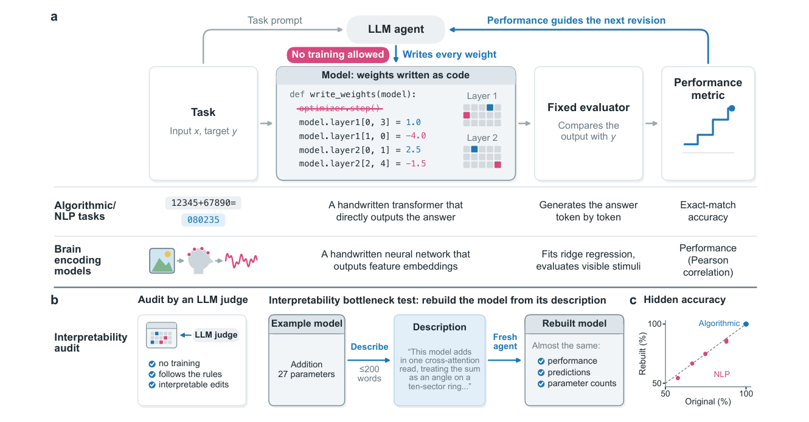
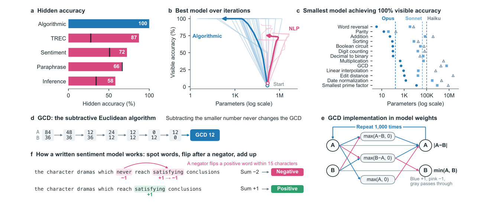
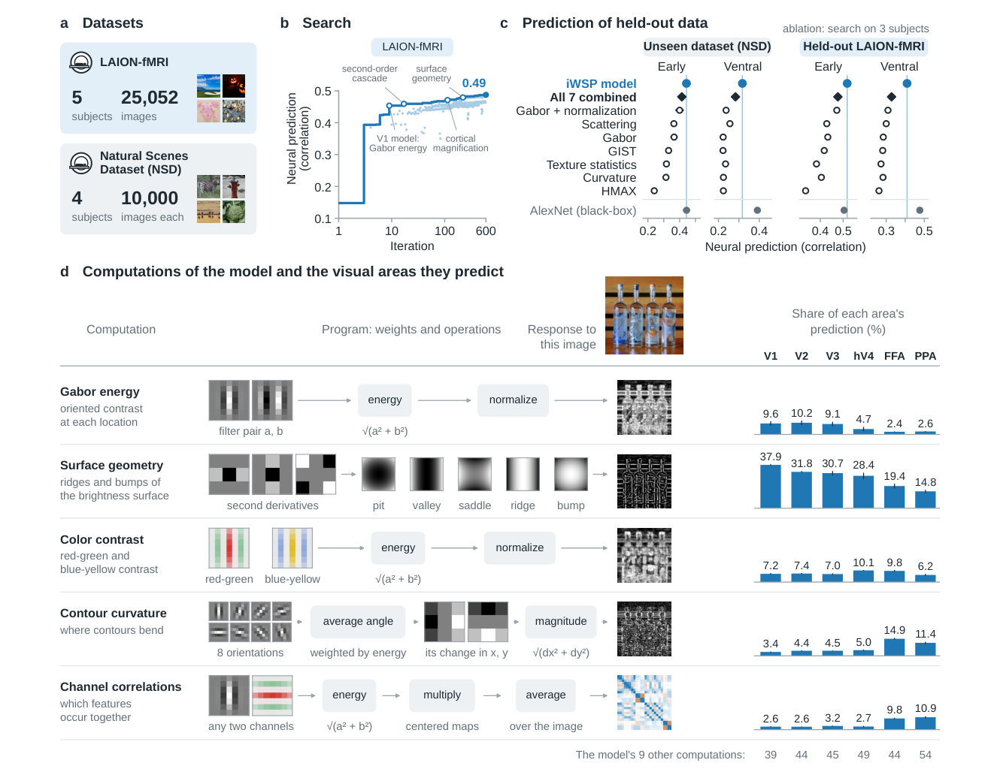
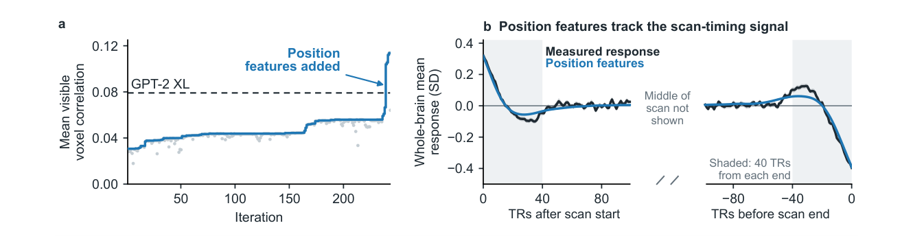
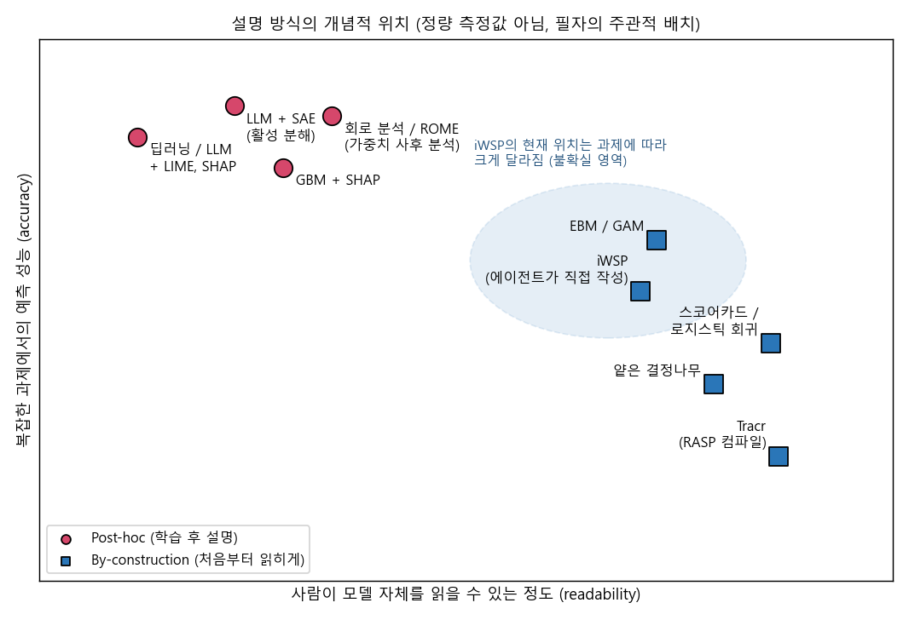

### 학습 없이 LLM 에이전트가 코드로 가중치를 한 줄씩 써 내려가는 iWSP를 살펴보고, 금융, 의료, 공공처럼 설명이 의무인 영역에서 어떤 의미가 있는지 정리해 봅니다.

> **Interpretable weight-space programming builds transparent transformers and brain encoding models**  
> Yash Mehta, Chandan Singh, Weijia Xu, Richard J. Antonello, Adeen Flinker, Nima Mesgarani, Michael F. Bonner, Nebojsa Jojic, Jianfeng Gao  
> (Microsoft Research, Johns Hopkins University, Columbia University, New York University), arXiv 2611.18114, v1 2026-11-13

<center></center>

<font size="2"><center> 출처: Mehta et al., Interpretable weight-space programming builds transparent transformers and brain encoding models, Figure 1 (https://arxiv.org/abs/2611.18114) </center>  </font>

<br/>

>  **1. iWSP는 LLM 에이전트가 역전파 없이 가중치와 feature를 코드로 직접 작성하고, 고정된 평가기의 점수만 보고 수정을 반복해 "처음부터 읽히는" 모델을 만드는 방법임**
>
>  **2. 알고리즘 과제 13개에서는 Opus 5.5 기준 hidden set 100%를 달성했고, 시각 피질 encoding에서는 해석 가능한 baseline 7종을 모두 이겼지만 NLP와 고차 시각 영역, 음성 ECoG에서는 black-box 모델에 아직 못 미침**
>
>  **3. 설명 의무가 있는 금융, 의료, 공공 영역에서는 "작고 읽히는 결정 모델"이 충분한 과제에 한해 후보가 될 수 있으나, 공개된 지 약 10일 된 논문이며 재현 연구가 아직 없음**

<br/>

----

**본 포스트는 arXiv 논문 2611.18114(v1)와 공개 코드 저장소를 읽고 정리한 노트이며, 후반부에는 규제 문서를 확인해 산업 관점의 생각을 덧붙였습니다.**
원문은 여기에서 보실 수 있습니다. [arXiv](https://arxiv.org/abs/2611.18114), [GitHub](https://github.com/csinva/weight-space-programming-autoresearch)

법률 관련 내용은 공개 문서를 읽고 정리한 것이며 법률 자문이 아닙니다.

----
#### Contents

1. [시리즈 복습: 설명은 어디에서 오는가](#recap)
2. [iWSP는 무엇을 하는가](#method)
3. [검증 1: 손으로 짠 transformer](#transformer)
4. [검증 2: 뇌 encoding 모델](#brain)
5. [한계와 아직 모르는 것들](#limits)
6. [설명이 의무인 산업에서는 어떨까?](#domain)
7. [실무자를 위한 체크리스트](#checklist)
8. [마치며](#conclusion)
<br />

<a id="recap"></a>
## 1. 시리즈 복습: 설명은 어디에서 오는가

이번 XAI 시리즈는 "설명이 모델의 어디에서 나오는가"를 따라 내려가는 구성인데요.

- 첫 단계는 [SHAP](https://myeonghak.github.io/xai/XAI-SHAP/) 같은 **post-hoc attribution**임. 이미 학습된 모델의 입력별 기여도를 바깥에서 추정함
- [① SAE와 Monosemanticity](https://myeonghak.github.io/xai/XAI-SAE%EC%99%80-Monosemanticity/)에서는 **activation**을 sparse autoencoder로 분해해 사람이 이름 붙일 수 있는 feature를 찾았음. 가중치는 건드리지 않는 사후 분석임
- [② 가중치 수준의 해석가능성](https://myeonghak.github.io/xai/XAI-%EA%B0%80%EC%A4%91%EC%B9%98-%EC%88%98%EC%A4%80%EC%9D%98-%ED%95%B4%EC%84%9D%EA%B0%80%EB%8A%A5%EC%84%B1/)에서는 circuit 분석, ROME, weight-sparse transformer, 그리고 RASP 프로그램을 transformer 가중치로 컴파일하는 **Tracr**까지 살펴봤음

여기서 Tracr가 이번 글과 가장 가까운 선배입니다. Tracr는 사람이 RASP라는 작은 언어로 프로그램을 쓰면 컴파일러가 그걸 attention과 MLP 가중치로 바꿔주는데요. 결과물은 완벽하게 읽히지만, 사람이 정답 알고리즘을 알고 있어야 하고 실제 데이터에서 성능을 끌어올리는 탐색 과정은 없습니다.

오늘 볼 **iWSP(interpretable weight-space programming)** 는 이 지점을 바꿉니다. DSL이나 컴파일러 없이, LLM 에이전트가 PyTorch 코드로 가중치를 직접 쓰고, 평가 점수를 보며 고치는 루프를 수백 번 도는 방식인데요. 논문도 related work에서 RASP/Tracr와 비교하며 "중간 DSL이나 컴파일러 없이 네트워크를 만든다"는 점을 차이로 꼽고 있습니다.

정리하면 지금까지는 "학습한 다음 설명하기"였다면, iWSP는 "설명(가설)을 먼저 쓰고 그걸 가중치로 구현해 검증하기"에 가깝습니다.


<a id="method"></a>
## 2. iWSP는 무엇을 하는가

### 동기: 과학에서는 예측보다 설명이 목적

저자들의 출발점은 신경과학입니다. 이미지나 문장을 보여주고 뇌 반응을 예측하는 **encoding model**은 딥러닝 feature를 쓰면 꽤 잘 맞추는데, 정작 "자극의 어떤 성질이 이 반응을 만드는가"는 말해주지 못합니다. 과학자 입장에서는 맞추는 것보다 이유를 아는 게 목적이니 아쉬운 상황이죠. 논문 서론은 McCulloch와 Pitts가 작은 네트워크의 연결을 손으로 하나하나 써서 논리 함수를 계산하던 시절을 소환하는데요, 그 "손으로 짠 네트워크"를 frontier LLM 에이전트에게 맡겨보자는 발상입니다.

### iWSP 루프

맨 위 그림 1a의 흐름을 개조식으로 정리하면 다음과 같습니다.

- 에이전트는 과제 설명 prompt, 시작 파일, 그리고 **수정할 수 없는 평가 스크립트**를 받음
- 학습은 금지됨. optimizer, fitting loop, backprop, 사전학습 가중치 다운로드 모두 불가. Gabor filter처럼 이미 알려진 해석 가능한 연산은 써도 되지만 주어진 기본 패키지(PyTorch 등)로 직접 구현해야 함
- 에이전트가 모델을 쓰면 평가기가 "visible set"에서 점수를 돌려주고, 에이전트는 그 점수와 이전 시도를 근거로 다음 수정을 함
- prompt는 "같은 성능이면 더 해석 가능한 쪽이 낫다"고 명시함. 파라미터 수는 proxy일 뿐이고, 진짜 기준은 사람이 이해할 수 있는 구조라고 적혀 있음
- 루프가 끝나면 한 번도 보지 않은 "hidden set"으로 재평가함

학습이 금지되어 있으니 가중치 변화 하나하나가 에이전트의 사전 지식과 추론에서 나오고, 매 변경마다 글로 된 설명과 성능 변화가 같이 남는다는 게 핵심입니다. 사람 과학자가 가설을 세우고 실험하고 고치는 과정과 비슷하죠.

### 해석가능성은 누가 확인하나: LLM 감사와 200단어 재구성 테스트

"해석 가능하다"는 주장을 어떻게 검증하느냐가 이 논문에서 제일 흥미로운 부분인데요. 장치가 세 가지 있습니다.

1. **LLM judge 감사**: 별도 에이전트가 저장된 모든 모델과 로그를 읽고 학습 여부, 규칙 위반, 해석 불가능한 수정이 있었는지 판정함
2. **데이터 의존성 체크**(알고리즘/NLP 과제): 과제 데이터를 바꿔서 가중치 작성 코드를 다시 돌려도 가중치가 그대로인지 확인함. 몰래 데이터에서 통계를 뽑아 쓰지 않았는지 보는 장치임
3. **텍스트 병목 테스트**: Opus 5.5가 최종 모델을 **200단어 이하**로 설명하고, 새 세션이 그 설명만 보고 모델을 다시 만듦. 다시 만든 모델이 원본과 성능, 예측, 파라미터 수가 비슷하면 "짧은 말로 옮길 수 있을 만큼 읽히는 모델"이라고 봄

세 번째가 특히 좋은 아이디어라고 생각하는데요. 설명가능성을 "사람이 봤을 때 그럴듯한가"가 아니라 "그 설명만으로 모델을 재현할 수 있는가"로 바꿔서 측정 가능하게 만든 셈입니다.


<a id="transformer"></a>
## 3. 검증 1: 손으로 짠 transformer

### 실험 설정

- 과제 17개: 알고리즘 13개(덧셈, 곱셈, 정렬, GCD, edit distance, 날짜 정규화 등) + NLP 4개(TREC 6-class 질문 분류, SST-2 감성 분류, MRPC paraphrase, SNLI 3-way NLI)
- 시작점은 GPT 스타일의 작은 transformer(기본 3 layer, width 64)와 `write_weights(model, task)` 함수. 에이전트가 이 함수를 채움
- 에이전트: Claude Code 위에서 Opus 5.5, Sonnet 5.5, Haiku 5.5. 과제당 LLM별 2회 실행, 실행당 30~50 iteration(LLM당 약 1,340 iteration)
- visible set은 200개 예시, 정답을 token 단위로 생성해 exact match로 채점. hidden set은 알고리즘 과제는 새 예시 2,000개, NLP는 공식 test split

<center></center>

<font size="2"><center> 출처: Mehta et al., arXiv 2611.18114, Figure 2 (https://arxiv.org/abs/2611.18114) </center>  </font>

### 결과

- **알고리즘 과제**: Opus의 26개 실행 모두 visible, hidden에서 100% 달성. 대부분 이미 알려진 알고리즘을 가중치로 옮긴 형태임(예: edit distance는 DP 테이블 한 행당 block 하나, 곱셈은 shifted partial product 덧셈)
- **NLP 과제**: 그림 2a 기준 hidden 정확도 TREC 87%, Sentiment 72%, Paraphrase 66%, Inference 58%. 4개 중 3개는 majority baseline을 확실히 넘었지만 Paraphrase(MRPC)는 baseline 아래에 머묾
- **정확해진 다음 압축함**: 알고리즘 과제는 평균적으로 iteration의 첫 10% 안에 visible 99%에 도달하고, 나머지 시간은 파라미터를 약 3,400개에서 약 200개로 줄이는 데 씀. 100%를 달성한 가장 작은 모델의 중앙값은 166개, 처음 100%를 찍은 모델보다 (중앙값 실행 기준) 29배 작음. NLP는 약 190,000 파라미터 근처에서 정체
- **LLM 크기의 차이는 압축에서 남**: 알고리즘 정확도는 세 모델 모두 대체로 100%지만, 가장 작은 100% 모델의 중앙값이 Opus 166, Sonnet 41,600, Haiku 100,000으로 크게 벌어짐. TREC hidden 정확도는 Opus 87.3%, Sonnet 86.6%, Haiku 71.1%

### 예시 1: GCD를 ReLU 3개로

GCD 모델은 뺄셈 버전 유클리드 알고리즘을 그대로 구현합니다. 쌍 $(A, B)$를 $(\lvert A-B \rvert, \min(A,B))$로 바꿔도 최대공약수는 변하지 않으니, $(g, 0)$에 도달할 때까지 반복하면 되는데요. iWSP는 이를 **ReLU 유닛 3개짜리 block 하나를 1,000번 반복**하는 구조로 만들었습니다(그림 2e).

얼마나 단순한지 감을 잡기 위해 그림 2e의 연결을 그대로 PyTorch로 옮겨봤습니다. 논문 코드가 아니라 그림을 보고 제가 다시 쓴 것입니다.

```python
import torch, torch.nn as nn

# 2 -> 3 -> 2 블록: 가중치를 학습 없이 직접 씀
block_in = nn.Linear(2, 3, bias=False)
block_out = nn.Linear(3, 2, bias=False)
with torch.no_grad():
    block_in.weight[:] = torch.tensor([[ 1., -1.],   # max(A-B, 0)
                                       [-1.,  1.],   # max(B-A, 0)
                                       [ 1.,  0.]])  # max(A, 0) = A
    block_out.weight[:] = torch.tensor([[1., 1.,  0.],   # |A-B|
                                        [-1., 0., 1.]])  # min(A,B) = A - max(A-B, 0)

def gcd_net(a, b, n_repeat=1000):
    x = torch.tensor([[float(a), float(b)]])
    for _ in range(n_repeat):
        x = block_out(torch.relu(block_in(x)))
    return int(x[0, 0].item())

print(gcd_net(84, 36), gcd_net(252, 105), gcd_net(17, 5))
```

```
12 21 1
```

가중치 하나하나에 의미가 붙어 있죠. 다만 논문도 지적하듯 평가 과제에서 100%라고 모든 입력에서 맞는다는 보장은 없습니다. GCD 테스트는 3자리 입력만 다뤘고, 고려하지 않은 입력에서는 완전히 틀릴 수도 있습니다.

### 예시 2: 감성 분류는 "단어 찾기 + 부정어 뒤집기 + 합산"

정답 알고리즘이 없는 NLP에서는 꽤 투박한 규칙이 나옵니다. 가장 좋은 감성 모델은 attention head로 만든 shift register가 **1,515개의 손으로 쓴 단어 패턴** 뉴런에 입력을 넘기고, 두 번째 attention layer가 앞쪽의 부정어를 찾아 그 뒤의 긍정 증거를 뒤집고, 마지막 layer가 증거를 더하는 3단 구조입니다(그림 2f). 정확도는 72% 수준이지만, 왜 그렇게 판단했는지는 사람이 끝까지 따라갈 수 있습니다.

### 200단어로 다시 만들 수 있었나

- 알고리즘 13개 과제의 재구성 모델(seed 2개씩)은 모두 hidden 100%
- NLP 재구성 모델은 hidden 정확도가 평균 약 1.4점 하락
- 설명 없이 다시 만들게 한 control과 비교하면, 알고리즘 과제 재구성 모델의 파라미터 수는 원본의 1.74배(기하평균)인 반면 control은 2,043배. NLP에서는 원본과의 예측 상관이 0.74 대 0.51로 재구성 쪽이 원본에 더 가까움


<a id="brain"></a>
## 4. 검증 2: 뇌 encoding 모델

뇌 데이터에서는 설정이 조금 다릅니다. 에이전트가 쓴 네트워크는 자극 $x$를 feature $f(x)$로 바꾸기만 하고, 고정된 평가기가 ridge regression $W$를 맞춰 $\hat{y} = W f(x)$를 만든 뒤 visible set에서 Pearson 상관을 돌려줍니다. 모델이 뇌 반응을 읽는 것은 금지되고, feature가 10,000개 이상이면 평가기가 거절합니다.

### 시각 피질: 해석 가능한 baseline은 이기고, ventral에서는 AlexNet에 밀림

<center></center>

<font size="2"><center> 출처: Mehta et al., arXiv 2611.18114, Figure 3 (https://arxiv.org/abs/2611.18114) </center>  </font>

- 탐색 데이터: LAION-fMRI(7T, 피험자 5명, 자연 이미지 25,052장). 외부 검증: Natural Scenes Dataset(NSD, 피험자 4명, 1인당 10,000장)
- 제약: feature 10,000개 미만, 명시적 파라미터 100,000개 미만. 이 실험의 에이전트는 Gemini 4 Carbon이고 네트워크와 데이터 접근이 막힌 sandbox에서 실행됨
- 600 iteration 동안 성능이 꾸준히 오르는데, 이득의 대부분은 처음 9 iteration 안에 multi-scale Gabor filter와 divisive normalization이라는 고전적 V1 front end를 복원하면서 나옴
- 최종 모델은 **865줄짜리 프로그램, 14개의 명시적 계산, 9,996개 feature**. 185단어 요약만으로 새 세션이 재구성한 모델은 pooled 상관 0.451(원본 0.488)

NSD 제로샷 결과가 핵심인데요. NSD 피험자 4명 모두에서 iWSP는 해석 가능한 baseline 7종(Gabor + normalization, Portilla-Simoncelli texture statistics, GIST, HMAX 등)을 모두 이겼습니다.

| 영역 | iWSP | 최고 해석 가능 baseline | 7종 결합 ridge | AlexNet (black-box) |
|---|---|---|---|---|
| Early visual cortex | 0.443 | 0.400 | - | iWSP와 비슷 |
| Ventral visual cortex | 0.317 | 0.256 | 0.283 | 0.391 |

즉 초기 시각 영역에서는 black-box와 비슷하지만, 고차 영역인 ventral에서는 아직 AlexNet에 뒤집니다. LAION-fMRI에서 피험자 3명으로만 탐색하고 나머지 2명과 미공개 이미지로 평가한 ablation에서도 같은 패턴이 재현됐습니다(early 0.518 대 0.472, ventral 0.409 대 0.309, 비교 대상은 최고 baseline).

해석 측면에서 재밌는 건 영역별 기여도 차이입니다. 탐색은 해부학 라벨 없이 하나의 pooled 점수만 최적화했는데도,

- surface geometry(밝기 표면의 2차 미분) 기여는 V1 38%에서 PPA 15%로 감소
- Gabor energy 기여는 V1~V3 약 10%에서 FFA, PPA 3% 미만으로 감소
- contour curvature는 V1~hV4 5% 이하에서 FFA 15%로 증가, channel correlation은 약 3%에서 약 10%로 증가

처럼 초기 영역은 국소 음영과 edge, 범주 선택적 영역은 중간 수준 구조에 기대는 그림이 나왔습니다. 계산들끼리 상관이 커서 저자들은 계산 하나씩 빼고 다시 맞추는 unique variance 분석도 했는데, 예를 들어 Gabor energy는 V1~V3에서만 1.4~2.0%를 고유하게 설명하고 FFA, PPA에서는 0이었습니다.

### 언어 fMRI: 읽히는 모델이 데이터의 confound를 잡아냄

<center></center>

<font size="2"><center> 출처: Mehta et al., arXiv 2611.18114, Figure 4 (https://arxiv.org/abs/2611.18114) </center>  </font>

개인적으로 이 논문에서 가장 설득력 있는 장면입니다.

- 데이터: 팟캐스트 이야기를 듣는 fMRI, 피험자 UTS03의 84개 story scan(voxel 95,556개). ridge는 8개 이야기로 맞추고 visible은 3개, hidden은 10개 이야기
- 에이전트는 Claude Opus 4.7. black-box baseline은 GPT-2 XL의 48개 중 24번째 layer hidden state
- 단어 의미 feature로는 천천히 오르며 GPT-2 XL(0.079)보다 낮게 머물다가, 한 번의 수정에서 **0.067 -> 0.104**로 급등함
- 그 수정이 추가한 feature는 단어 의미가 아니라 **이야기 안에서의 위치**였고, 위치 feature만으로도 약 0.090이 나와 GPT-2 XL을 넘음
- 원인을 따라가 보니 각 스캔의 시작은 비정상적으로 높고 끝은 비정상적으로 낮은 신호가 있었음(피험자 3명 모두). 위치 feature는 이 평균 곡선을 0.97 상관으로 따라감
- 저자들은 context 길이나 이야기 위치에 민감한 연구라면 스캔 양 끝을 약 40 TR 잘라내라고 제안함. 잘라낸 뒤에는 의미 중심 iWSP 모델이 GPT-2 XL과 비슷한 수준

black-box였다면 "새 feature가 성능을 올렸다"에서 끝났을 텐데, 모델이 읽히니까 "이건 언어가 아니라 스캔 타이밍이다"를 알아챌 수 있었던 거죠. 논문은 이 데이터셋의 기존 결론들은 유효하다고 분명히 적고 있습니다.

### 청각 ECoG: Whisper보다는 낮지만, Whisper가 놓친 신호를 잡음

- 환자 1명, 전극 166개, 7일간 연속 기록한 high-gamma(30 Hz). 자극은 방 안의 원본 오디오. ridge는 500개 segment(약 16시간)로 맞추고, visible은 팟캐스트 구간 23개 segment(약 44분), hidden은 317개 segment(약 10시간)
- 비교 대상: Whisper-large-v3 encoder feature, 그리고 Opus 5.5 세션 5개가 피드백 없이 한 번에 쓴 "교과서 feature"(spectrogram, cepstral coefficient, pitch, loudness)
- 902 iteration, 약 500에서 정체. 최종 모델은 3,852개 feature로 cochleagram, modulation filter, 수 초 단위 slow context, wavelet scattering 등 알려진 커널의 조합
- surface grid 전극 hidden 상관: iWSP 0.074, Whisper 0.082, 교과서 feature 0.059, iWSP + Whisper 결합 0.087
- 전체 166개 전극에서는 iWSP 0.065 대 Whisper 0.070, iWSP가 77개 전극에서 앞섬. 결합 모델의 분산 중 6%는 iWSP만, 25%는 Whisper만, 69%는 공유. 결합하면 166개 중 126개 전극이 개선되고 40개는 나빠짐
- 추가 환자 5명에서는 모든 환자에서 Whisper가 iWSP보다 높았지만, 6명 중 4명에서 iWSP feature가 Whisper가 놓친 분산을 설명함


<a id="limits"></a>
## 5. 한계와 아직 모르는 것들

결과가 인상적인 만큼 선을 분명히 그어두는 게 좋겠습니다.

- **과제의 규모**: 알고리즘 과제는 5자리 덧셈, 3자리 GCD 수준이고, NLP는 각 데이터셋의 작은 부분집합임. 대규모 실데이터에서의 성능은 보여주지 않음
- **black-box와의 격차**: ventral 시각 피질, 어려운 언어 과제, 음성 ECoG에서 사전학습 모델보다 낮음. 저자들은 역전파 없이 깊은 계층 표현을 프로그래밍하는 문제가 아직 열려 있다고 봄
- **에이전트의 사전 지식 의존**: 저자들 스스로 에이전트가 새로운 계산 원리를 발명하지는 못하고, 교과서 알고리즘이나 Gabor filter 같은 알려진 motif를 조합한다고 인정함. 바꿔 말하면 에이전트가 모르는 도메인 지식은 모델에 들어가기 어려움
- **LLM 감사의 신뢰성**: 하네스는 에이전트의 Python이 몰래 학습하거나 네트워크 밖에서 답을 계산하는 것을 막지 못하고, 사후 감사에 의존함. 실제로 Table A2를 보면 Sonnet의 iteration 중 50개는 라벨에, 34개는 입력에 가중치가 의존했고 215개는 검사 자체가 불가능했음(라벨에 맞춘 Sonnet 실행 1개는 제외됨). 언어 fMRI와 ECoG 탐색은 sandbox 격리 없이 prompt와 사후 감사에만 의존함. 저자들도 더 강한 에이전트일수록 불투명한 heuristic을 숨기지 않는지 계속 검증해야 한다고 씀
- **비용**: 논문 전체 실험 비용은 API 정가 기준 약 $17,500(탐색용 실행 추정치 포함). 시각 피질 최종 탐색만 $539, 탐색용 실행이 약 $4,500
- **증거의 성격**: 신경과학 실험은 관찰 연구이고 피험자 수가 적으며 인과적 개입이 없음. 시각 영역 기여도는 "이 865줄 모델 안에서의 기여"이지 뇌의 고유한 인과 메커니즘이 아님
- **신선도**: arXiv v1이 2026-11-13에 올라왔고, 이 글을 쓰는 시점에서 약 10일 지났음. 동료 심사나 독립적인 재현 결과는 아직 보지 못했음. 실험에 쓰인 모델(Opus 5.5, Gemini 4 Carbon 등)도 최신 frontier 모델이라, 같은 결과가 다른 에이전트로 재현되는지는 열린 질문임


<a id="domain"></a>
## 6. 설명이 의무인 산업에서는 어떨까?

이제 시선을 과학에서 산업으로 옮겨 보겠습니다. 논문이 다루는 것은 신경과학이지만, 서론에서 불투명성이 규제 준수(regulatory compliance) 문제를 일으킨다고 언급하고, discussion에서는 폐렴 위험을 예측하는 GAM이 "천식 환자의 사망 위험이 더 낮다"는 패턴을 드러내 confound를 발견했던 사례를 인용합니다. 이 사례는 예전에 정리한 [EBM 포스트](https://myeonghak.github.io/xai/XAI-EBM%28Explainable-Boosting-Machine%29-%EC%95%8C%EA%B3%A0%EB%A6%AC%EC%A6%98-%EC%86%8C%EA%B0%9C/)의 그 계열 연구이기도 한데요. 규제 산업에서도 "읽히는 모델이 데이터의 함정을 드러낸다"는 장면은 낯설지 않습니다.

<center></center>

<font size="2"><center> 필자가 직접 그린 개념도. 정량 측정값이 아니라 이해를 돕기 위한 주관적 배치임 </center>  </font>

위 그림처럼 보면 post-hoc 방식은 성능을 유지한 채 설명을 바깥에 덧붙이고, by-construction 방식은 모델 자체가 설명입니다. iWSP는 by-construction 쪽에서 성능 축을 위로 밀어보려는 시도로 읽힙니다. 다만 위치는 과제마다 크게 달라서, 알고리즘 과제에서는 오른쪽 위 끝에, 감성 분류에서는 한참 아래에 있습니다.

먼저 영향이 큰 세 영역의 공통 규제 배경을 확인한 범위에서만 정리합니다.

- **EU AI Act** ([Regulation (EU) 2024/1689](https://eur-lex.europa.eu/eli/reg/2024/1689/oj)): Annex III에 고위험 용도가 나열되어 있고, 5(a)는 공공기관이 공적 부조와 서비스 수급 자격을 평가하는 경우, 5(b)는 자연인의 신용도 평가와 신용점수 산정(금융 사기 탐지는 제외)임. Art. 13은 deployer가 출력을 해석할 수 있을 만큼의 투명성을, Art. 86은 영향을 받는 사람이 AI의 역할과 결정의 주요 요소에 대해 "명확하고 의미 있는 설명"을 요구할 권리를 규정함. 2026-07-27 발효된 [AI Omnibus](https://digital-strategy.ec.europa.eu/en/news/ai-omnibus-enters-force)로 Annex III 고위험 규정은 2027-12-02부터, Annex I 제품(의료기기 등)에 내장된 고위험 AI는 2028-08-02부터 적용되도록 일정이 늦춰짐
- **GDPR Art. 22** ([본문](https://gdpr-info.eu/art-22-gdpr/)): 법적 효과나 그에 준하는 중대한 영향을 주는, 오로지 자동화된 처리에 의한 결정을 받지 않을 권리. 예외가 적용되더라도 사람의 개입, 의견 표명, 이의 제기 등 안전장치가 필요함
- **한국 인공지능기본법** ([국가법령정보센터](https://www.law.go.kr/법령/인공지능발전과신뢰기반조성등에관한기본법), 2026-01-22 시행): 제2조의 "고영향 인공지능" 영역에 대출 심사 등 개인의 권리와 의무에 중대한 영향을 미치는 판단 또는 평가, 의료기기와 디지털의료기기의 개발 및 이용, 공공서비스 자격 확인 및 결정 등 국가기관등의 의사결정이 포함됨. 제34조 제1항 제2호는 사업자에게 "기술적으로 가능한 범위에서" 최종결과, 결과 도출에 활용된 주요 기준, 학습용데이터 개요 등에 대한 설명 방안을 수립하고 시행하도록 함

### 금융: 신용평가, 대출 심사, AML

**어떤 설명이 필요한가.** 대출 거절을 받은 고객에게는 "어떤 요인이 결정에 영향을 줬는가"라는 개별 설명이, 감독당국에는 모델 전체의 작동 원리와 변수 영향도가 필요합니다. 금융위원회가 2026-06-18 발표한 [「금융분야 인공지능 가이드라인」 개정안](https://www.fsc.go.kr/no010101/87142)의 첨부 자료에는 감독당국 요청 시 작동 원리와 의사결정 과정을 설명할 자료(학습 데이터, 알고리즘 선택 근거, 주요 변수 영향도, 성능 검증 결과 등)를 준비하고, 고객에게 중요한 영향을 미치는 AI는 의사결정 논리를 단계별로 추적하며 필요하면 개별 고객 사례를 설명하라는 내용이 있습니다. AML 예시에서는 AI가 근거 자료를 제공하고 의심거래보고(SAR) 여부는 담당자가 최종 결정하는 구조를 보여줍니다. [법률신문 정리](https://www.lawtimes.co.kr/news/articleViewAmp.html?idxno=222762)에 따르면 이 가이드라인은 2026-06-22부터 시행되었고, 고위험 AI는 사람의 의사결정을 보조하는 용도로만 쓰도록 하는 내용을 담고 있습니다.

**post-hoc과 SAE가 부족한 지점.** [SHAP](https://myeonghak.github.io/xai/XAI-SHAP/)이나 LIME은 "모델이 실제로 그렇게 계산했다"가 아니라 "이 근사로 보면 이렇다"는 추정이라, 설명 방법이나 background 데이터를 바꾸면 기여도가 달라질 수 있습니다. "단계별로 추적"이라는 요구에 SHAP 막대그래프가 충분한지는 조직마다 판단이 갈릴 겁니다. SAE는 LLM 내부 feature를 보는 연구 도구에 가깝고, 신용 결정의 사유서를 만드는 용도로 쓰기엔 거리가 있습니다.

**iWSP 스타일이 맞을 수 있는 곳.** 신용평가는 원래 스코어카드라는 "사람이 읽는 작은 모델"의 전통이 강한 영역입니다. 변수 수십 개짜리 tabular 결정 모델에서 에이전트가 구간화, 가중치, 상호작용 규칙을 코드로 쓰고 검증 점수로 다듬는 방식은 iWSP의 구조와 잘 맞습니다. 사유 코드(reason code)가 모델 구조에서 그대로 나오고, "200단어 재구성 테스트"는 모델 문서화의 품질 검증으로도 응용할 만합니다.

**아직 맞지 않는 곳.** 논문이 tabular 신용 데이터로 실험한 것은 아니고, NLP에서 보였듯 정답 구조가 불분명한 과제에서는 성능이 크게 떨어집니다. 거래 그래프와 시계열이 얽힌 AML 탐지는 이에 더 가까워 보입니다. 또 하나, 에이전트가 사전 지식으로 규칙을 고르면 그 규칙에 들어간 편향도 같이 들어갑니다. 공정성 검증은 여전히 별도로 해야 합니다.

### 의료: 진단 보조, 임상 의사결정 지원, 의료기기

**어떤 설명이 필요한가.** FDA, Health Canada, MHRA가 함께 낸 [ML 의료기기 투명성 원칙](https://www.fda.gov/medical-devices/artificial-intelligence-enabled-medical-devices/transparency-machine-learning-enabled-medical-devices-guiding-principles)은 출력에 이른 근거를 "logic"으로, 그것을 사람이 이해할 수 있게 설명할 수 있는 정도를 "explainability"로 정의하고, logic 정보는 "가용하고 쉽게 이해될 때" 제공하는 것이 가치 있다고 봅니다. FDA의 [AI-enabled device software functions 가이드라인](https://www.fda.gov/regulatory-information/search-fda-guidance-documents/artificial-intelligence-enabled-device-software-functions-lifecycle-management-and-marketing)은 2025년 1월 draft로 나왔고, 확인 시점 기준 여전히 draft(비구속적 권고) 상태입니다. 데이터 관리, 성능 검증, 편향, model card 등 문서화를 강조하는 내용입니다. 한국에서는 의료기기가 인공지능기본법의 고영향 영역에 들어갑니다.

**post-hoc과 SAE가 부족한 지점.** 영상 진단에서 saliency map은 "어디를 봤는지"는 보여줘도 "왜 그 결론인지"는 말하지 않습니다. 임상의가 근거를 비판적으로 검토하려면 모델 논리 자체가 필요한 경우가 있는데, 사후 설명은 원 모델과 다를 수 있다는 근본적 한계가 있습니다.

**iWSP 스타일이 맞을 수 있는 곳.** 위험 점수, 트리아지 규칙처럼 임상 변수 중심의 작은 결정 모델은 후보가 될 수 있습니다. 그리고 논문의 언어 fMRI 사례처럼 **데이터 감사 도구**로서의 가치가 크다고 봅니다. 병원별 장비 차이, 촬영 순서, 기록 시점 같은 누수를 읽히는 모델이 드러내는 장면은 천식 폐렴 사례와 같은 계열이죠. 논문도 future work에서 데이터가 부족한 의료 영역에서 도메인 전문가가 모델 개선에 참여하는 경로를 언급합니다.

**아직 맞지 않는 곳.** 영상 판독처럼 깊은 계층 표현이 필요한 과제는 논문에서 iWSP가 가장 약했던 영역(ventral 시각 피질에서 AlexNet 0.391 대 iWSP 0.317)과 닮아 있습니다. 또 의료기기 인허가는 변경 관리와 재현성을 요구하는데, LLM 에이전트가 매 실행마다 다른 모델을 내놓는다는 점은 아직 정리되지 않은 문제입니다.

### 공공: 복지 수급, 공공서비스 자격 결정

**어떤 설명이 필요한가.** EU AI Act Annex III 5(a)와 한국 인공지능기본법의 국가기관등 의사결정이 모두 이 영역을 가리킵니다. 공공 결정은 행정 절차상 이유 제시와 이의 제기 가능성이 핵심이라, 결정 사유를 시민이 이해하고 다툴 수 있어야 합니다. GDPR Art. 22의 안전장치나 AI Act Art. 86의 설명 요구권도 이 맥락과 맞닿아 있습니다.

**post-hoc과 SAE가 부족한 지점.** 이의 제기 절차에서 "이 기여도는 근사치"라는 설명은 방어하기 어렵습니다. 같은 사람에 대해 설명 도구 설정에 따라 다른 사유가 나온다면 행정의 일관성 문제로 번질 수 있습니다.

**iWSP 스타일이 맞을 수 있는 곳.** 수급 자격 판단은 원래 법령과 지침이라는 "규칙"이 있는 과제입니다. 규칙 기반 구조 위에 데이터로 검증된 소수의 조정 항목을 얹는 형태라면, 알고리즘 과제에서 보였던 "알려진 절차를 가중치로 옮기는" iWSP의 강점과 맞닿습니다. [Counterfactual Explanation](https://myeonghak.github.io/xai/XAI-Counterfactual-Explanation/)("소득이 X 이하였다면 승인")도 모델이 읽히면 정확히 계산할 수 있습니다.

**아직 맞지 않는 곳.** 공공 영역에서는 모델을 누가 썼는가가 책임 문제와 직결됩니다. 에이전트가 쓴 규칙을 공무원이나 감사인이 실제로 검토하고 승인하는 절차 없이 "LLM judge가 해석 가능하다고 판정했다"는 것만으로는 부족합니다. 논문의 감사도 결국 LLM이 LLM을 검사하는 구조라는 점을 잊으면 안 됩니다.


<a id="checklist"></a>
## 7. 실무자를 위한 체크리스트

규제 영역에서 설명 방식을 고를 때 제가 스스로 던져볼 질문들입니다.

1. **누구에게 설명해야 하는가**: 고객(개별 사유), 감독당국(모델 전체 논리), 내부 검증팀(재현성) 중 어디가 우선인지 정함
2. **어떤 수준이 요구되는가**: "주요 요인" 수준이면 post-hoc으로 충분할 수 있고, "단계별 추적"이나 "결정 논리"를 요구하면 by-construction 모델을 우선 검토함
3. **작은 모델로 충분한지 먼저 확인함**: [EBM](https://myeonghak.github.io/xai/XAI-EBM%28Explainable-Boosting-Machine%29-%EC%95%8C%EA%B3%A0%EB%A6%AC%EC%A6%98-%EC%86%8C%EA%B0%9C/), 스코어카드 같은 해석 가능한 baseline과 black-box의 성능 차이를 측정해, 차이가 업무상 의미 있는지 판단함
4. **post-hoc을 쓴다면 안정성을 검증함**: 설명 방법, background 데이터, seed를 바꿔도 사유가 유지되는지 확인함
5. **에이전트가 만든 모델이라면 사람의 승인이 들어가야 함**: LLM 감사는 1차 필터로만 쓰고, 도메인 전문가가 규칙을 읽고 서명하는 절차를 둠
6. **데이터 의존성과 누수를 점검함**: 논문의 "데이터를 바꿔도 가중치가 그대로인가" 체크와 언어 fMRI의 위치 confound처럼, 읽히는 모델로 데이터 감사를 먼저 해봄
7. **재현과 변경 관리를 정함**: 모델 코드, 에이전트 로그, 설명 문서를 버전 관리하고, 재실행 시 다른 모델이 나와도 승인된 버전만 배포함
8. **공정성 검증은 별도로 함**: 읽힌다고 공정한 것은 아님. 사람이든 에이전트든 사전 지식의 편향이 규칙에 들어갈 수 있음
9. **적용 일정을 확인함**: EU AI Act 고위험 규정 일정 변경, 국내 시행령과 가이드라인 개정 여부를 법무팀과 함께 주기적으로 확인함


<a id="conclusion"></a>
## 8. 마치며

SHAP에서 시작해 SAE, 가중치 수준 분석을 거쳐 여기까지 오니, 설명의 위치가 "모델 바깥"에서 "모델 그 자체"로 이동하는 흐름이 꽤 선명하게 보입니다. iWSP는 Tracr가 열어둔 "가중치를 직접 쓴다"는 아이디어에, 정답을 모르는 문제에서도 점수를 보며 탐색하는 에이전트를 붙인 셈인데요.

제게 가장 인상 깊었던 건 성능 숫자보다 **"200단어로 다시 만들 수 있는가"라는 측정 방식**과 **스캔 위치 confound를 잡아낸 장면**이었습니다. 규제 산업에서 설명가능성 논의가 자주 "어떤 XAI 라이브러리를 쓰느냐"로 좁혀지는데, 이 논문은 "그 설명만으로 모델을 재현할 수 있느냐"라는 더 엄격한 질문을 던집니다. 좋은 모델 문서의 기준으로 흔히 "이 문서만 보고 다른 사람이 같은 모델을 만들 수 있나?"를 꼽는데, 그 기준을 자동화된 테스트로 만든 셈이라 반가웠습니다.

다만 지금 단계에서 금융이나 의료 현업에 바로 가져갈 수 있는 방법이라고 보지는 않습니다. 과제 규모가 작고, black-box와의 격차가 분명하며, 감사도 LLM이 하고, 무엇보다 나온 지 열흘 남짓 된 논문입니다. 당장 써먹을 수 있는 부분은 방법 자체보다 그 안의 검증 장치들, 즉 데이터 의존성 체크, 텍스트 병목 재구성, 읽히는 모델을 이용한 데이터 감사라고 생각합니다. 개인적으로는 작은 tabular 결정 과제에서 EBM과 에이전트가 짠 스코어카드를 나란히 놓고 200단어 재구성 테스트를 돌려보면 어떤 결과가 나올지 가장 궁금합니다.

----------------


**개선을 위한 여러분의 피드백과 제안을 코멘트로 공유해 주세요.**
**내용에 대한 지적, 혹은 질문을 환영합니다.**  


**출처**  
[Mehta et al., Interpretable weight-space programming builds transparent transformers and brain encoding models (arXiv 2611.18114)](https://arxiv.org/abs/2611.18114)  
[GitHub: csinva/weight-space-programming-autoresearch](https://github.com/csinva/weight-space-programming-autoresearch)  
[Regulation (EU) 2024/1689 (EU AI Act)](https://eur-lex.europa.eu/eli/reg/2024/1689/oj)  
[European Commission, AI Omnibus enters into force](https://digital-strategy.ec.europa.eu/en/news/ai-omnibus-enters-force)  
[GDPR Art. 22](https://gdpr-info.eu/art-22-gdpr/)  
[국가법령정보센터, 인공지능 발전과 신뢰 기반 조성 등에 관한 기본법](https://www.law.go.kr/법령/인공지능발전과신뢰기반조성등에관한기본법)  
[금융위원회 보도자료, 금융분야 인공지능 가이드라인 개정안 발표 (2026-06-18)](https://www.fsc.go.kr/no010101/87142)  
[법률신문, 「금융분야 인공지능 가이드라인」의 주요 내용 및 시사점](https://www.lawtimes.co.kr/news/articleViewAmp.html?idxno=222762)  
[FDA, Transparency for Machine Learning-Enabled Medical Devices: Guiding Principles](https://www.fda.gov/medical-devices/artificial-intelligence-enabled-medical-devices/transparency-machine-learning-enabled-medical-devices-guiding-principles)  
[FDA, Artificial Intelligence-Enabled Device Software Functions (Draft Guidance, 2025-01)](https://www.fda.gov/regulatory-information/search-fda-guidance-documents/artificial-intelligence-enabled-device-software-functions-lifecycle-management-and-marketing)  
