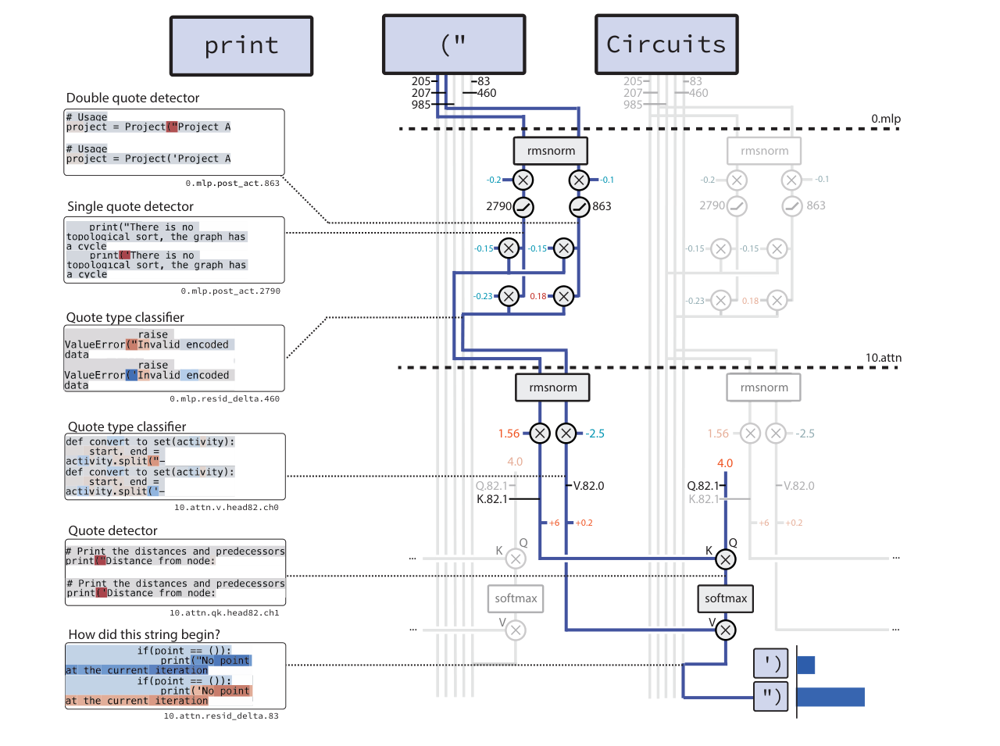
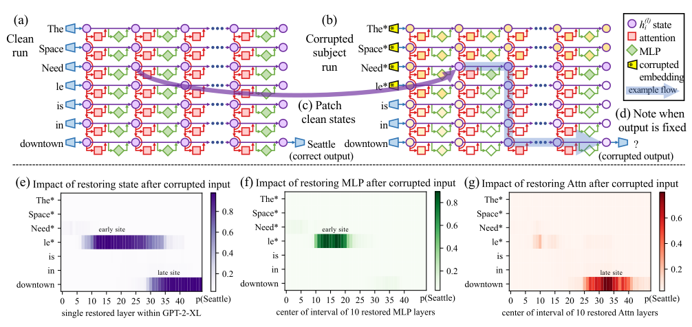
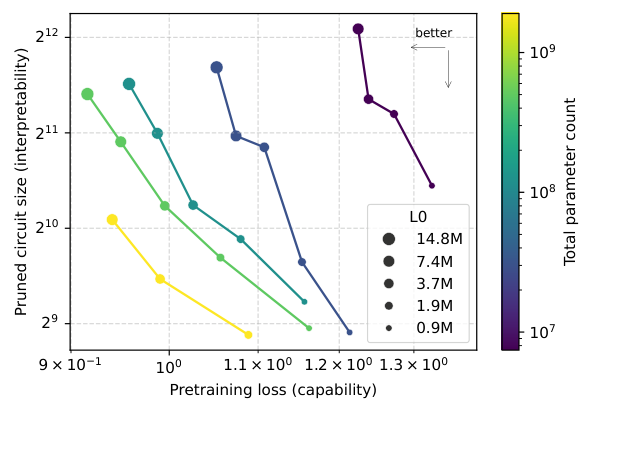
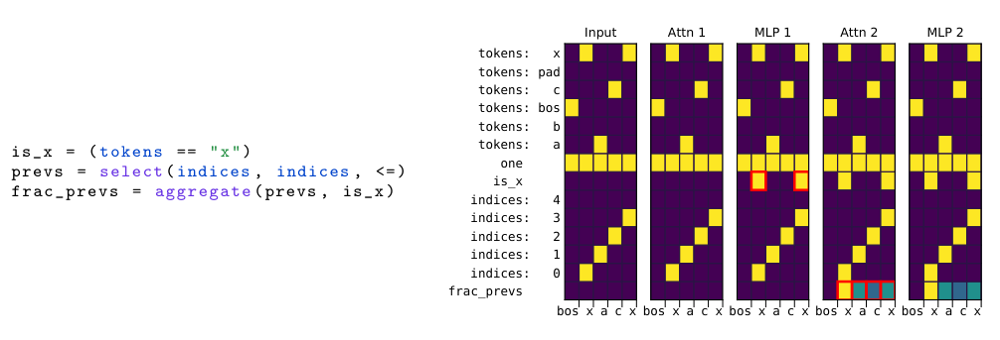

### 활성값이 아니라 가중치 자체를 해석의 대상으로 삼는 연구 흐름을 읽기, 고치기, 설계하기의 세 갈래로 나누어 알아봅니다.


> 다루는 논문  
> **Zoom In**: An Introduction to Circuits (Olah et al., Distill 2020)  
> **A Mathematical Framework for Transformer Circuits** (Elhage et al., Transformer Circuits Thread 2021)  
> **ROME**: Locating and Editing Factual Associations in GPT (Meng et al., NeurIPS 2022)  
> **MEMIT**: Mass-Editing Memory in a Transformer (Meng et al., ICLR 2023)  
> **Weight-sparse transformers have interpretable circuits** (Gao et al., OpenAI, ICML 2026 / PMLR 306)  
> **RASP**: Thinking Like Transformers (Weiss et al., ICML 2021), **Tracr**: Compiled Transformers as a Laboratory for Interpretability (Lindner et al., NeurIPS 2023)  

<center></center>

<font size="2"><center> 출처: Gao et al., Weight-sparse transformers have interpretable circuits, Figure 4 (https://arxiv.org/abs/2511.13653) </center>  </font>   

<br/>


>  **1. 가중치 수준의 해석은 이미 학습된 가중치를 "읽는" 연구(Circuits, QK/OV 회로), 특정 지식을 가중치에서 찾아 "고치는" 연구(ROME, MEMIT), 처음부터 읽기 쉬운 가중치를 "학습시키는" 연구(weight-sparse transformer)로 나눠볼 수 있음**
>
>  **2. OpenAI의 weight-sparse transformer는 가중치의 대부분을 0으로 강제해, 같은 pretraining loss의 dense 모델보다 약 16배 작은 task 회로를 얻었고, 모델 크기를 키우면 성능과 해석가능성의 trade-off 곡선 자체가 개선됨**
>
>  **3. 다만 학습/추론 비용이 dense 대비 100~1000배에 달하고, 해석 가능성을 유지하며 nonzero 파라미터를 수천만 개 이상으로 키우는 것은 아직 숙제임. 반대 방향으로 가중치를 사람이 직접 "쓰는" RASP/Tracr 계열이 다음 단계의 실마리가 됨**

<br/>

----

**본 포스트는 가중치 수준의 해석가능성(weight-level interpretability)과 관련된 주요 논문들을 읽고 정리한 노트입니다.**
원문은 글 하단의 출처에서 보실 수 있습니다.  

XAI 시리즈 3편 중 두 번째 글입니다.
- ① [[XAI] SAE와 Monosemanticity](https://myeonghak.github.io/xai/XAI-SAE%EC%99%80-Monosemanticity/)  
- ② 가중치 수준의 해석가능성 (이번 글)  
- ③ [[XAI] iWSP와 설명가능성](https://myeonghak.github.io/xai/XAI-iWSP%EC%99%80-%EC%84%A4%EB%AA%85%EA%B0%80%EB%8A%A5%EC%84%B1/)  

----
#### Contents  

1. [Intro - 해석은 어디에서 일어나는가](#intro)  
2. [가중치를 읽기: Circuits와 QK/OV 회로](#read)  
3. [가중치를 고치기: ROME과 MEMIT](#edit)  
4. [처음부터 읽기 쉽게 학습시키기: Weight-sparse Transformer](#sparse)  
5. [아예 가중치를 손으로 쓴다면? RASP와 Tracr](#tracr)  
6. [한눈에 비교하기](#compare)  
7. [마치며](#conclusion)  
<br />

<a id="intro"></a>
## 1. Intro - 해석은 어디에서 일어나는가  

이 시리즈는 "해석이 모델의 어느 지점에서 일어나는가"라는 축을 따라가고 있습니다.  
가장 바깥쪽에는 예전에 다뤘던 [LIME](https://myeonghak.github.io/xai/XAI-LIME%28Local-Interpretable-Model-agnostic-Explanation%29-%EC%95%8C%EA%B3%A0%EB%A6%AC%EC%A6%98/)이나 [SHAP](https://myeonghak.github.io/xai/XAI-SHAP/) 같은 post-hoc attribution이 있습니다. 모델은 블랙박스로 두고 입력과 출력의 관계만으로 "어떤 feature가 얼마나 기여했나"를 계산하는 방식이죠.  

[① 편](https://myeonghak.github.io/xai/XAI-SAE%EC%99%80-Monosemanticity/)에서는 한 단계 안으로 들어가, Sparse Autoencoder(SAE)로 모델 내부의 **활성값(activation)** 을 사람이 이해할 수 있는 feature들로 분해하는 방법을 살펴봤습니다. 그런데 SAE는 어디까지나 이미 학습된 모델의 활성값을 사후적으로 번역해 주는 사전(dictionary)일 뿐이고, 모델의 가중치는 한 줄도 건드리지 않습니다. 즉 모델 자체가 읽기 쉬워지는 것은 아니고, 번역기가 하나 더 생긴 셈인데요.  

그렇다면 질문을 바꿔볼 수 있겠습니다. **활성값이 아니라 가중치 자체를 들여다보거나, 아예 가중치를 읽기 쉬운 모양으로 만들 수는 없을까?** 이번 글에서는 이 질문에 대한 세 가지 접근을 순서대로 보겠습니다.  

- **읽기**: 학습된 가중치를 그대로 두고, 가중치 행렬을 곱해 "회로"를 읽어냄 (Circuits, Transformer Circuits)  
- **고치기**: 특정 지식이 저장된 가중치를 찾아 직접 수정함 (ROME, MEMIT)  
- **설계하기**: 학습 단계에서부터 가중치를 희소하게 강제해 회로가 저절로 읽기 쉬워지게 함 (Weight-sparse Transformer)  

그리고 마지막에는 한 발 더 나아가, 가중치를 사람이 직접 "작성"하는 RASP/Tracr를 짧게 다루며 ③ 편으로 넘어가겠습니다.  


<a id="read"></a>
## 2. 가중치를 읽기: Circuits와 QK/OV 회로  

### Zoom In: 뉴런은 feature이고, 가중치는 회로다  

Distill에 실린 Olah et al.(2020)의 "Zoom In"은 현미경이 세포생물학을 열었듯, 신경망도 "확대해서 보면" 새로운 과학이 열릴 수 있다는 문제의식으로 시작합니다. 이 글은 InceptionV1(이미지 분류 CNN)을 대상으로 세 가지 **추측성 주장(speculative claims)** 을 내놓습니다.  

- **Claim 1. Features**: feature는 신경망의 기본 단위이며, 엄밀하게 연구하고 이해할 수 있음 (예: 곡선 검출기, high-low frequency 검출기, 자세에 무관한 개 머리 검출기)  
- **Claim 2. Circuits**: feature들은 가중치로 연결되어 회로를 이루며, 이 회로도 엄밀하게 연구하고 이해할 수 있음  
- **Claim 3. Universality**: 비슷한 feature와 회로가 서로 다른 모델과 task에서 반복적으로 형성됨  

이번 글의 관점에서 핵심은 Claim 2입니다. 한 층의 뉴런은 이전 층 뉴런의 선형결합에 ReLU를 씌운 것이므로, **양쪽 층의 feature를 이해한다면 그 사이의 가중치도 이해할 수 있어야 한다**는 논리인데요. 실제로 Zoom In은 아래쪽에 바퀴, 위쪽에 창문이 있으면 반응하는 자동차 검출 뉴런(mixed4c 층)이 이전 층의 바퀴/창문 feature로부터 어떤 가중치로 조립되는지를 보여줍니다.  

흥미로운 건 그 다음입니다. 모델이 다음 층에서 깨끗한 자동차 뉴런을 하나 더 만드는 대신, 자동차 feature를 주로 개를 검출하는 여러 뉴런에 흩뿌려 놓는다는 것인데요. 저자들은 이를 **superposition** 이라고 부르고, 자동차와 개가 한 이미지에 같이 나오는 일이 드물다면 뉴런을 아끼기 위해 이렇게 섞어 저장하는 것이라고 해석합니다. 바로 이 superposition 때문에 뉴런 하나하나가 polysemantic해지고, ① 편의 SAE가 등장할 동기가 생겼죠. 이번 글의 4장에서 다룰 weight-sparse 모델도 같은 문제를 반대 방향에서 공략합니다.  

### Transformer Circuits: 가중치 행렬을 곱하면 알고리즘이 보인다  

Elhage et al.(2021)의 "A Mathematical Framework for Transformer Circuits"는 이 아이디어를 Transformer로 가져옵니다. 처음부터 거대한 LLM을 해석하려 하지 않고, **MLP를 뺀 attention-only 모델을 0층, 1층, 2층** 순서로 아주 작게 시작하는 것이 특징입니다.  

핵심 관찰은 attention head 하나가 서로 거의 독립적인 두 개의 계산으로 쪼개진다는 것입니다.  

- **QK 회로**: 어떤 토큰이 어떤 토큰을 볼지(attention pattern)를 결정함. 1층 모델에서는 $W_E^T W_Q^T W_K W_E$ 형태의 (vocab x vocab) 행렬로 표현됨  
- **OV 회로**: 어떤 토큰을 봤을 때 출력 logit이 어떻게 바뀌는지를 결정함. $W_U W_O W_V W_E$ 형태의 (vocab x vocab) 행렬로 표현됨  

$$
A^h = \text{softmax}\left(t^T W_E^T W_{QK}^h W_E \, t\right), \quad W_{QK}^h = W_Q^{h\,T} W_K^h, \quad W_{OV}^h = W_O^h W_V^h
$$

여기서 query/key/value 벡터는 저차원 행렬 $W_Q^T W_K$, $W_O W_V$를 계산하는 중간 결과일 뿐이고, 본질은 가중치 행렬의 곱이라는 관점입니다. 이렇게 보면 논문의 결과가 꽤 깔끔하게 정리됩니다.  

- **0층 모델**은 bigram 통계를 학습하며, bigram 표를 가중치에서 직접 읽을 수 있음  
- **1층 attention-only 모델**은 bigram과 "A ... B C" 형태의 skip-trigram 모델의 앙상블이며, 이 표 역시 **모델을 돌리지 않고 가중치만으로** 읽을 수 있음  
- 1층 모델의 head 상당수는 용량의 큰 부분을 **복사(copying)** 에 씀. OV 회로가 "본 토큰의 확률을 올리는" 구조이고, 저자들은 OV 회로 행렬에 양의 고윳값이 많다는 점을 복사의 신호로 사용함  
- **2층 모델**은 head 간 합성(Q/K/V-composition)으로 훨씬 복잡한 알고리즘을 구현하며, 그 대표가 in-context learning을 설명하는 **induction head**임. induction head는 attention 층이 최소 2개 이상일 때만 생김  

### 직접 해보자! 1층 모델의 OV/QK 회로 읽기  

말로만 보면 감이 잘 안 오니, 정말 작은 1층 attention-only 모델을 학습시켜서 가중치만으로 동작을 읽어보겠습니다. task는 단순하게 "마지막 위치에서 0번 위치의 토큰을 그대로 출력하기"로 잡았습니다. 이 task를 풀려면 모델은 (1) QK 회로로 0번 위치를 보고, (2) OV 회로로 본 토큰을 복사해야 하겠죠.  

```python
import torch, torch.nn as nn
torch.manual_seed(0)
V, D, T = 12, 32, 8                      # vocab, d_model, seq_len

class OneLayerAttnOnly(nn.Module):
    def __init__(s):
        super().__init__()
        s.W_E = nn.Parameter(torch.randn(V, D) * 0.1)   # token embedding
        s.W_P = nn.Parameter(torch.randn(T, D) * 0.1)   # positional embedding
        s.W_Q, s.W_K, s.W_V, s.W_O = (nn.Parameter(torch.randn(D, D) * 0.1) for _ in range(4))
        s.W_U = nn.Parameter(torch.randn(D, V) * 0.1)   # unembedding
    def forward(s, x):
        h = s.W_E[x] + s.W_P                            # residual stream
        q, k, v = h @ s.W_Q, h @ s.W_K, h @ s.W_V
        att = (q @ k.transpose(-1, -2) / D**0.5).masked_fill(torch.ones(T, T).triu(1).bool(), -1e9).softmax(-1)
        h = h + att @ v @ s.W_O
        return h @ s.W_U

# task: at the last position, output the token that was at position 0
m = OneLayerAttnOnly(); opt = torch.optim.Adam(m.parameters(), 1e-2)
for step in range(1500):
    x = torch.randint(0, V, (256, T))
    loss = nn.functional.cross_entropy(m(x)[:, -1], x[:, 0])
    opt.zero_grad(); loss.backward(); opt.step()
x = torch.randint(0, V, (2000, T))
print(f"test acc: {(m(x)[:, -1].argmax(-1) == x[:, 0]).float().mean():.3f}")

with torch.no_grad():
    # OV circuit: if token j is attended to, how much does it raise logit i?  (V x V)
    OV = (m.W_E @ m.W_V @ m.W_O @ m.W_U).T
    print("OV argmax == identity:", (OV.argmax(0) == torch.arange(V)).float().mean().item())
    ev = torch.linalg.eigvals(OV)
    print(f"OV eigenvalues: sum(lambda)/sum(|lambda|) = {(ev.sum().real / ev.abs().sum()):.3f}")
    # positional QK circuit: last position (query) -> every position (key)
    P = m.W_P
    qk = (P[-1] @ m.W_Q) @ (P @ m.W_K).T / D**0.5
    print("positional QK scores from last pos:", [round(v, 1) for v in qk.tolist()])
```

```
test acc: 1.000
OV argmax == identity: 1.0
OV eigenvalues: sum(lambda)/sum(|lambda|) = 1.000
positional QK scores from last pos: [22.4, -12.2, -13.9, -14.2, -12.5, -14.5, -13.3, -4.8]
```

입력 데이터를 한 번도 넣지 않고 가중치 행렬만 곱해서 다음을 확인할 수 있습니다.  

- **OV 회로**: 12개 토큰 모두에서 "토큰 j를 보면 logit j가 가장 크게 오름"(대각 성분이 최대)이 성립함. 고윳값 합을 고윳값 절댓값 합으로 나눈 값이 1.000이라는 것은 고윳값이 사실상 모두 양의 실수라는 뜻이고, 프레임워크 논문이 말하는 "복사 head"의 서명과 같음  
- **QK 회로**: 위치 임베딩 부분만 떼어 보면, 마지막 위치의 query는 0번 위치 key에 22.4점, 나머지에는 음수 점수를 줌. 즉 "0번 위치를 본다"는 것이 가중치에 그대로 적혀 있음 (토큰 임베딩 쪽 기여는 이 계산에서 생략함)  

물론 이건 장난감이고, 실제 LLM에서는 MLP가 끼고, head끼리 합성되고, superposition 때문에 깨끗한 대각 행렬 같은 건 잘 안 보입니다. 저자들도 이 첫 논문에서는 큰 모델로의 확장을 시도하지 않았다고 밝히고 있죠. 그래서 "학습된 가중치를 그대로 읽는" 접근은 작은 모델에서는 아름답지만, 규모가 커질수록 사람이 감당하기 어려워진다는 한계가 있습니다.  


<a id="edit"></a>
## 3. 가중치를 고치기: ROME과 MEMIT  

가중치를 완전히 읽어내지는 못하더라도, **특정 지식이 어디에 저장되어 있는지 찾아내고 그 자리를 고칠 수 있다면** 그것도 가중치 수준의 이해라고 볼 수 있겠죠. Meng et al.(2022)의 ROME이 바로 이 질문에서 출발합니다.  

### Causal Tracing: 지식은 어디에 있을까?  

<center></center>

<font size="2"><center> 출처: Meng et al., Locating and Editing Factual Associations in GPT, Figure 1 (https://arxiv.org/abs/2202.05262) </center>  </font>   

방법은 위 그림처럼 세 번의 forward pass를 비교하는 것입니다.  

- (a) **clean run**: "The Space Needle is in downtown" 을 넣으면 "Seattle"을 맞힘  
- (b) **corrupted run**: 주어(subject) 토큰의 임베딩에 노이즈를 섞어 정답을 못 맞히게 만듦  
- (c) **patch**: corrupted run에서 특정 층, 특정 위치의 hidden state 하나만 clean run의 값으로 되돌려 놓고, 정답 확률이 얼마나 회복되는지 측정함  

GPT-2 XL(1.5B)에서 1000개의 사실 문장으로 이 실험을 한 결과, 전체 효과(ATE)는 18.6%였고, 그중 큰 부분이 **주어의 마지막 토큰 위치, 중간 층**의 상태에 몰려 있었습니다(15번 층 AIE 8.7%). 이를 MLP와 attention으로 나눠 보면, 이 "early site"에서는 MLP 기여가 AIE 6.6%로 최고점을 찍은 반면 같은 위치 attention은 1.6%에 그쳤습니다. 마지막 토큰 근처의 "late site"는 attention이 중요한데, 이는 예측 직전이니 놀랍지 않은 부분이고, 중간 층 MLP가 사실 회상에 결정적이라는 점이 새로운 발견이라는 것이 저자들의 설명입니다.  

### Rank-One Model Editing  

그럼 그 중간 층 MLP의 출력 projection 행렬 $W$를 **key-value 메모리**로 보면 어떨까요? 주어의 마지막 토큰에서 나온 벡터가 key $k$, 그 사실에 해당하는 출력이 value $v$라고 보는 겁니다. 새로운 사실 $(k_*, v_*)$를 넣고 싶다면, 기존 key-value 쌍들은 최대한 유지하면서 $\hat{W}k_* = v_*$를 만족하는 제약 최소제곱 문제를 풀면 되고, 이는 닫힌 형태로 풀립니다.  

$$
\hat{W} = W + \Lambda \left(C^{-1} k_*\right)^T, \quad C = KK^T
$$

여기서 $C$는 Wikipedia 텍스트 샘플로 미리 추정해 둔 key의 공분산이고, $\Lambda$는 새 key-value 쌍이 기존 메모리에서 얼마나 어긋나는지에 비례하는 벡터입니다. 결국 **rank-one 업데이트 한 번**으로 사실 하나를 바꾸는 셈이죠.  

ROME은 zsRE 편집 벤치마크에서 효과적이었고, 저자들이 새로 만든 어려운 반사실 데이터셋 **CounterFact(21,919개 레코드)** 에서 GPT-2 XL(1.5B)과 GPT-J(6B)에 대해 일반화(paraphrase에도 바뀐 사실이 적용됨)와 특이성(관련 없는 사실은 그대로 유지됨)을 동시에 잘 지키는 반면, 비교 방법들은 둘 중 하나를 희생하는 경향을 보였습니다.  

### MEMIT, 그리고 한계  

ROME의 한계는 논문에 솔직하게 적혀 있습니다.  

- 한 번에 **사실 하나**만 편집함  
- 편집이 **방향성**을 가짐. "시애틀의 랜드마크는 스페이스 니들"과 "스페이스 니들은 시애틀의 랜드마크"는 따로 저장되어 두 번 편집해야 함  
- 논리, 공간, 수치 같은 다른 종류의 지식은 다루지 않았음  

첫 번째 한계를 푼 것이 후속작 **MEMIT**(ICLR 2023)입니다. 여러 중간 층 MLP에 편집을 나눠 넣는 방식으로 GPT-J(6B)와 GPT-NeoX(20B)에서 **수천 개의 사실을 한꺼번에** 업데이트할 수 있음을 보였고, zsRE 기준 10,000개 편집까지 실험했습니다.  

다만 "위치를 찾았으니 그곳을 고친다"는 논리 자체에 대한 반론도 있습니다. Hase et al.(2023, "Does Localization Inform Editing?")은 causal tracing이 가리키는 층과, 실제로 편집이 가장 잘 되는 층 사이에 별 관계가 없다는 결과를 보고했는데요. 가중치를 고칠 수 있다는 것과 가중치를 이해했다는 것은 같은 말이 아니라는 점을 상기시켜 주는 대목입니다.  


<a id="sparse"></a>
## 4. 처음부터 읽기 쉽게 학습시키기: Weight-sparse Transformer  

여기까지는 모두 **이미 학습된 dense 모델**을 대상으로 했습니다. 그런데 dense 모델의 가중치가 읽기 어려운 근본 원인이 superposition이라면, 아예 학습할 때부터 superposition이 생기기 어렵게 만들면 어떨까요? OpenAI의 Gao et al.(2025, arXiv 2511.13653, ICML 2026 PMLR 306)이 바로 이 방향입니다.  

### 아이디어: 뉴런마다 연결을 몇 개만 허락하자  

방법 자체는 놀라울 정도로 단순합니다.  

- GPT-2 스타일 decoder-only Transformer를 **Python 코드 데이터**로 사전학습함  
- 토큰 임베딩을 포함한 **모든 가중치와 bias에 L0 희소성**을 강제함. 가장 희소한 모델은 대략 **1000개 중 1개**의 가중치만 0이 아님  
- 구현은 매 step마다 AdamW 업데이트 후, 각 가중치 행렬에서 크기가 가장 큰 값들만 남기고 나머지를 0으로 만듦. L0는 학습 중 dense에서 목표값까지 점차 줄여 나감(annealing)  
- 활성값도 약하게 희소화함(각 위치에서 4개 중 1개만 nonzero)  

이렇게 하면 각 뉴런은 residual 채널 몇 개만 읽고 쓸 수 있으니, 개념 하나를 여러 채널에 흩뿌리거나 필요 이상으로 많은 뉴런을 쓰는 것이 구조적으로 어려워집니다. 같은 nonzero 개수(L0)를 유지한 채로 모델 폭만 넓힐 수 있다는 점도 중요한데, 뒤의 scaling 결과와 연결됩니다.  

참고로 여기서 말하는 sparsity는 MoE의 sparsity와 다릅니다. 저자들도 MoE는 가중치 대부분이 nonzero이므로 자신들의 용어로는 "weight-dense"라고 선을 긋고 있습니다.  

### 해석가능성을 어떻게 측정할까?  

"해석 가능하다"를 숫자로 만들기 위해 저자들은 다음과 같이 정의합니다.  

- **Task**: 직접 만든 20개의 간단한 Python next-token 이지선다 task. 예를 들어 문자열을 `'`로 열었는지 `"`로 열었는지에 따라 닫는 따옴표를 고르기, 변수가 `set()`으로 초기화됐는지에 따라 `.add`와 `+=` 중 고르기 등  
- **노드와 엣지**: 노드는 뉴런, attention 채널, residual 채널 읽기/쓰기 하나하나로 최대한 잘게 정의하고, **엣지는 가중치 행렬의 nonzero 원소 하나**임  
- **Pruning**: 각 task에서 목표 loss(기본 0.15)를 달성하는 가장 작은 회로를 찾음. 노드별 mask를 학습하고, 제거된 노드는 pretraining 분포에서의 평균 활성값으로 고정(mean ablation)함  
- **지표**: task별 회로의 엣지 수의 기하평균  

### 결과 1: 같은 성능이면 회로가 약 16배 작다  

pretraining loss가 비슷한 sparse 모델과 dense 모델을 비교했을 때, sparse 모델을 pruning해서 얻은 회로는 어떤 목표 loss에서든 **대략 16배 작았습니다.** 또 회로가 충분조건일 뿐 아니라 필요조건이라는 것도 확인했는데요. 회로에 속한 아주 적은 노드만 지우면 task 성능이 크게 망가지는 반면, 회로 밖 노드를 전부 mean ablation해도 task loss는 유지됩니다.  

맨 위의 그림이 그 예시인 **문자열 닫기 회로**입니다. 논문은 이 회로를 생략 없이 **12개 노드와 9개 엣지**로 보여줍니다.  

- 0번 MLP가 `("`와 `('` 토큰 임베딩을 "따옴표 검출기" 채널과 "따옴표 종류 분류기" 채널로 변환함  
- 10번 attention 층에서 key 채널은 따옴표 검출기를, value 채널은 따옴표 종류 분류기를 읽음  
- 뒤따르는 토큰이 따옴표 위치를 attend해서 종류를 복사해 오고, 맞는 닫는 따옴표를 예측함  

2장의 장난감 실험에서 본 "QK로 어디를 볼지 정하고, OV로 복사한다"는 구조가, 실제 사전학습된 모델 안에서 엣지 9개 수준으로 깔끔하게 드러난 것이죠.  

리스트 중첩 깊이를 세는 회로(7개 노드, 4개 엣지)는 더 재미있습니다. attention head가 `[` 검출기 값을 context 전체에 대해 **평균**내는 방식으로 깊이를 계산하는데, 이걸 이해하고 나니 공격법이 보였다고 합니다. 리스트를 길게 만들면 평균이 희석되어 모델이 `]]`를 틀리게 되는데, 이 "context dilution" 공격은 pruning하지 않은 원래 모델에서도 통했고, 비슷한 성능의 dense 모델에도 일반화되었다고 합니다. 회로를 이해한 것이 실제로 모델의 약점을 예측하게 해준 사례라 인상적이었습니다.  

### 결과 2: 희소성과 성능의 trade-off, 그리고 scaling  

<center></center>

<font size="2"><center> 출처: Gao et al., Weight-sparse transformers have interpretable circuits, Figure 3 (https://arxiv.org/abs/2511.13653) </center>  </font>   

이 그림은 x축이 pretraining loss(성능), y축이 pruning된 회로 크기(해석가능성)이고, 왼쪽 아래로 갈수록 좋습니다. 색은 총 파라미터 수, 점 크기는 L0(nonzero 개수, 0.9M ~ 14.8M)입니다.  

- **총 파라미터 수를 고정하고 L0를 줄이면** 하나의 곡선 위를 따라 움직임. 회로는 작아지지만(해석가능성 상승) loss는 올라감(성능 하락). 즉 희소성은 성능과 해석가능성을 맞바꾸는 손잡이임  
- **L0를 고정하고 모델을 키우면** 곡선 자체가 왼쪽 아래로 이동함. 성능과 해석가능성이 동시에 좋아짐. 더 큰 모델은 같은 L0에서 표현력이 더 크고, 뉴런/채널당 nonzero 가중치는 더 적어지기 때문이라는 설명임  
- 가중치 희소성을 높이면 residual stream 활성값도 자연스럽게 더 희소해짐(kurtosis로 측정). ① 편에서 SAE가 사후적으로 얻으려던 성질을 학습 단계에서 일부 얻는 셈임  

### 기존 dense 모델에도 쓸 수 있을까? Bridges  

weight-sparse 모델을 처음부터 학습하는 건 좋지만, 우리가 정말 이해하고 싶은 건 이미 배포된 dense 모델이겠죠. 그래서 저자들은 **bridge**라는 장치를 붙여봅니다. dense 모델의 각 sublayer 앞에서 sparse 모델의 활성값으로 가는 encoder와, 다시 돌아오는 decoder를 함께 학습시키는 건데요. 저자들 표현대로 각 bridge는 "latent 공간이 sparse 모델의 residual 활성값인 SAE"라고 볼 수 있습니다. ① 편의 SAE와 이번 글의 weight sparsity가 여기서 만나는 셈이죠.  

이렇게 연결한 뒤 sparse 모델 회로의 "따옴표 종류 분류기" 채널을 작은따옴표 쪽으로 조작하고 bridge로 dense 모델에 옮겨 주면, dense 모델이 작은따옴표를 출력할 확률이 가파르게 올라갔습니다. 다만 저자들 스스로 이 부분은 **예비 결과(preliminary)** 라고 명시하고 있습니다.  

### 한계  

논문이 직접 꼽는 한계도 분명합니다.  

- **연산 비효율**: 비슷한 성능의 dense 모델 대비 학습/추론 연산이 **100~1000배** 더 듦. 비정형 희소 행렬 연산은 GPU에서 근본적으로 비효율적이라 frontier 모델을 이렇게 학습하는 건 사실상 불가능하다고 봄  
- **규모의 벽**: 해석가능성을 유지하면서 nonzero 파라미터 **수천만 개 이상**으로 키우는 건 아직 과제임  
- **수작업 해석**: 회로 하나를 사람이 해석하는 데 대략 연구자 하루가 걸렸고, 해석한 task도 단순한 것들임  

그래서 저자들이 제시하는 방향은 frontier 모델을 직접 sparse로 만드는 것이 아니라, GPT-3 수준까지의 **해석 가능한 model organism**을 만들어 공통 회로 모티프를 연구하거나, 기만/거절 같은 좁지만 중요한 task 분포에 대해서만 bridge로 연결된 sparse 모델을 학습하는 것입니다. 학습된 sparse 모델의 가중치와 pruning된 회로, 시각화 코드는 [openai/circuit_sparsity](https://github.com/openai/circuit_sparsity/)에 공개되어 있습니다.  


<a id="tracr"></a>
## 5. 아예 가중치를 손으로 쓴다면? RASP와 Tracr  

읽기, 고치기, 희소하게 학습시키기까지 왔다면 마지막 질문이 남습니다. **가중치를 사람이 직접 쓰면 어떨까?** 그러면 해석은 할 필요조차 없겠죠. 정답을 우리가 이미 알고 있으니까요.  

### RASP: Transformer처럼 생각하기  

Weiss et al.(2021)의 RASP(Restricted Access Sequence Processing Language)는 Transformer encoder의 계산을 프로그래밍 언어로 옮긴 것입니다. attention은 `select`(어떤 위치끼리 볼지 정하는 selector)와 `aggregate`(선택된 값을 평균내기)로, feed-forward는 위치별 elementwise 연산으로 대응시킵니다. RNN을 유한 상태 오토마타로 생각하듯, Transformer를 이 언어로 생각해 보자는 제안인데요.  

RASP 프로그램을 짜면 그 task에 필요한 층 수와 head 수의 **상한**을 알 수 있습니다. 저자들은 그 크기 그대로의 Transformer를 실제로 학습시켜 봤는데, 예를 들어 reverse(2층 1 head)는 99.99%, sort(2층 1 head)는 99.96%, Dyck-1(2층 1 head)은 99.67%의 test 정확도를 보였습니다. double histogram task에서는 attention에 RASP 해답의 패턴을 따르도록 추가 지도까지 주자 99.9% 정확도와 함께 RASP 프로그램과 거의 같은 attention 패턴이 학습되었다고 합니다.  

### Tracr: RASP를 실제 가중치로 컴파일하기  

<center></center>

<font size="2"><center> 출처: Lindner et al., Tracr: Compiled Transformers as a Laboratory for Interpretability, Figure 2 (https://arxiv.org/abs/2301.05062) </center>  </font>   

Google DeepMind의 Lindner et al.(2023)은 여기서 한 걸음 더 나아가, RASP 프로그램을 **학습 없이** 표준 decoder-only Transformer 가중치로 변환하는 컴파일러 Tracr를 만들었습니다. elementwise 연산은 MLP 블록으로, select-aggregate는 attention 블록으로 번역하고, 이를 층에 배치해 가중치를 만들어내는 방식입니다.  

위 그림의 `frac_prevs`는 "지금까지 나온 토큰 중 x의 비율"을 계산하는 세 줄짜리 프로그램인데, 컴파일된 모델은 14차원 residual stream을 가지며(그중 12차원을 사용), 그림의 각 행처럼 `tokens: x`, `indices: 3`, `is_x`, `frac_prevs` 같은 이름 붙은 변수가 residual stream의 특정 차원에 대응합니다. 가중치의 모든 축이 처음부터 이름표를 달고 태어나는 셈이죠.  

Tracr의 원래 목적은 실용 모델이 아니라 **해석 기법의 정답지(ground truth)** 입니다. 메커니즘을 아는 모델에 SAE나 causal tracing 같은 도구를 돌려 보고, 그 도구가 정답을 찾는지 확인하자는 거죠. 저자들의 비유를 빌리면, 익숙한 모양을 한 번도 비춰보지 못한 채 현미경 렌즈를 발명하려는 상황을 바꾸자는 것입니다. 또 컴파일된 모델을 gradient descent로 더 작은 차원으로 압축해 보면서 superposition이 어떻게 생기는지도 관찰합니다.  

물론 한계도 분명합니다. 저자들 스스로 완전한 언어 모델을 Tracr로 컴파일하는 일은 아마 없을 것이라고 말하며, 컴파일된 모델에서의 평가는 "최소 기준"으로만 봐야 한다고 선을 긋습니다.  


<a id="compare"></a>
## 6. 한눈에 비교하기  

시리즈 전체의 축 위에 이번 글의 방법들을 올려 보면 다음과 같습니다.  

| 방법 | 무엇을 해석하나 | 언제 | 보여준 규모 | 주요 한계 |
|---|---|---|---|---|
| LIME / SHAP | 입력 feature 기여도 (모델 외부) | 사후 (post-hoc) | 모델 무관 | 내부 메커니즘은 설명하지 않음 |
| SAE (① 편) | 활성값 | 사후 | Claude 3 Sonnet 등 대형 LLM | 가중치는 그대로, 재구성 오차와 추상화의 왜곡 가능 |
| Circuits / QK-OV 회로 | 가중치 (+ 활성값) | 사후 | InceptionV1, 2층 이하 attention-only 모델 | superposition 때문에 큰 모델로 갈수록 수작업이 감당 불가 |
| ROME / MEMIT | 가중치 (사실 저장 위치) | 사후 (편집) | GPT-2 XL, GPT-J 6B / GPT-NeoX 20B, 1만 건 편집 | 사실 지식에 국한, 위치 찾기와 편집 효과의 관계가 논쟁적 |
| Weight-sparse Transformer | 가중치 (회로 자체) | 학습 시점 | nonzero 최대 약 1480만, 총 파라미터 10^9 규모 | dense 대비 100~1000배 연산, 수천만 nonzero 이상 확장이 숙제 |
| RASP / Tracr | 가중치 (설계된 프로그램) | 구성 시점 (학습 없음) | 소형 알고리즘 task (sort, Dyck, frac_prevs 등) | 언어 모델 수준 기능은 컴파일 불가, 사람이 프로그램을 써야 함 |

아래로 내려갈수록 해석이 모델 바깥에서 안쪽으로, 그리고 학습 이후에서 학습 이전으로 이동합니다. 그 대가로 다룰 수 있는 모델의 규모와 성능은 작아지죠. 이 표의 왼쪽 아래 칸(해석은 가중치 수준에서, 성능은 실용 수준으로)을 채우는 것이 이 분야의 숙제라고 볼 수 있겠습니다.  


<a id="conclusion"></a>
## 7. 마치며  

정리해 보면, 가중치 수준의 해석가능성은 세 가지 태도로 나뉩니다. 이미 있는 가중치를 **읽고**(Circuits), 필요한 부분을 **고치고**(ROME/MEMIT), 처음부터 읽히도록 **학습시키는**(weight-sparse) 것인데요.  

개인적으로 가장 와닿았던 건 weight-sparse 논문의 context dilution 사례였습니다. 회로를 엣지 몇 개 수준으로 이해하고 나니, 데이터를 뒤지지 않고도 모델이 어디서 틀릴지를 먼저 예측할 수 있었다는 점입니다. SHAP 값을 아무리 들여다봐도 이런 종류의 예측은 나오기 어렵죠. 반대로 100~1000배라는 연산 비용을 보면, 이게 당장 서비스 모델에 들어가기는 어렵겠다는 것도 분명합니다. (가난한 영세 개발자에게 1000배는 너무 큰 숫자입니다.)  

그리고 5장에서 본 것처럼, 축의 가장 끝에는 가중치를 아예 "쓰는" 길이 있습니다. Tracr는 사람이 직접 작성한 RASP 프로그램을 가중치로 컴파일하지만, 사람이 프로그램을 짜야 한다는 점 때문에 규모가 묶여 있었죠. 그렇다면 그 프로그램 작성을 **LLM 에이전트**에게 맡기면 어떨까요? 다음 [③ 편, iWSP와 설명가능성](https://myeonghak.github.io/xai/XAI-iWSP%EC%99%80-%EC%84%A4%EB%AA%85%EA%B0%80%EB%8A%A5%EC%84%B1/)에서는 LLM 에이전트가 해석 가능한 가중치를 직접 작성하는 interpretable weight-space programming(iWSP)과, 이것이 금융, 의료, 공공 부문처럼 설명 책임이 큰 영역에 주는 의미를 다뤄보겠습니다.  

----------------


**개선을 위한 여러분의 피드백과 제안을 코멘트로 공유해 주세요.**
**내용에 대한 지적, 혹은 질문을 환영합니다.**  


**출처**  
[Olah et al., Zoom In: An Introduction to Circuits, Distill 2020](https://distill.pub/2020/circuits/zoom-in/)  
[Elhage et al., A Mathematical Framework for Transformer Circuits, 2021](https://transformer-circuits.pub/2021/framework/index.html)  
[Meng et al., Locating and Editing Factual Associations in GPT (arXiv 2202.05262)](https://arxiv.org/abs/2202.05262)  
[Meng et al., Mass-Editing Memory in a Transformer (arXiv 2210.07229)](https://arxiv.org/abs/2210.07229)  
[Hase et al., Does Localization Inform Editing? (arXiv 2301.04213)](https://arxiv.org/abs/2301.04213)  
[Gao et al., Weight-sparse transformers have interpretable circuits (arXiv 2511.13653)](https://arxiv.org/abs/2511.13653)  
[Gao et al., PMLR 306 (ICML 2026)](https://proceedings.mlr.press/v306/gao26w.html)  
[openai/circuit_sparsity (GitHub)](https://github.com/openai/circuit_sparsity/)  
[Weiss et al., Thinking Like Transformers (arXiv 2106.06981)](https://arxiv.org/abs/2106.06981)  
[Lindner et al., Tracr: Compiled Transformers as a Laboratory for Interpretability (arXiv 2301.05062)](https://arxiv.org/abs/2301.05062)  
[google-deepmind/tracr (GitHub)](https://github.com/google-deepmind/tracr)  
