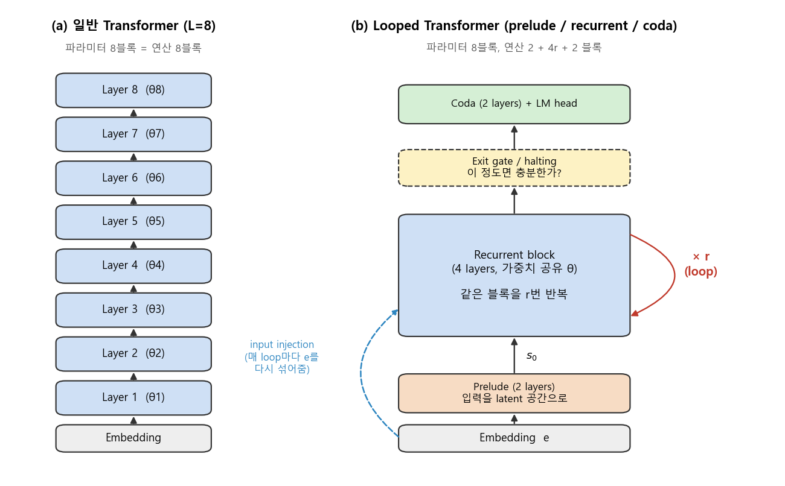
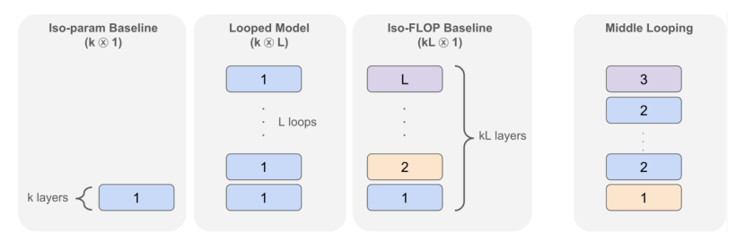
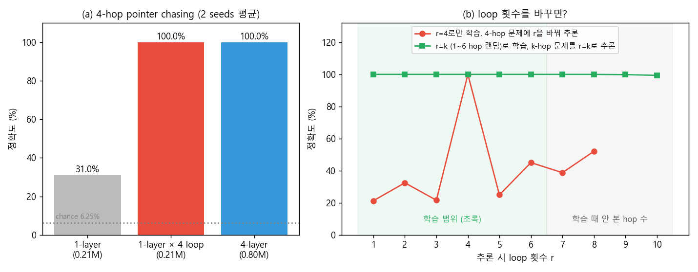
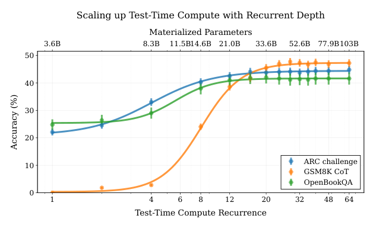
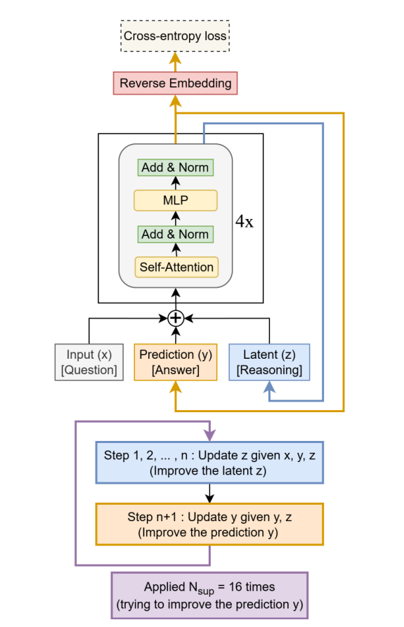
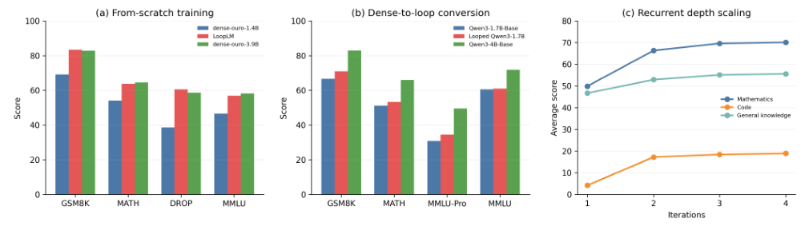

### 같은 블록을 여러 번 돌려서 모델을 "깊게" 만드는 looped transformer의 구조와 이론, 최근 흐름, 그리고 bitter lesson 관점에서의 의미를 알아봅니다.

> 주요 참고 논문  
> **Universal Transformers** (Dehghani et al., ICLR 2019)  
> **Reasoning with Latent Thoughts: On the Power of Looped Transformers** (Saunshi et al., ICLR 2025)  
> **Scaling up Test-Time Compute with Latent Reasoning: A Recurrent Depth Approach** (Geiping et al., 2025)  
> **Less is More: Recursive Reasoning with Tiny Networks** (Jolicoeur-Martineau, 2025)  
> **Scaling Latent Reasoning via Looped Language Models** (Ouro, Zhu et al., 2025)  
> **Closing the Loop: Practical Training Recipes for Looped Language Models** (Marchenko et al., 2026)  
> 외 Looped Transformers as Programmable Computers, Mixture-of-Recursions, HRM, Hyperloop Transformers, Looped Transformers as Optimizers 등

<center></center>

<br/>

>  **1. Looped transformer는 가중치를 공유하는 블록을 r번 반복 적용해, 파라미터 수와 연산 깊이(effective depth)를 분리하는 구조임**
>
>  **2. 이론적으로는 반복만으로 범용 프로그램 실행이 가능하고, 실험적으로는 k개 레이어를 L번 돌린 모델이 kL층 모델에 가까운 추론 성능을 보임. 단, 암기(memorization)와 perplexity는 파라미터 수를 따라감**
>
>  **3. 반복은 bitter lesson이 말하는 "연산을 활용하는 일반적 방법"의 새 축이지만, 공짜 연산은 아님. 과제 의존적이고, loop 수는 포화하며, 학습 레시피와 halting이 필요함**
>
>  **4. 가중치 공유 자체가 사람이 설계한 inductive bias라는 점에서, looped transformer는 bitter lesson의 사례이자 반례임. 핵심 질문은 "얼마나 많은 연산"이 아니라 "연산을 어디에 쓰느냐"임**

<br/>

----

**본 포스트는 looped transformer 관련 논문들을 읽고 정리한 노트입니다.** 원문 링크는 글 하단 출처에 모아 두었습니다.  
본문의 수치는 모두 각 논문 PDF에서 확인한 값이며, 4장의 toy 실험은 직접 돌린 결과입니다.

----
#### Contents

1. [Intro - looped transformer가 다시 돌아온 이유](#intro)
2. [구조: 같은 블록을 여러 번](#structure)
3. [왜 유효한가: 이론과 "추론 vs 암기"](#theory)
4. [작은 실험: 직접 loop를 돌려보자!](#toy)
5. [최근 흐름: Huginn부터 Closing the Loop까지](#recent)
6. [bitter lesson 관점에서 다시 보기](#bitter)
7. [한계와 열린 질문](#limits)
8. [마치며](#conclusion)

<br />

<a id="intro"></a>
## 1. Intro - looped transformer가 다시 돌아온 이유

처음 looped transformer 이야기를 들었을 때, 제 머릿속에 떠오른 건 Rich Sutton의 [The Bitter Lesson](http://www.incompleteideas.net/IncIdeas/BitterLesson.html)이었습니다.  
"결국 연산(compute)을 쏟아붓는 일반적인 방법이 이긴다"는 그 글 말이죠. 같은 블록을 몇 번이고 더 돌리면 성능이 오른다니, 이거야말로 "연산 부으면 된다"의 끝판왕 아닌가 싶었는데요.  
논문들을 하나씩 읽어 보니 절반은 맞고 절반은 틀린 생각이었습니다. 이 글은 그 절반을 바로잡는 과정의 기록이기도 합니다.

먼저 왜 지금 이 주제가 다시 뜨거운지부터 짚어 보겠습니다. 크게 세 가지 흐름이 겹쳐 있습니다.

- **Test-time compute 경쟁**: o1 이후 "추론 시점에 더 많이 생각하게 하자"가 대세가 됨. 그런데 지금의 주류 방식은 chain-of-thought(CoT) 토큰을 길게 생성하는 것임
- **Latent reasoning**: 생각을 굳이 텍스트 토큰으로 내뱉지 않고, hidden state 안에서 반복적으로 다듬자는 방향. Geiping et al.(2025)은 "모든 내부 추론을 다음 토큰 하나로 투영해야 한다는 제약은 낭비처럼 보인다"고 표현함
- **작은 재귀 모델의 반란**: 27M 파라미터의 HRM, 7M 파라미터의 TRM이 ARC-AGI에서 Deepseek R1, o3-mini 같은 LLM보다 높은 점수를 기록하면서 "크기가 아니라 반복"이라는 메시지가 화제가 됨

사실 아이디어 자체는 새롭지 않습니다. 2018년의 Universal Transformer가 이미 "같은 블록을 반복 적용하고, 위치별로 언제 멈출지(halting)를 학습하자"를 제안했고, ALBERT는 cross-layer parameter sharing으로 BERT-large 대비 파라미터를 18배 줄였습니다(334M vs 18M). Huginn 논문의 표현을 빌리면, 이 아이디어는 RNN, diffusion, universal/looped transformer의 모습으로 "매 십 년마다 재발견"되어 왔다고 하네요. 이번에 다른 점은 이것이 1B 이상, 수천억에서 수조 토큰 규모로 검증되기 시작했다는 것입니다.

<a id="structure"></a>
## 2. 구조: 같은 블록을 여러 번

### 퇴고하는 편집자 비유

직관부터 잡아 보겠습니다. 일반 Transformer가 원고를 8명의 서로 다른 편집자에게 차례로 넘기는 구조라면, looped transformer는 **한 명의 편집자가 같은 원고를 여러 번 퇴고하는 구조**입니다.  
편집자(가중치)는 그대로지만, 원고(hidden state)는 매 회차마다 조금씩 나아지죠. 편집자를 8명 고용하는 것보다 인건비(파라미터)는 훨씬 싸고, 대신 시간(연산)은 퇴고 횟수만큼 듭니다.

예전 [Longformer 글](https://myeonghak.github.io/natural%20language%20processing/NLP-Longformer/)에서 FCN과 CNN의 관계로 Longformer를 설명한 적이 있는데요, 비슷한 시선으로 볼 수도 있습니다. CNN이 **공간 축**으로 가중치를 공유해서 파라미터를 아꼈다면, looped transformer는 **깊이 축**으로 가중치를 공유합니다. 이 비유는 6장에서 bitter lesson을 이야기할 때 다시 쓰겠습니다.

### 구성 요소

맨 위 그림이 최근 모델들이 공통적으로 쓰는 구조를 그려 본 것입니다. ([Transformer와 BERT 글](https://myeonghak.github.io/natural%20language%20processing/NLP-Transformer%EC%99%80-BERT/)의 블록 하나를 떠올리시면 됩니다.)

- **Prelude**: 입력 토큰을 latent 공간으로 올려 주는 앞단 레이어들 (Huginn은 2층)
- **Recurrent block (core)**: 가중치를 공유하는 블록. 이걸 r번 반복함 (Huginn은 4층)
- **Coda**: 최종 latent state를 다시 어휘 공간으로 내려 보내는 뒷단 + LM head (Huginn은 2층)
- **Input injection**: 매 loop마다 원래 입력 임베딩 e를 다시 섞어 줌. Huginn은 상태 s와 e를 concat해서 선형 변환하고, Fan et al.(2024)도 길이 일반화에서 input injection이 성능을 올린다고 보고함. 반복하다 보면 원래 문제가 무엇이었는지 잊어버리는 것을 막아 주는 장치임
- **Exit gate / halting**: "이 정도면 충분히 생각했나?"를 판단해 loop를 조기 종료함. Universal Transformer의 ACT, Ouro의 entropy 정규화된 exit gate, MoR의 토큰별 router가 모두 이 계열임

식으로 쓰면 아주 간단합니다.

$$
e = P(x), \quad s_0 \sim \mathcal{N}(0, \sigma^2 I), \quad s_i = R(e, s_{i-1}) \;\; (i = 1, \dots, r), \quad p = C(s_r)
$$

여기서 $P$, $R$, $C$가 각각 prelude, recurrent block, coda이고, 핵심은 **$R$의 파라미터가 모든 $i$에서 같다**는 점입니다. ($s_0$를 노이즈로 초기화하는 것은 Huginn의 방식입니다.)  
그래서 파라미터는 $P + R + C$로 고정인데, 연산량은 $P + r \cdot R + C$로 r에 비례해 늘어납니다. Huginn은 학습 때 r을 log-normal Poisson 분포에서 매번 샘플링(평균 32)해서, 추론 시점에 r을 키워도 망가지지 않도록 학습했습니다.

Saunshi et al.(2025)은 비교 기준을 깔끔하게 정의해 두었는데, 이후 논문들이 거의 이 용어를 씁니다.

<center></center>
<font size="2"><center> 출처: Saunshi et al., Reasoning with Latent Thoughts: On the Power of Looped Transformers, Figure 1 (https://arxiv.org/abs/2502.17416) </center>  </font>

<br/>

- $(k \otimes L)$: k층 블록을 L번 반복한 looped 모델
- **iso-param baseline** $(k \otimes 1)$: 파라미터 수가 같은 k층 모델 (반복 없음)
- **iso-FLOP baseline** $(kL \otimes 1)$: 연산량(깊이)이 같은 kL층 모델. 파라미터는 L배 많음
- **middle looping**: 앞뒤 레이어는 따로 두고 가운데만 반복하는 방식. 위의 prelude/coda 구조가 바로 이것임

looped 모델은 이 둘 사이 어딘가에 놓이게 됩니다. iso-param보다는 연산을 더 쓰고, iso-FLOP보다는 파라미터가 적죠. 결국 "looped가 좋다"는 말은 항상 **누구와 비교해서**인지를 따져 봐야 합니다. 이게 이 글 전체에서 계속 중요해지는 포인트입니다.

<a id="theory"></a>
## 3. 왜 유효한가: 이론과 "추론 vs 암기"

### 반복만으로 컴퓨터를 만들 수 있다

Giannou et al.(2023)의 *Looped Transformers as Programmable Computers*는 꽤 도발적인 결과를 보여 줍니다. 입력 시퀀스를 일종의 **천공 카드(punchcard)** 처럼 써서 명령어와 메모리를 담고, **13층짜리 transformer를 loop로 돌리면** 작은 명령어 집합 컴퓨터를 흉내 낼 수 있다는 것이죠. 이걸로 기본 계산기, 기본 선형대수 라이브러리, 역전파를 쓰는 in-context learning 알고리즘까지 실행해 보입니다.  
여기서 가중치는 학습한 게 아니라 **사람이 직접 짜 넣은** 것입니다. 이전 [가중치 수준의 해석가능성 글](https://myeonghak.github.io/xai/XAI-%EA%B0%80%EC%A4%91%EC%B9%98-%EC%88%98%EC%A4%80%EC%9D%98-%ED%95%B4%EC%84%9D%EA%B0%80%EB%8A%A5%EC%84%B1/)에서 다룬 RASP/Tracr처럼 "프로그램을 transformer 가중치로 컴파일한다"는 발상과 맞닿아 있는데요, 차이는 고정 깊이 대신 **loop**가 들어가면서 반복문, 분기, 프로그램 카운터 같은 진짜 컴퓨터의 부품이 가능해진다는 점입니다.

이 연결은 Fan et al.(ICLR 2025)의 *Looped Transformers for Length Generalization*에서 더 직접적으로 드러납니다. 저자들은 RASP-L(유한 크기 transformer로 표현 가능한, 길이 일반화가 되는 연산) 연산을 n번 반복하면 풀리는 문제를 **n-RASP-L**로 정의하고, Copy(n번 shift), Parity(n번 shift + XOR), Addition(n+1단계)이 여기에 속함을 보입니다. 그리고 중간 과정 supervision 없이 최종 답만으로 학습해도, 문제 길이에 맞춰 loop 수를 늘리면 학습 때 보지 못한 긴 입력에도 일반화된다는 것을 보여 줬습니다. loop 수는 정답 단계 수를 주거나, 출력의 confidence가 최대인 지점에서 멈추는 식으로 정합니다.

### 깊이는 필요하지만 파라미터는 꼭 필요하지 않다

이론 쪽에서 가장 중요한 논문은 Saunshi et al.(ICLR 2025)이라고 생각합니다. 이 논문의 주장은 한 줄로 요약됩니다.

> "많은 추론 문제는 깊이(depth)를 요구하지만, 꼭 많은 파라미터를 요구하지는 않는다."

- 덧셈, p-hop induction, 수학 문제 같은 합성 추론 과제에서 k층을 L번 돌린 모델이 kL층 모델과 거의 맞먹고, k층 모델보다는 확연히 좋음
- 이론적으로도 looped 모델은 latent thought를 암묵적으로 생성하며, **T번의 loop로 T단계의 CoT를 시뮬레이션**할 수 있음을 증명함
- 언어 모델링에서도 다운스트림 정확도가 **effective depth의 로그**에 비례해 오르는 경향을 관찰함. CoT의 inference-time scaling과 닮은 꼴임

그런데 이 논문에서 제가 제일 흥미롭게 본 건 성공 사례보다 **"추론 vs 암기"의 이분법**이었습니다. Pile로 사전학습한 1B급 실험에서:

- **Perplexity**: looped 모델은 iso-param보다는 좋지만 iso-FLOP(24층)보다는 나쁨. 둘 사이 격차의 약 34~50%만 메움
- **Closed book QA (암기)**: perplexity와 비슷한 수준만큼만 격차를 메움
- **Open book QA, 수학 문제 (추론)**: 격차를 훨씬 많이 메움. 12층을 2번 돌린 모델이 수학 문제 평균 34.3으로 24층 모델(29.3)보다 오히려 높음. 파라미터는 절반이고 perplexity는 더 나쁜데도 말이죠
- **Reasoning primitives**: 모든 k에서 looped 모델이 24층 baseline보다 좋음

즉, **지식을 저장하는 일은 파라미터가, 지식을 조작하는 일은 깊이가** 맡는다는 그림입니다. Ouro도 controlled experiment에서 비슷한 결론을 냈습니다. looped든 아니든 지식 저장량은 파라미터당 약 2 bits 수준으로 같고, looped의 이점은 **knowledge manipulation**에서 나온다는 것이죠. 이 이분법은 6장의 bitter lesson 이야기에서 핵심 재료가 됩니다.

<a id="toy"></a>
## 4. 작은 실험: 직접 loop를 돌려보자!

말로만 들으면 감이 잘 안 와서, 집에 있는 RTX 5060 Ti 한 장으로 아주 작은 실험을 돌려 봤습니다. (가난한 영세 개발자에게 딱 맞는 규모입니다.)

**과제: k-hop pointer chasing**

- 길이 16의 랜덤 함수 $f: \{0..15\} \rightarrow \{0..15\}$를 시퀀스로 주고, 시작점 $x$를 query로 줌
- 정답은 $f$를 k번 적용한 $f^k(x)$. 매 샘플마다 $f$가 새로 생성되므로 암기는 불가능함
- 한 레이어의 attention이 "현재 포인터 위치를 찾아가서 값을 읽어 오는" 1-hop을 할 수 있으니, k-hop은 대략 k층의 깊이가 필요한 문제임. Saunshi et al.의 p-hop induction과 같은 계열임

모델은 d=128, 4 heads의 pre-LN 블록이고, looped 버전은 매 loop마다 입력 임베딩을 다시 더해 주는(input injection) 것만 다릅니다. 핵심 코드는 이게 전부입니다.

```python
def forward(self, f, x, loops=1):
    e = torch.cat([self.val(f), self.qry(x)[:, None]], 1) + self.pos
    h = e
    for _ in range(loops):
        for b in self.blocks:
            h = b(h + e) if loops > 1 else b(h)   # looped 모델만 input injection
    return self.out(self.lnf(h[:, -1]))
```

3,000 step(batch 512) 학습 후, 새로 생성한 8,192개 샘플로 평가했고 seed 2개의 결과가 거의 같았습니다. (전체 실험이 10분 남짓 걸렸습니다.)

| 모델 | 파라미터 | 4-hop 정확도 (seed 0 / 1) |
|---|---|---|
| 1-layer (iso-param) | 0.21M | 31.0% / 31.0% |
| 1-layer × 4 loop | 0.21M | 100.0% / 100.0% |
| 4-layer (iso-FLOP) | 0.80M | 100.0% / 100.0% |

<center></center>

<br/>

왼쪽 그래프(a)는 Saunshi et al.의 주장을 그대로 재현합니다. 같은 0.21M 파라미터로 한 번만 통과하면 31%에 그치지만, 4번 돌리면 4배 큰 4-layer 모델과 똑같이 100%를 맞힙니다. **이 문제에 필요했던 건 파라미터가 아니라 깊이**였던 것이죠.

오른쪽 그래프(b)가 더 재미있습니다.

- **빨간 선**: r=4로만 학습한 모델에 같은 4-hop 문제를 주고 loop 수만 바꿔 봄. r=4에서만 100%이고, r=5 이상으로 "더 생각하게" 하면 오히려 25~52%로 무너짐. **loop를 더 돈다고 무조건 좋아지지 않는다**는 걸 아주 노골적으로 보여 줌
- **초록 선**: 1~6 hop 문제를 랜덤으로 섞고 loop 수를 hop 수에 맞춰(r=k) 학습한 모델. 학습 때 본 적 없는 7~10 hop에서도 99.4% 이상을 유지함 (seed 2개 평균, 10-hop 99.4%)

같은 구조인데도, **학습할 때 반복 횟수를 어떻게 다뤘느냐**에 따라 "반복 = 알고리즘의 한 단계"가 되기도 하고 "반복 = 그냥 특정 깊이에 맞춰진 회로"가 되기도 한다는 것입니다. Fan et al.이 step 수에 맞춰 supervision을 주고, Huginn이 r을 랜덤 샘플링해서 학습한 이유가 바로 이것이겠죠. 물론 이건 합성 과제의 장난감 실험이니, 언어 모델에 그대로 일반화할 수는 없다는 점은 감안해 주세요.

<a id="recent"></a>
## 5. 최근 흐름: Huginn부터 Closing the Loop까지

### Huginn: test-time compute를 깊이로

Geiping et al.(2025)의 Huginn은 recurrent depth를 대규모로 밀어붙인 첫 사례 중 하나입니다. 3.5B 파라미터(prelude/head 1.5B, core recurrent block 1.5B, 임베딩 0.5B)를 800B 토큰으로 학습했습니다.

<center></center>
<font size="2"><center> 출처: Geiping et al., Scaling up Test-Time Compute with Latent Reasoning, Figure 1 (https://arxiv.org/abs/2502.05171) </center>  </font>

<br/>

추론 시 반복 횟수를 늘리면 성능이 오르는데, 최대 50B 파라미터 모델에 해당하는 연산량까지 확장됩니다. 여기서 주목할 점은 **과제마다 곡선이 다르다**는 것입니다. 추론이 덜 필요한 OpenBookQA는 일찍 포화하고, GSM8K는 훨씬 많은 반복을 먹고 나서야 올라갑니다. 연산을 더 부어도 과제가 그걸 쓸 수 있어야 의미가 있는 셈이죠. 덤으로 토큰별 adaptive compute, self-speculative decoding, KV-cache 공유 같은 기능이 별도 튜닝 없이 자연스럽게 따라온다는 점도 보여 줬습니다.

### Mixture-of-Recursions: 토큰마다 다른 깊이

Bae et al.(2025)의 MoR은 [MoE](https://myeonghak.github.io/large%20language%20models/LLM-MoE-Expert-%EC%8F%A0%EB%A6%BC-%ED%98%84%EC%83%81%EA%B3%BC-Load-Balancing/)의 router 아이디어를 깊이 방향으로 가져온 것입니다. MoE의 router가 "이 토큰을 어떤 expert에게 보낼까"를 정했다면, MoR의 router는 "이 토큰을 몇 번 더 재귀시킬까"를 정합니다.

- 135M~1.7B 규모에서 동일 학습 FLOPs 기준 vanilla 대비 약 50% 적은 파라미터로 few-shot 평균 정확도 43.1% vs 42.3%
- 아직 활성 상태인 토큰들끼리만 attention하고 KV를 캐시해서 메모리 접근을 줄임. continuous depth-wise batching과 결합해 MoR-4가 최대 2.06배 throughput
- 대신 MoE에서 load balancing이 골치였듯이, MoR도 router가 죽지 않도록 balancing loss가 필요함

### HRM에서 TRM으로: 작은 재귀 모델의 ARC 도전

HRM(Wang et al., 2025)은 뇌의 계층적, 다중 시간 척도 처리에서 영감을 받아 **느린 고수준 모듈(H)** 과 **빠른 저수준 모듈(L)** 두 개의 recurrent 네트워크를 엮은 모델입니다. 27M 파라미터, 약 1,000개의 학습 예제만으로 ARC-AGI-1 40.3%, Sudoku-Extreme 55.0%, Maze-Hard 74.5%를 기록했습니다.

그런데 이 결과를 검증한 [ARC Prize Foundation의 분석](https://arcprize.org/blog/hrm-analysis)은 꽤 다른 이야기를 합니다.

- Semi-Private 평가셋에서 ARC-AGI-1 32%, ARC-AGI-2 2%로 대체로 재현은 됨
- 하지만 **"계층적" 구조 자체의 효과는 미미**했음. 같은 크기의 일반 transformer로 바꿔도 약 5pp 이내로 따라옴
- 진짜 성능을 끌어낸 건 잘 문서화되지 않았던 **outer loop refinement**(모델 출력을 다시 입력으로 넣어 반복 개선하고, 각 단계마다 loss를 주는 deep supervision)였음

TRM 논문은 이 분석을 인용해 "deep supervision은 정확도를 19%에서 39%로 두 배 올렸지만, 재귀적 계층 추론은 단일 forward 대비 35.7%에서 39.0%로 소폭 개선에 그쳤다"고 정리합니다.

<center></center>
<font size="2"><center> 출처: Jolicoeur-Martineau, Less is More: Recursive Reasoning with Tiny Networks, Figure 1 (https://arxiv.org/abs/2510.04871) </center>  </font>

<br/>

그래서 TRM(Jolicoeur-Martineau, 2025)은 HRM에서 생물학적 정당화, 고정점 정리, 계층 구조를 전부 걷어냅니다. **2층짜리 단일 tiny network** 하나로 latent z를 n번 갱신하고, 그걸로 답 y를 갱신하는 과정을 최대 16번($N_{sup} = 16$) 반복할 뿐입니다.

- 7M 파라미터(attention 버전)로 ARC-AGI-1 44.6%, ARC-AGI-2 7.8%. 같은 표의 Deepseek R1(15.8% / 1.3%), o3-mini-high(34.5% / 3.0%), Gemini 2.5 Pro 32K(37.0% / 4.9%)보다 높음
- Sudoku-Extreme 87.4%는 self-attention 대신 MLP를 쓴 5M 변형의 결과임. attention 버전은 74.7%이고, 저자도 MLP 대체가 Sudoku에서만 잘 먹히고 다른 데이터셋에서는 별로였다고 밝힘
- 4층보다 2층이 더 좋았는데(79.5% -> 87.4%), 저자는 데이터가 워낙 적어서 큰 모델이 과적합하기 때문이라고 추정함. 왜 재귀가 더 크고 깊은 네트워크보다 나은지는 "아직 이론이 없다"고 솔직하게 적어 둠

### Ouro: 반복을 사전학습에 넣다

Ouro(Zhu et al., 2025)는 이름처럼 자기 꼬리를 무는 우로보로스입니다. 1.4B, 2.6B 모델을 4번의 recurrent step으로 **7.7T 토큰**까지 사전학습했고, 최대 12B급 SOTA LLM과 비슷한 성능을 냈다고 보고합니다. entropy 정규화된 objective로 exit gate를 함께 학습해서 쉬운 입력은 일찍 빠져나가게 하고요.  
다만 학습 파이프라인이 5단계(8 step 사전학습, 4 step 연속 사전학습, annealing, context 확장, mid-training)로 무겁고, 8 step에서 loss spike가 나서 4 step으로 줄였다는 점, 그리고 학습한 깊이(T=4)를 넘어 T=5~8로 외삽하면 성능이 떨어진다는 점은 기억해 둘 만합니다.

### Closing the Loop: 레시피와 공정한 비교

가장 최근인 Marchenko et al.(2026)은 제가 보기에 이 분야에서 가장 "정직한" 질문을 던집니다. **같은 데이터로 학습한 dense 모델과 비교하면, 반복의 순수한 이득은 얼마인가?**

<center></center>
<font size="2"><center> 출처: Marchenko et al., Closing the Loop: Practical Training Recipes for Looped Language Models, Figure 1 (https://arxiv.org/abs/2610.00673) </center>  </font>

<br/>

- Ouro의 5단계 7.7T 토큰 파이프라인을 **2단계 310B 토큰**으로 줄임 (Ouro-1.4B 대비 학습 연산 약 3%). 불안정의 주범으로 **exit gate의 조기 붕괴**를 지목하고, learning-rate warmup과 더 강한 KL 정규화로 해결함
- 1.4B LoopLM(4 step)이 같은 데이터로 학습한 파라미터 동일 dense 모델을 **12개 벤치마크 전부에서** 이김. GSM8K +14, MATH 약 +10, DROP +22, CRUXEval-I +17
- 그러나 **추론 연산을 맞춘** 3.9B dense 모델과 비교하면 dense가 모든 벤치마크에서 앞서거나 비김. LoopLM의 장점은 3.9B의 37% 파라미터로 수학과 독해에서 근접한다는 "크기"에 있음. 남은 격차는 주로 지식과 상식 과제(1~9점)이고, 저자들은 dense의 추가 파라미터가 사실을 더 많이 저장하기 때문일 수 있다고 해석함. 게다가 dense 3.9B가 학습 비용은 1.4배 더 쌈
- 그림 (c)를 보면 수학은 1->2 step에서 크게 오르고 이후 완만해지며, general knowledge는 처음부터 거의 평평함
- Qwen3-1.7B-Base를 학습된 스칼라 하나(입력 임베딩 혼합)와 smoothed exit loss만으로 looped 모델로 변환하는 레시피도 제시함

### Hyperloop와 OperLoop: 어떻게 돌릴 것인가

2026년에는 "어디를 반복할지"에서 "반복과 반복 사이를 어떻게 이을지"로 관심이 옮겨 가는 모습입니다.

- **Hyperloop Transformers**(Zeitoun et al., 2026): begin/middle/end 블록 중 middle만 3번 반복하고, loop가 끝날 때마다 hyper-connection(residual stream을 행렬 형태로 확장)을 붙임. depth-matched Transformer(240M, 1B, 2B) 대비 약 50% 적은 파라미터로 더 좋은 성능을 내고, INT4 양자화 후에도 유지됨. 반면 vanilla looped transformer는 depth-matched baseline보다 못했고, loop 수를 늘릴수록 수확 체감이 나타남
- **Looped Transformers as Optimizers**(Huang et al., 2026): looped hidden state를 깊이 방향으로 갱신되는 fast weight로 보고, loop transition을 국소 목적함수에 대한 gradient update로 해석함. 여기서 유도한 OperLoop는 MoE baseline(5B, 10B) 대비 약 절반의 파라미터로 생성형 과제 EM 평균을 1.69pp, 1.04pp 올림. 단, **perplexity와 log-likelihood 정확도는 모든 looped 모델이 소폭 열세**였고, 저자들은 "PPL만 보면 looped 모델의 생성 성능을 과소평가한다"고 지적함

### 한눈에 비교

| 모델 | 파라미터 | 반복 방식 | 학습 데이터 | 핵심 결과 |
|---|---|---|---|---|
| Universal Transformer (2018) | - | 블록 전체 반복 + 위치별 ACT halting | - | 알고리즘 과제 강세, WMT14 En-De +0.9 BLEU |
| Huginn (2025.02) | 3.5B | prelude 2 / core 4 / coda 2, 학습 시 평균 r=32 | 800B 토큰 | 반복 늘릴수록 상승, 50B 파라미터 상당 연산까지 |
| HRM (2025.06) | 27M | H/L 두 recurrent 모듈 + outer loop | 약 1,000 예제 | ARC-AGI-1 40.3%, Sudoku-Extreme 55.0% |
| MoR (2025.07) | 135M~1.7B | 토큰별 router가 재귀 깊이 결정 | 동일 FLOPs 비교 | 약 50% 적은 파라미터로 43.1% vs 42.3%, 최대 2.06배 throughput |
| TRM (2025.10) | 7M (2층) | 단일 tiny net, z를 n번 + y 갱신을 최대 16회 | 약 1,000 예제 | ARC-AGI-1 44.6%, ARC-AGI-2 7.8% |
| Ouro (2025.10) | 1.4B / 2.6B | 전체 반복 4 step + exit gate | 7.7T 토큰 | 최대 12B급과 비슷, 지식 저장량은 동일 |
| Hyperloop (2026.04) | baseline의 약 50% | middle 3회 반복 + loop 단위 hyper-connection | - | depth-matched 대비 우세, loop 수확 체감 |
| OperLoop (2026.09) | baseline의 약 50% | loop transition = optimizer update | 동일 학습 FLOPs | EM +1.69 / +1.04pp, PPL은 소폭 열세 |
| Closing the Loop (2026.10) | 1.4B | 4 step + exit gate, LR warmup + KL | 310B 토큰 | 동일 파라미터 dense 대비 12/12 우세, 동일 연산 dense에는 열세 |

<a id="bitter"></a>
## 6. bitter lesson 관점에서 다시 보기

이제 처음의 생각, "looped transformer = 연산 부으면 된다 = bitter lesson"으로 돌아가 보겠습니다. 결론부터 말하면 세 겹으로 나눠서 봐야 할 것 같습니다.

### (a) 맞는 부분: 연산을 늘리는 새로운 축

Sutton의 글(2019)의 요지는 이렇습니다. 70년 AI 연구의 가장 큰 교훈은 **연산을 활용하는 일반적인 방법이 결국 가장 효과적**이라는 것, 그리고 그런 방법의 대표가 search와 learning이라는 것입니다. 사람이 아는 도메인 지식을 집어넣는 방식은 단기적으로는 도움이 되지만 결국 정체되고, 연산을 확장하는 방식에 따라잡힌다는 것이죠.

이 관점에서 looped transformer는 분명 bitter lesson의 정신을 따릅니다.

- 기존에는 연산을 늘리려면 파라미터(모델 크기)를 늘리거나, 토큰(CoT 길이)을 늘려야 했음
- looped transformer는 **파라미터와 effective depth를 분리**해서, 같은 가중치로 연산을 늘리는 세 번째 축을 열어 줌. Ouro도 스스로를 데이터 확장, CoT에 이은 "third pathway"로 소개함
- Huginn처럼 추론 시점에 r을 키우는 것은 search에 가까운 test-time compute이고, 학습은 여전히 범용 learning임

### (b) 틀린 부분: "무조건"은 아니다

하지만 "부으면 된다"는 아니었습니다. 논문들이 반복해서 보여 주는 단서들을 모아 보면:

- **과제 의존적임**: 추론, 알고리즘, 수학은 반복의 덕을 크게 보지만, 암기와 지식, perplexity는 파라미터 수를 따라감 (Saunshi et al., Ouro의 2 bits/param, Closing the Loop의 knowledge 곡선, OperLoop의 PPL)
- **loop 수는 포화하고, 오히려 해가 되기도 함**: Huginn의 OpenBookQA는 일찍 포화하고, Ouro는 학습 깊이 T=4를 넘으면 성능이 떨어지며, Hyperloop는 loop를 늘릴수록 수확 체감을 보고함. 제 toy 실험의 빨간 선은 그 극단적인 버전임. 그래서 adaptive halting과 exit gate가 필요함
- **학습 안정성에는 레시피가 필요함**: Ouro는 8 step에서 loss spike, Huginn의 첫 대형 학습은 모든 토큰의 hidden state가 같아지며 멈춤, Closing the Loop는 exit gate 붕괴를 지목함. 반복은 그냥 돌리면 되는 게 아니라 잘 다뤄야 하는 대상임
- **이득의 출처를 의심해야 함**: TRM이 인용한 ARC Prize 분석에서 정확도를 19% -> 39%로 끌어올린 건 deep supervision이었고, 재귀 구조 자체는 35.7% -> 39.0%였음. "반복했더니 좋아졌다"의 상당 부분이 반복 그 자체가 아니라 **학습 신호를 주는 방식**에서 왔을 수 있다는 뜻임
- **같은 연산이면 dense가 아직 강함**: Closing the Loop에서 추론 연산을 맞춘 3.9B dense는 모든 벤치마크에서 앞서거나 비겼고, 학습 비용은 오히려 1.4배 쌌음. looped의 이득은 "같은 연산에서 더 좋다"가 아니라 "같은 파라미터에서 더 좋다", 즉 메모리 효율에 가까움

### (c) 아이러니: 가중치 공유는 그 자체로 사람이 넣은 inductive bias

가장 재미있는 건 여기입니다. "같은 함수를 반복 적용하라"는 제약은 데이터에서 발견된 게 아니라 **사람이 설계한 구조적 가정**입니다. Universal Transformer 초록부터가 스스로를 "RNN의 recurrent inductive bias"를 Transformer에 결합한 것이라고 소개하죠. Saunshi et al.도 looped 모델의 추론 강세를 "inductive bias"로 설명합니다.  
그러니 looped transformer는 bitter lesson의 **사례이자 반례**입니다. 연산을 늘리는 일반적 방법이면서, 동시에 "추론은 반복적인 알고리즘이다"라는 사람의 믿음을 구조에 새겨 넣은 것이니까요.

흥미롭게도 loop 계열 안에서도 bitter lesson이 작은 규모로 재현됐습니다. 뇌의 계층 구조를 본뜬 HRM에서, ARC Prize 분석은 "계층" 자체의 효과가 미미하다는 걸 보였고, TRM은 생물학적 정당화와 계층을 걷어낸 더 단순한 구조로 더 높은 점수를 냈습니다. 사람이 "우리 뇌는 이렇게 생각한다"고 넣은 지식이 결국 단순한 방법에 밀린 셈이죠.

그럼 가중치 공유는 언젠가 버려질 bias일까요? 여기서 2장의 CNN 비유가 다시 쓸모 있습니다. Sutton은 같은 글에서 현대 컴퓨터 비전이 edge나 SIFT feature는 버렸지만 **convolution과 몇 가지 invariance**만은 남겨서 훨씬 잘 된다고 썼습니다. 그리고 우리가 넣어야 할 것은 내용물이 아니라 복잡성을 스스로 찾아내는 **meta-method**뿐이라고 했죠. 공간 축의 가중치 공유(convolution)가 살아남았듯이, 깊이 축의 가중치 공유도 "특정 지식"이 아니라 "반복 계산이라는 meta 구조"에 가깝다면 살아남을 수 있겠습니다. 반대로 HRM의 계층처럼 구체적인 설계는 금방 걷어내질 테고요.

### 그림자: 얼마나가 아니라 어디에

그래서 제가 제목에 "그림자"라고 붙인 의미는 이렇습니다. bitter lesson이 "연산을 늘려라"라고 말할 때, looped transformer는 그 뒤에 따라붙는 질문을 드러냅니다. **"그 연산을 어디에 쓸 것인가?"**

| 연산을 쓰는 곳 | 늘어나는 것 | 잘하는 것 | 대가 |
|---|---|---|---|
| 파라미터 (dense, MoE) | 저장 용량 | 지식, 암기, perplexity | 메모리, 학습 비용 |
| 깊이 (loop) | latent 상의 계산 단계 | 지식 조작, 알고리즘, 수학 | 순차 latency, KV cache, halting 설계 |
| 토큰 (CoT) | 명시적 중간 단계 | 해석 가능한 긴 추론 | context 길이, 생성 시간 |

세 축은 경쟁 관계라기보다 서로 다른 일을 잘하는 자원입니다. Ouro가 "LoopLM의 latent 추론이 명시적 CoT보다 최종 출력과 더 정렬된다"고 보고한 것처럼 깊이와 토큰이 겹치는 영역도 있고, Closing the Loop의 결과처럼 지식 과제에서는 여전히 파라미터가 이깁니다. bitter lesson이 틀렸다기보다는, 연산이라는 자원에 **방향**이 생겼다고 보는 게 맞을 것 같습니다.

<a id="limits"></a>
## 7. 한계와 열린 질문

- **순차적인 latency**: loop는 깊이 방향이라 병렬화가 안 됨. Closing the Loop의 LoopLM은 3 step에서 토큰당 72개 레이어를 통과하며, 같은 연산의 dense 모델과 decoding 속도가 비슷한 수준임. 파라미터가 적다고 빨라지는 건 아님
- **loop마다 쌓이는 KV cache**: Ouro는 4 step 모델에서 단순 구현 시 KV cache가 4배가 된다고 밝힘. prefill에서는 KV 재사용 시 GSM8K가 10점 이상 떨어졌고, decoding에서만 재사용이 가능했음. Closing the Loop는 첫 iteration은 따로 두고 나머지 3개를 공유해 KV 메모리를 절반으로 줄이면서 GSM8K 3.7점 하락(sampling noise 범위)을 보고함
- **halting은 아직 어려움**: exit gate는 쉽게 붕괴하고, 학습한 깊이를 넘어서 외삽하면 성능이 떨어짐. "얼마나 생각할지"를 정하는 것 자체가 풀린 문제가 아님
- **학습 비용**: r번 펼친 그래프 전체를 역전파하면 메모리가 r에 비례함. Huginn은 마지막 k=8번 iteration만 역전파하는 truncated backpropagation을 썼음. 같은 파라미터에서 연산이 많으니 학습 FLOPs도 당연히 늘어남
- **평가 기준**: iso-param, iso-FLOP, 같은 데이터, 같은 학습 비용 중 무엇을 맞추느냐에 따라 결론이 뒤집힘. 그리고 PPL만 보면 looped 모델을 과소평가하고(OperLoop), 추론 벤치마크만 보면 과대평가할 수 있음
- **RL과의 궁합**: GRPO 같은 기존 RL은 고정된 계산 경로를 가정함. Ouro는 최종 모델에서 RL 이득이 없었다고 보고했고, 반복 단계에 credit을 어떻게 나눌지는 아직 열린 문제임
- **왜 되는가**: TRM 저자도 인정했듯, 왜 재귀가 더 크고 깊은 네트워크보다 나은지에 대한 이론은 아직 부족함

<a id="conclusion"></a>
## 8. 마치며

처음엔 "looped transformer는 bitter lesson이다, 연산만 부으면 된다"라고 생각했는데, 논문들을 다 읽고 나니 문장을 조금 고쳐야겠더군요. **looped transformer는 bitter lesson의 또 다른 축이지만, 그 축은 공짜가 아니고 방향이 있다.** 정도가 맞을 것 같습니다.

개인적으로 가장 와닿았던 건 두 가지입니다.  
하나는 toy 실험의 빨간 선입니다. 4번 돌리도록 학습한 모델에게 5번 돌려 보라고 하니 100%가 25%로 무너지는 걸 보면서, "더 생각하게 하면 더 잘한다"는 직관이 학습 방식에 얼마나 의존하는지 체감했습니다. 반복을 알고리즘의 단계로 만들어 주는 건 구조가 아니라 학습 신호였던 거죠. 그 점에서 TRM과 ARC Prize 분석의 deep supervision 이야기도 같은 맥락으로 읽혔습니다.  
다른 하나는 "얼마나"가 아니라 "어디에"라는 질문입니다. 가난한 영세 개발자 입장에서는 같은 VRAM에 더 많은 사고력을 담을 수 있다는 것만으로도 매력적인데요, 대신 지식은 파라미터에, 조작은 깊이에, 설명은 토큰에 맡기는 식으로 연산의 용도를 나눠서 생각하는 습관이 필요하겠다 싶었습니다.

LoRA가 "파라미터를 다 학습할 필요가 있나?"라고 물었다면, looped transformer는 "파라미터를 다 따로 둘 필요가 있나?"라고 묻는 셈입니다. 그리고 그 대답은 "추론에는 아닐 수도, 지식에는 아직 그렇다" 정도가 지금의 정직한 답인 것 같습니다.

----------------


**개선을 위한 여러분의 피드백과 제안을 코멘트로 공유해 주세요.**
**내용에 대한 지적, 혹은 질문을 환영합니다.**  


**출처**  
[Rich Sutton, The Bitter Lesson (2019)](http://www.incompleteideas.net/IncIdeas/BitterLesson.html)  
[Universal Transformers (Dehghani et al., 2018)](https://arxiv.org/abs/1807.03819)  
[ALBERT (Lan et al., 2019)](https://arxiv.org/abs/1909.11942)  
[Looped Transformers as Programmable Computers (Giannou et al., 2023)](https://arxiv.org/abs/2301.13196)  
[Looped Transformers for Length Generalization (Fan et al., 2024)](https://arxiv.org/abs/2409.15647)  
[Reasoning with Latent Thoughts: On the Power of Looped Transformers (Saunshi et al., 2025)](https://arxiv.org/abs/2502.17416)  
[Scaling up Test-Time Compute with Latent Reasoning: A Recurrent Depth Approach (Geiping et al., 2025)](https://arxiv.org/abs/2502.05171)  
[Mixture-of-Recursions (Bae et al., 2025)](https://arxiv.org/abs/2507.10524)  
[Hierarchical Reasoning Model (Wang et al., 2025)](https://arxiv.org/abs/2506.21734)  
[The Hidden Drivers of HRM's Performance on ARC-AGI (ARC Prize Foundation, 2025)](https://arcprize.org/blog/hrm-analysis)  
[Less is More: Recursive Reasoning with Tiny Networks (Jolicoeur-Martineau, 2025)](https://arxiv.org/abs/2510.04871)  
[Scaling Latent Reasoning via Looped Language Models (Zhu et al., 2025)](https://arxiv.org/abs/2510.25741)  
[Hyperloop Transformers (Zeitoun et al., 2026)](https://arxiv.org/abs/2604.21254)  
[Looped Transformers as Optimizers (Huang et al., 2026)](https://arxiv.org/abs/2609.37379)  
[Closing the Loop: Practical Training Recipes for Looped Language Models (Marchenko et al., 2026)](https://arxiv.org/abs/2610.00673)  
